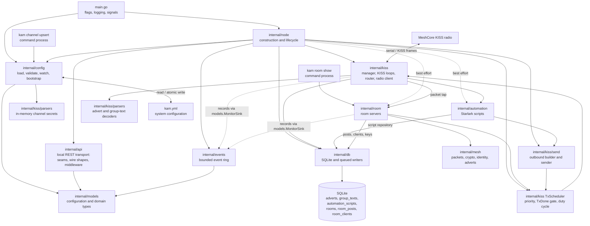
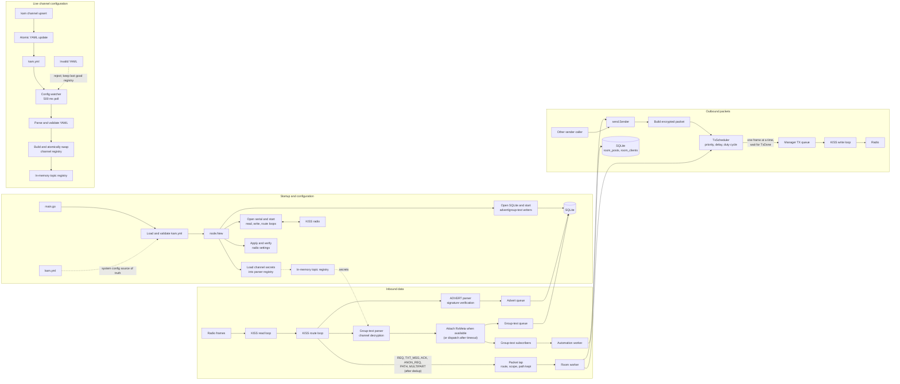
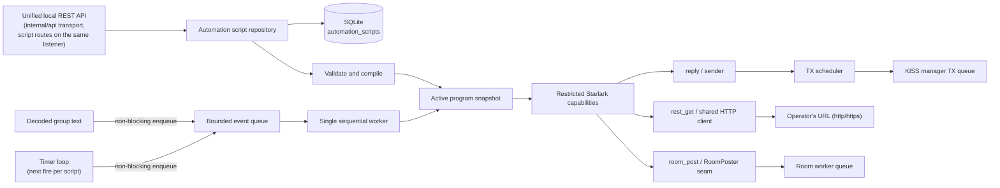

# KAM Application Structure

KAM is a single-process Go service that connects a MeshCore-compatible KISS radio to local SQLite storage. Its current runtime is organized around a node lifecycle, a KISS transport manager, packet parsers, asynchronous persistence, an optional Starlark automation runtime, and optional MeshCore room servers.

## Package Structure

## Responsibilities

| Area | Responsibility |
|---|---|
| `main.go` | Parses command-line overrides, configures logging, loads configuration, constructs the node, and handles SIGINT/SIGTERM. Also runs the short-lived `channel upsert` and `room show` commands. |
| `internal/config` | Loads and validates YAML, polls for updates, atomically replaces the in-memory channel registry, upserts channels in YAML, and resolves the database path. |
| `internal/models` | Defines configuration and persisted packet data types, along with configuration normalization and validation, including the `mesh:` and `rooms:` settings (`ResolveRooms` disables an invalid room instead of failing the whole file). |
| `internal/node` | Owns component construction and shutdown. It bootstraps channels and persistence, starts the KISS manager, applies and verifies radio settings, creates the transmit scheduler, and (best effort) starts the automation runtime and the room servers. `startMonitor` builds the unified local REST API handler from capability adapters (scripts, events, status, channels, rooms, modem) and starts its one HTTP server; with the API enabled it also runs the modem refresh loop behind `/v1/modem`. `Run` also starts the 500 ms config watcher and the 30 s radio health probe, and joins them first at shutdown. |
| `internal/kiss` | Owns the serial connection and KISS read/write/route loops, response registry, radio control, time-bounded packet deduplication, the group-text and packet taps, and the `TxScheduler` that owns the radio data path. |
| `internal/kiss/parsers` | Parses and verifies adverts, decrypts group texts using configured channel secrets, and maintains the in-memory channel registry. |
| `internal/kiss/send` | Builds encrypted group-text packets and queues them on the transmit scheduler. |
| `internal/mesh` | MeshCore wire primitives with no transport dependency: packet framing, the AES-128-ECB + HMAC envelope, Ed25519 identities with X25519 key exchange, signed adverts, region keys and transport codes, and ACK hashes. |
| `internal/room` | The room server: logins and roles, posts committed before they are acknowledged, round-robin push sync, keep-alive, signed adverts, rate limiting, and identity files. One worker owns all room state. |
| `internal/events` | The bounded metadata-only event ring. Copies event pages under a short lock and hands them out after releasing it, so a slow reader never blocks packet recording. |
| `internal/db` | Opens SQLite, maintains advert, group-text, automation and room schemas, persists incoming records through bounded background writer queues, and provides the revision-checked `AutomationRepository` and the `RoomRepository` (own connection, `synchronous=FULL`). |
| `internal/automation` | Compiles and runs operator-managed Starlark scripts on a single worker fed by a bounded queue, for decoded group texts and for due timers (a separate timer-loop goroutine owns the schedule and only enqueues fires). Enforces per-script timeouts (`FROZEN`), applies `timeout_ms` defaults, and exports its domain sentinels for script mutations. Host functions: `reply` through the shared sender, `rest_get` over one shared HTTP client with a 1 MiB response cap, and `room_post` through the consumer-defined `RoomPoster` seam. It serves no HTTP; the local API's transport is `internal/api`. |
| `internal/api` | The local REST API (loopback, default port 8766): one listener for status, events, channel and room reads, script management, and the modem snapshot/query/radio routes. Transport only — routes, JSON decoding with unknown-field rejection, wire shapes, error classes → status codes, the loopback Host guard, an eight-request limit, a five-second deadline, panic recovery, and the self-describing `GET /` index. Imports only the standard library and `internal/models`; capabilities reach it through consumer-defined seams implemented by `internal/node` adapters. A guard test keeps the import rule. |

## Runtime Flows

## Lifecycle and Data Ownership

- The `monitor:` config block is enabled by default, with one best-effort local REST listener (`monitor.listen`, default port 8766) and an 8192-event ring. The router observes RX including duplicates/unhandled types, and the writer captures TX submission metadata through completion/abandonment. A small `models.MonitorSink` interface separates recording from HTTP handling. The listener carries script management too, so `monitor.enabled: false` removes the listener and the ring and takes script management offline. No client registration, separate event database or event-aggregation worker is introduced.
- The node starts the KAM API listener independently of automation and rooms, and shuts its HTTP server down before stopping those owners. Status reads existing counters and cached startup identity, not live modem queries. Channel endpoints read configured channel metadata and persisted group texts; room endpoints request a snapshot from the room worker and read posts/labels from SQLite; script routes go through the automation runtime. No API handler opens the modem or accesses worker-owned room maps directly: `internal/api` imports nothing but the standard library and `internal/models`, and a guard test enforces that.

- `main` resolves flags and configuration, then delegates runtime ownership to `node.Node`.
- The node loads channel secrets into memory from YAML. Channel configuration is not stored in SQLite; runtime channel upserts are written back to YAML and immediately applied to the parser registry.
- While running, the node polls the YAML file for content changes every 500 ms. `kam channel upsert` writes channel changes atomically; the watcher validates the new YAML and swaps the complete channel registry. Invalid YAML is logged and ignored, leaving the last valid registry active.
- Live reload currently applies channel secrets only, and a radio change through `PUT /v1/modem/radio` updates the radio settings at runtime (and rewrites `kam.yml`). Node identity, database path, and the legacy YAML `echo` settings (consumed once by the migration) are still read at startup and require a restart to take effect.
- `kiss.Manager` is the sole owner of the serial connection. It serializes radio control requests and routes inbound frames to the supported advert and group-text parsers.
- Advert and group-text persistence is asynchronous. The route loop enqueues records to bounded queues; dedicated writers batch inserts into SQLite. Queue saturation can drop records rather than block packet routing.
- The automation runtime is a group-text subscriber. Its handler clones the message and does a bounded, non-blocking enqueue; its worker runs enabled scripts sequentially, and `reply` sends through the shared sender and the transmit scheduler. A timer loop feeds the same queue, so a timer run takes its turn with the group texts, and `room_post` hands the text to the room worker's queue.
- Room servers subscribe to the packet tap. The handler does a bounded, non-blocking enqueue; one worker owns every room's client table, push state and advert timers. Posts are committed to SQLite before their ACK is queued; client sessions, including last-heard timestamps, are written in batches every 5 seconds and on shutdown. The API requests bounded snapshots through that worker. Room settings are read at start-up only.
- Every outbound packet, whether a group text or a room packet, goes through the `TxScheduler`, which hands the modem one frame at a time and waits for `TxDone`.
- On cancellation (or a lost modem link), the node first stops the radio health probe and the config watcher, then stops intake (both subscriptions) and shuts down the local API's one HTTP server, stopping the modem refresh loop with it, then the automation runtime, then the room worker (which flushes client state), then the transmit scheduler, and finally the manager. Manager shutdown closes persistence, which drains and flushes its queues, before closing SQLite and the serial port.

## Starlark Automations

The automation runtime is implemented, including the timers, `rest_get` and `room_post` added by [FeatureStarlarkPeriodicPosts.md](FeatureStarlarkPeriodicPosts.md). The runtime itself is described in [FeatureStarlark.md](FeatureStarlark.md).

- Scripts are persisted in SQLite; YAML remains authoritative for node, radio, and channel settings.
- The local REST API's script routes validate source before activation. Invalid source loaded from SQLite is marked `BROKEN`; it remains inactive without preventing radio ingestion. Scripts in `BROKEN` or `FROZEN` retain their latest error detail in `last_error`.
- Each script defaults to `READY` and stores a timeout (500 ms default, tunable by the system administrator with no application-imposed maximum). A timeout marks it `FROZEN` until explicitly recovered. Returning to `READY` clears `last_error`. The worker consumes an internally bounded queue off the route loop; initial execution is sequential, and overflow drops/errors are logged to the console.
- Script administration uses one system-administrator model; there are no per-user ownership or ACL structures. A future Remote API is out of scope here and will require a separate authentication design.
- The script routes are loopback HTTP only; with `monitor.enabled: false` they are unreachable together with the read-only data surfaces. If automation schema setup fails, core radio ingestion and persistence continue with automation disabled, and the script routes answer `503`.
- ECHO is the example script [`examples/echo.star`](examples/echo.star), installed through the API; there is no native ECHO service.
- `reply` is routed through the existing sender.
- A script runs on a timer when its source sets `timer_interval_minutes` and defines `on_timer(message)`. The interval is a compile-time integer literal of at least 1, so a script cannot change its own schedule; the API reports the value read-only.
- `rest_get` is the only network access and is plain HTTP(S) from the script. It uses the invocation context as its deadline, caps a body at 1 MiB, and returns the status instead of failing on a non-2xx answer. There is no provider adapter and no fixed allowlist — the operator's URL and key live in the script source, like channel keys in `kam.yml`.
- `room_post` writes into one of KAM's own rooms as the room identity. The room service exposes it as `AddSystemPost`, which runs on its worker and shares the script deadline.
- [`examples/periodic.star`](examples/periodic.star) is the weather post built on these: every 15 minutes, one API call, one room line.

## Room Servers

Room servers are implemented for plan phases 1-3; the requirements, decisions and deviations from the reference firmware are in [FeatureRoomServer.md](FeatureRoomServer.md), and the end-to-end flows are in [SYSTEM_DESIGN.md §10](SYSTEM_DESIGN.md).

- Each room has its own Ed25519 identity, stored as a hex seed in `<database directory>/rooms/<id>.key` (mode `0600`). The public key is the room's address.
- `kam room show` prints each room's public key, a `meshcore://contact/add` URI and the signed advert as hex, creating a missing identity file first.
- An invalid room is reported and stays disabled; other rooms and radio ingestion are unaffected.
- The loopback local REST API exposes room summaries, clients, and posts, and can make a room forget one client (`DELETE /v1/rooms/{id}/clients/{key}`; not a ban). Status, telemetry and access-list requests (no reply), the over-the-air CLI, and the post-v1 items in FeatureRoomServer §11 are not implemented.

## Source Map

- Entry point: [`main.go`](../main.go)
- Node lifecycle: [`internal/node/node.go`](../internal/node/node.go)
- Config and channel bootstrap: [`internal/config`](../internal/config/)
- Domain types and validation: [`internal/models/models.go`](../internal/models/models.go), room settings in [`internal/models/rooms.go`](../internal/models/rooms.go)
- KISS manager and router: [`internal/kiss/kiss_manager.go`](../internal/kiss/kiss_manager.go), [`internal/kiss/kiss_router.go`](../internal/kiss/kiss_router.go)
- Transmit scheduler, airtime estimate and deduplication: [`internal/kiss/scheduler.go`](../internal/kiss/scheduler.go), [`internal/kiss/airtime.go`](../internal/kiss/airtime.go), [`internal/kiss/dedup.go`](../internal/kiss/dedup.go)
- MeshCore wire primitives: [`internal/mesh`](../internal/mesh/)
- Room server: [`internal/room`](../internal/room/)
- Payload parsers: [`internal/kiss/parsers`](../internal/kiss/parsers/)
- Outbound sender: [`internal/kiss/send`](../internal/kiss/send/)
- SQLite persistence: [`internal/db/persistence.go`](../internal/db/persistence.go), room repository [`internal/db/rooms.go`](../internal/db/rooms.go)
- Starlark automation: [`internal/automation`](../internal/automation/), script routes over the unified listener in [`internal/api`](../internal/api/) and the adapter [`internal/node/scripts.go`](../internal/node/scripts.go)
- Automation script repository: [`internal/db/automation.go`](../internal/db/automation.go)
- Local REST API: [`internal/api`](../internal/api/), event ring [`internal/events`](../internal/events/), node adapters [`internal/node/monitor.go`](../internal/node/monitor.go), [`internal/node/scripts.go`](../internal/node/scripts.go), modem capability [`internal/node/modem.go`](../internal/node/modem.go)
- Unified API design: [`FeatureUnifiedApi.md`](FeatureUnifiedApi.md)
- Example ECHO script: [`examples/echo.star`](examples/echo.star)
- Example periodic weather post: [`examples/periodic.star`](examples/periodic.star)
- Starlark automation design: [`FeatureStarlark.md`](FeatureStarlark.md); timers, `rest_get` and `room_post`: [`FeatureStarlarkPeriodicPosts.md`](FeatureStarlarkPeriodicPosts.md)
