# KAM — System Design (language-agnostic)

> KAM is a regional MeshCore node: a bridge between a KISS TNC / LoRa radio
> and durable local storage, with a pluggable consumer pipeline. It decodes
> adverts and group texts, verifies signatures, persists traffic, optionally
> replies to mentions on-mesh, hosts MeshCore room servers that stock clients
> can log in to, and is shaped to grow into an operator analytics surface.

This document describes the **runtime architecture** — logical modules,
workers, data flow, concurrency control, and lifecycle. It deliberately
excludes implementation-language and file-layout details so the design stays
portable across runtimes.

---

## 1. Purpose & scope

### 1.1 Purpose

KAM is a **regional service** for communities needing a backup messaging and
broadcast channel when conventional infrastructure (cellular, internet) is
unavailable. It aims to:

- Share **emergency broadcasts** and public-safety advisories across a
  MeshCore mesh region.
- Relay **weather updates** and similar operational bulletins.
- Act as a **MeshCore room server / bulletin board**: clients log in, post,
  and receive pushed posts (implemented; see
  [FeatureRoomServer.md](FeatureRoomServer.md)). Mirroring group-text channels
  into a room is a later step.
- Provide **operator-facing analytics** so a human can watch network health,
  congestion, and traffic composition in real time.

### 1.2 Hardware target

- Any **KISS TNC modem running MeshCore firmware**.
- Today only **USB serial** transports are validated. The transport boundary
  is abstract by design, so byte-stream transports (TCP KISS, Bluetooth)
  are expected to work behind the same interface without changing upper
  layers.

### 1.3 Non-goals (today)

- KAM is **not** a chat client UI; it is a server-side node.
- KAM is **not** a repeater/router firmware replacement; it consumes and
  optionally produces mesh traffic, but is not a relay hop.
- Scope is **not final**. The module boundaries below are the current shape,
  not a frozen contract.

### 1.4 Design principles

| Principle | Consequence |
|---|---|
| Keep the node alive through outages | Zero-ops embedded storage, no external processes required at runtime. |
| Never let RF bursts stall ingestion | Bounded, non-blocking hand-offs; drops counted, never silent. |
| Protect constrained radios | One in-flight hardware request at a time; no reliance on transaction IDs. |
| Extend by addition, not modification | Per-payload-type parsers; consumer subscription tap. |
| Optional traffic cannot backpressure core | Outbound producers fully decoupled from ingestion. |
| Clean, ordered shutdown | Flush persistence before storage close; stop producers before transports. |

---

## 2. Logical architecture

### 2.0 System units

The physical edge of KAM is a **KISS modem** — a LoRa radio running MeshCore
firmware that also implements the KISS TNC protocol — connected to the host
over **USB serial**. The host process runs the **KISS manager**, the single
owner of that serial link; everything else in KAM talks to the radio through
it.

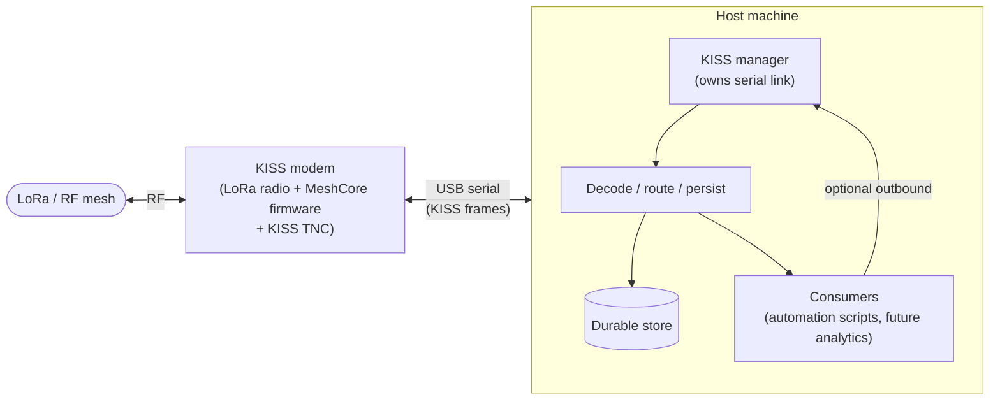

Key points:

- **One serial link, one owner.** The KISS manager is the only component that
  touches the USB serial port. All radio I/O (read, write, control) funnels
  through it.
- **KISS over USB.** The wire format is KISS frames; the transport is USB
  serial. The manager is transport-agnostic — any byte stream (TCP KISS,
  Bluetooth) can sit behind the same interface.
- **Radio is constrained.** No transaction IDs and a small internal queue, so
  the manager serializes hardware access (one in-flight request at a time).
- **Consumers loop back through the manager.** Optional outbound traffic
  (e.g. script replies) re-enters the radio via the manager, not directly.

### 2.1 Context view

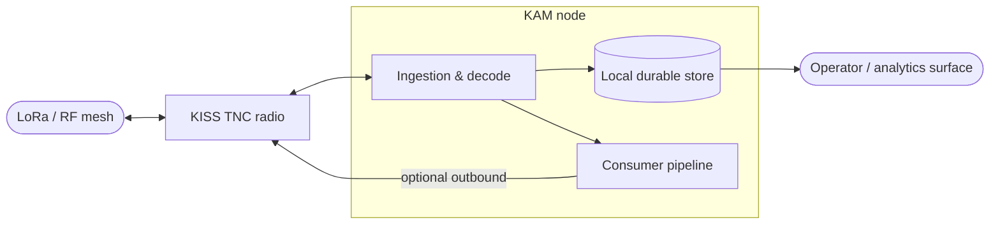

### 2.2 Module map

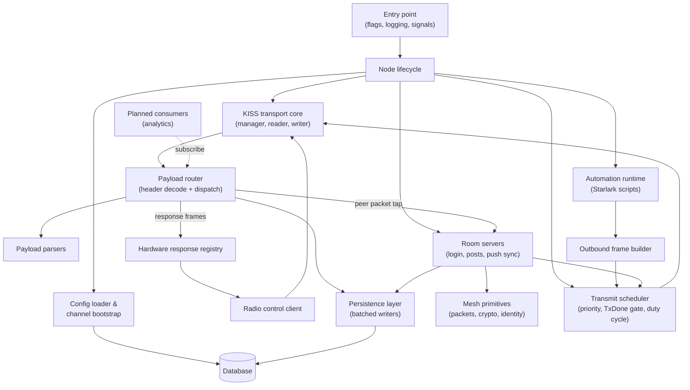

### 2.3 Responsibilities

| Module | Responsibility |
|---|---|
| **Entry point** | Parse configuration/flags, initialise logging, load config, construct the lifecycle, block on termination signals. |
| **Node lifecycle** | Owns all long-lived components. Construction bootstraps storage, opens the transport, and pushes + verifies radio settings. Run blocks until cancellation, then shuts components down in order. |
| **Config loader** | Parse and validate the human-editable YAML config file; load the active channel/secret set from it directly into the in-memory decode registry; write runtime channel additions/updates back into the YAML file; resolve effective store path. |
| **Domain models** | Pure configuration and record types; validation rules. Runtime-agnostic. |
| **KISS transport core** | Protocol framing, read/write loops, dispatch loop, response routing, time-bounded deduplication, radio-quality metadata staging, hardware serialization. |
| **Payload router** | Decode the frame header (route type, payload type, version); slice transport/path bytes; deduplicate; dispatch to the correct parser and onward sinks, and deliver peer packets (requests, text messages, ACKs, logins, paths) with their route, scope and path intact to the packet tap. Owns **no** parsing logic. |
| **Payload parsers** | One module per payload type. Adverts (signature verification), group texts (channel-secret decryption). Independently testable. |
| **Hardware response registry** | Maps hardware responses back to the single in-flight request. Channels are capacity-1 so dispatch never blocks. |
| **Radio control client** | Synchronous, context-aware get/set/apply operations over the transport; serialized by the hardware mutex. |
| **Outbound frame builder** | Constructs group-text data frames from channel + body, encrypting with the channel secret. |
| **Transmit scheduler** | Owns the radio data path for every producer: validates packets, orders them by priority with per-packet delay and cancellation, hands the transport one frame at a time and waits for the modem's transmit-done event, and keeps deferrable traffic (pushes, adverts) inside a duty-cycle budget. |
| **Mesh primitives** | Transport-independent MeshCore wire logic: packet framing, the shared-secret envelope, identities with signing and key exchange, signed adverts, region keys and transport codes. |
| **Room servers** | One worker owns every room: logins and roles, posts committed before they are acknowledged, round-robin push sync, keep-alive, adverts, session persistence. See [FeatureRoomServer.md](FeatureRoomServer.md). |
| **Persistence layer** | Batched, non-blocking writers for each record type; exposes counters for depth, drops, and flushes. Implements the sink interface used by the router. |
| **Automation runtime** | Subscribes to decoded group texts and runs operator-managed Starlark scripts sequentially on a dedicated bounded-queue worker; scripts reply via the outbound sender. Exposes a loopback-only management API. |

> **Extensibility seam.** The consumer tap is the integration point for any
> new subscriber: analytics aggregation, room-server fan-out, emergency
> detection, dashboards. Each subscriber receives the decrypted message plus
> attached radio-quality metadata. Subscribers **must not block** the dispatch
> loop; the automation runtime demonstrates the bounded-queue + worker pattern.

---

## 3. Worker model

KAM is a **single process** with a set of long-lived workers plus short-lived
request workers on the radio-control path. All long-lived workers exit on
their stop signal and are shut down in a defined order.

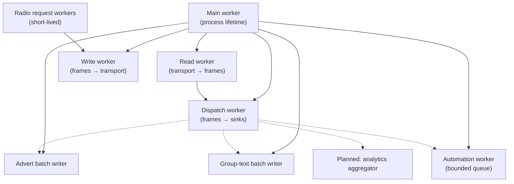

### 3.1 Worker inventory

| # | Worker | Owner | Lifecycle | I/O |
|---|---|---|---|---|
| 1 | Main | process | process lifetime | termination signal |
| 2 | Read | transport core | start → stop | reads transport, emits inbound frames |
| 3 | Write | transport core | start → stop | consumes outbound frames, writes transport |
| 4 | Dispatch | transport core | start → stop | consumes inbound frames, routes to registry / parsers / sinks / subscribers |
| 5 | Advert batch writer | persistence | open → stop | consumes advert queue, batches into storage |
| 6 | Group-text batch writer | persistence | open → stop | consumes group-text queue, batches into storage |
| 7 | Automation | automation runtime | start → stop | consumes bounded queue, runs scripts sequentially, sends their replies |
| 8 | Analytics aggregator *(planned)* | future module | — | subscribes via the consumer tap; periodic snapshots |
| * | Radio request | caller | per get/set call | registers a response waiter, enqueues, blocks on reply |

> Worker 8 is **not yet implemented**. It is recorded to make the intended
> growth direction explicit. Automation (7) is currently the only non-persistence
> consumer of the group-text tap.

---

## 4. Concurrency model

### 4.1 Hardware serialization

MeshCore radios are constrained: they expose **no transaction IDs** and have a
small internal queue. The transport core enforces that **only one
bidirectional hardware request is in flight at a time** via a hardware mutex:

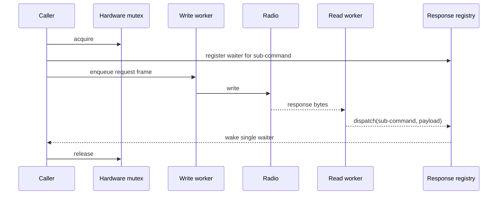

Because only one request is outstanding, the next response frame is
unambiguously that caller's — no transaction IDs required.

### 4.2 Response registry guarantees

- Waiter channels are **capacity-1** and buffered, so the dispatch worker
  **never blocks** even if the caller already abandoned the request on a
  timeout.
- Registration and deregistration bracket each request.
- Timeout is caller-driven; the dispatcher does not track deadlines.

### 4.3 Outbound path

Outbound frames flow through a single **bounded outbound queue** with one
writer:

- Producers: radio control (control frames) and the outbound sender
  (group-text data frames, used by script replies).
- Because there is exactly one writer, the data path needs no extra
  serialization. Control-path serialization is the **hardware mutex**.

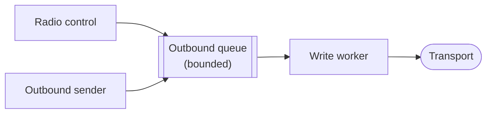

### 4.4 Inbound dispatch & metadata staging

The dispatch worker decodes the frame header, slices transport/path bytes,
deduplicates by a hash of the application payload, then routes:

- **Advert** → parse + signature verification → enqueue to advert sink.
- **Group text** → decrypt → **stage** the message and arm an
  **RxMeta timeout**; the next radio-quality metadata frame attaches SNR/RSSI
  and dispatches; if metadata never arrives, the timer flushes the message
  without it.
- **Other** payload types → logged only (extension point).

Dispatch of a group text = enqueue to the group-text sink **plus** invoke all
subscribed consumers.

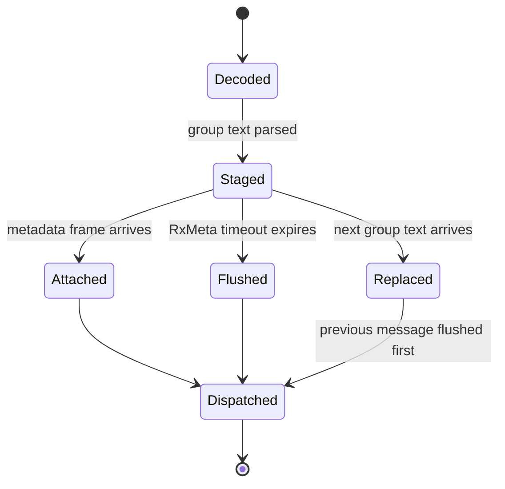

Only **one** group text is held at a time. A new message flushes the previous
pending one before staging itself. A single guard protects the pending message
and its timer.

### 4.5 Persistence backpressure

Both record queues are **bounded channels with non-blocking enqueue**. When a
queue is full the record is dropped and a counter incremented — ingestion is
never stalled by storage.

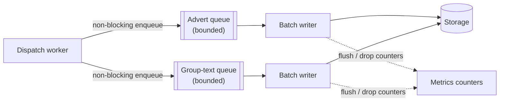

### 4.6 Shared state & guards

| State | Guard | Notes |
|---|---|---|
| Hardware request in flight | mutex | One bidirectional request at a time. |
| Response waiters | mutex | Waiter channels capacity-1 → dispatch never blocks. |
| Consumer subscription list | read/write lock | Dispatch reads; subscribe/unsubscribe writes. Removing a slot does not shrink the list. |
| Pending group text + timer | mutex | Single in-flight message awaiting metadata. |
| Dedup hash FIFO | none (dispatch worker only) | Accessed only by the dispatch worker; fixed-size FIFO. |
| Record queues | channels | Bounded; enqueue non-blocking; drop counted. |
| Stop signals | close/broadcast | One per long-lived worker group. |

---

## 5. Data flow

### 5.1 Inbound advert

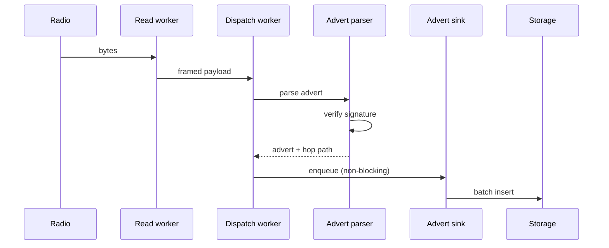

### 5.2 Inbound group text (with radio-quality metadata)

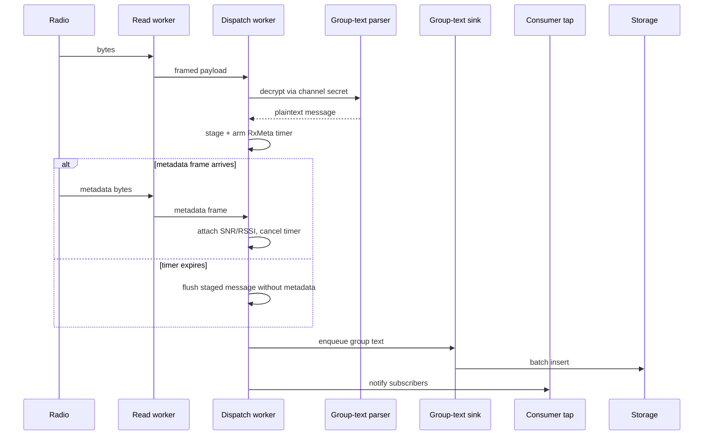

### 5.3 Outbound group text (script reply)

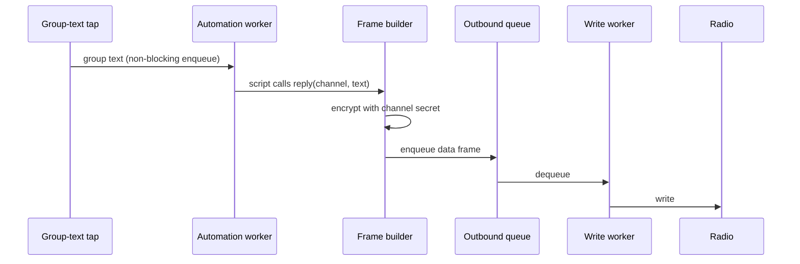

### 5.4 Radio configuration at startup

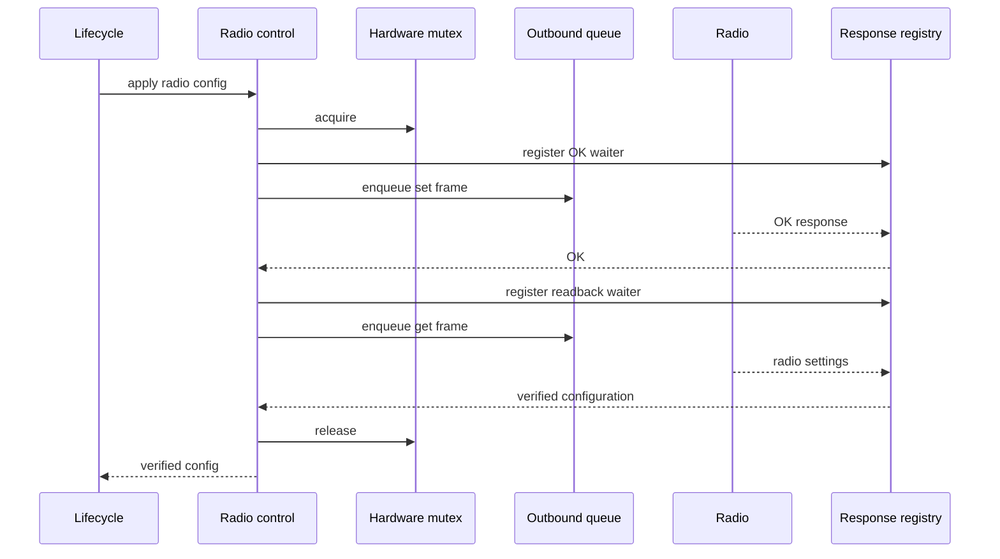

Configuration is **pushed then read back**, so the reported live radio state
comes from the hardware, not from the config file.

### 5.5 Configuration bootstrap

System configuration lives in **one place**: the YAML config file. It is both
the bootstrap and the runtime source of truth — the durable store is not used
for channel state.

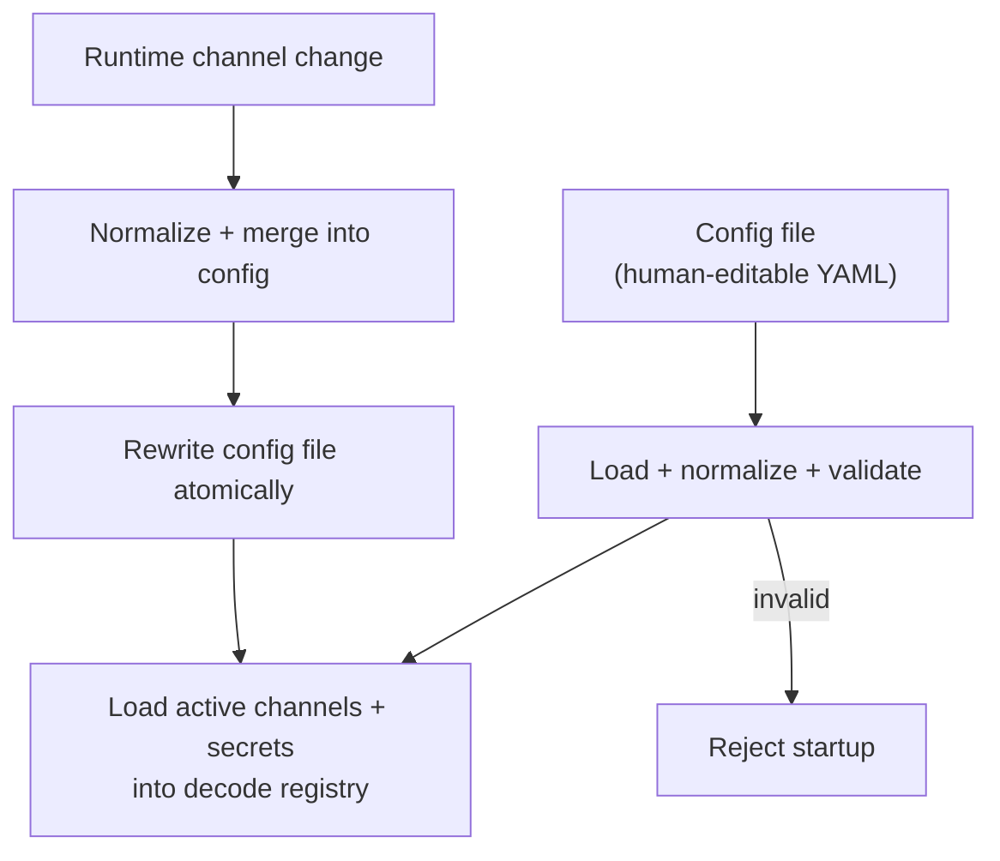

At startup the file is parsed, normalized, and validated; enabled channels and
their secrets are loaded directly into the in-memory decode registry. When the
application needs to add or change a channel at runtime, it normalizes the
channel, merges it into the loaded config (inserted or replaced by normalised
name), rewrites the file **atomically** (temp file + rename), and applies the
changed channel to the registry without a restart. `#public` is structural
and must be edited in the file directly.

---

## 6. Lifecycle & shutdown

### 6.1 Startup sequence

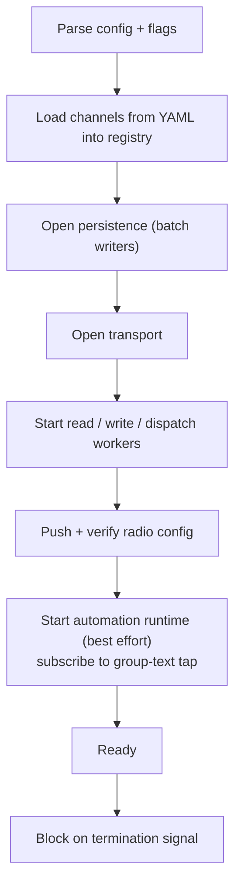

Failure at any step tears down everything opened so far.

### 6.2 Shutdown ordering

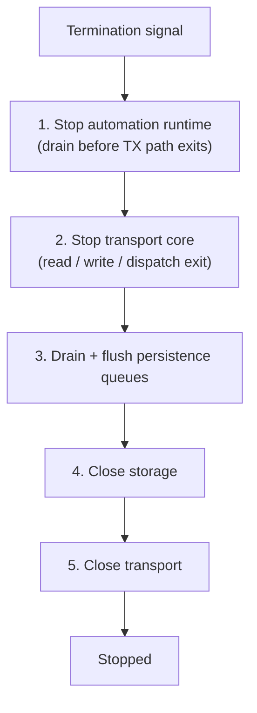

**Ordering invariants:**

- **Automation before transport core** — scripts must not enqueue outbound
  frames into a write path that has already exited.
- **Persistence flush before storage close** — no ingested traffic is lost.
- **Storage close before transport close** — no sink references a closed
  handle after shutdown starts.

---

## 7. Persistence

One embedded database holds **adverts and group texts**. It does **not** hold
system configuration — channel definitions live only in the YAML config file
(see §5.5). Configured for **write-ahead logging**, a busy timeout, and
relaxed synchronous mode so reads stay responsive while writers batch and the
node survives power loss.

### 7.1 Record ownership

| Record | Written by | Notable fields |
|---|---|---|
| **Advert** | advert batch writer | node identity, node type, nickname, location, hop count, hop path, clock drift |
| **Group text** | group-text batch writer | channel, sender, body, hop count, hop path, SNR, RSSI, `hasRxMeta` flag, clock drift |

> Channel definitions are **not** a database record. They are configuration,
kept in the YAML file and loaded into the in-memory decode registry at
startup; runtime changes are written back to the YAML file.

### 7.2 Channel key strategies

| Strategy | Meaning | Key material |
|---|---|---|
| `public` | Reserved public channel | Required, fixed-length secret |
| `derived` | Secret derived from normalised channel name | Must be empty |
| `explicit` | Caller-supplied secret | Required; short form is padded to full length to preserve legacy behaviour |

**Validation rules:** node name required; channel names trimmed, lowercased,
prefixed with `#`; `#public` must use the `public` strategy; names unique after
normalisation; `enabled: false` keeps the channel in the file but excludes it
from the decode registry.

Channels are **configuration**, not database records: they are loaded from the
YAML file into the decode registry at startup, and runtime additions/updates
are written back to the YAML file (see §5.5).

---

## 8. Operator metrics & analytics

A core goal is to give a regional operator visibility into actual mesh
behaviour — not merely decode traffic, but *characterise* it.

### 8.1 Signals captured in the ingestion path

| Signal | Source | Persisted? |
|---|---|---|
| Payload type | header decode | advert + group-text rows; others logged only |
| Route type (flood / direct / transport) | header bits | no |
| Hop count + per-hop path hashes | path frame | yes (adverts + group texts) |
| Radio RX quality (SNR, RSSI) | metadata frame | yes (group texts) |
| Clock drift | parsers | yes (both record types) |
| Sender / channel / body | group-text parser | yes |
| Node identity / type / nickname / location | advert parser | yes |
| Duplicate suppression | dedup FIFO | counter only |
| Queue depth / drops / flushes | persistence counters | in-memory, not yet exported |

### 8.2 Congestion monitoring (planned)

Congestion is inferred from a combination of signals:

- **Dedup drop rate** — the same advert/text seen N times indicates
  flooding/saturation.
- **Queue depth + drops** — ingestion outrunning storage indicates a burst.
- **SNR/RSSI distribution per channel/hop** — link-quality regressions.
- **Message-type mix over time** — a spike in group-text vs advert ratio, or a
  new payload type appearing, indicates a behavioural shift.
- **Clock drift across senders** — drifting nodes may miss windows.

The data is captured at ingestion. The missing piece is an **aggregator
worker** (worker 8) that taps the group-text stream plus the queue counters
and periodically snapshots them to an operator-facing surface.

---

## 9. Room-server role (implemented for plan phases 1-3)

A MeshCore room server is a node advertising a **room** type. It is a
**bulletin board**: it persists posts, pushes new posts to logged-in clients,
and (in the reference firmware, not in KAM) can forward mesh packets. This
traffic is **direct** (ECDH-derived shared secret), **not** group text, so it
reaches KAM through the peer-packet tap rather than the group-text path.

### 9.1 Conceptual login / post / push

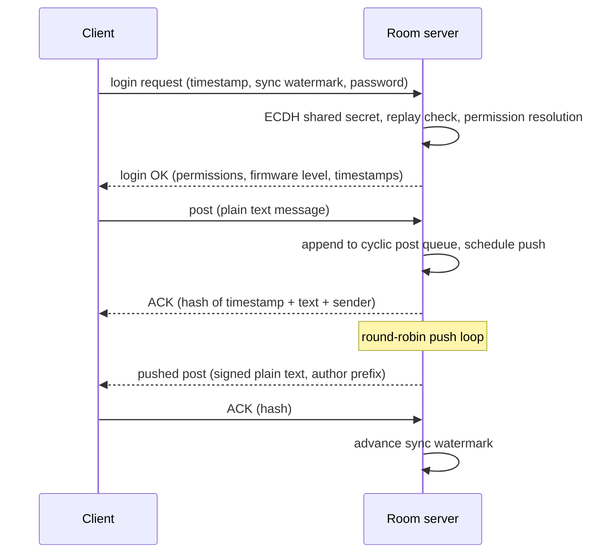

### 9.2 Permission model

| Role | Granted by | Capabilities |
|---|---|---|
| Admin | admin password | Full command set, post, telemetry, ACL management |
| Read-write | guest/"room" password | Post + read |
| Read-only | no password (if allowed) | Read only, no ACK on posts |

KAM enforces the intent of the table: only read-write and admin clients may
post (the reference firmware also lets role 1 post by accident).

### 9.3 How KAM implements it

1. **Login handling + session table** — the router delivers the anonymous
   request to the packet tap; the room keeps a bounded client table (least
   recently active non-admin evicted) with per-client replay protection, and
   persists sessions so a restart does not force a re-login.
2. **Crypto** — KAM holds each room's identity and runs the key exchange and
   signing itself; the modem's identity and crypto commands are not used, because
   the modem cannot be given a chosen identity and its encrypt/decrypt take a
   caller-supplied key anyway.
3. **Post store + push state machine** — posts live in SQLite and are committed
   before they are acknowledged; per-client sync watermark, pending-ACK and
   failure counters drive a round-robin push loop on the room worker.
4. **Path learning** — path and ACK payloads advance sync and store routes.
5. **Flood scoping** — replies reuse the request's region when known; adverts
   and pushes use a configured default region.
6. **Operator metrics** — not yet: status requests get no reply, and KAM does
   not yet query other room servers for theirs.

---

## 10. Deployment & operations

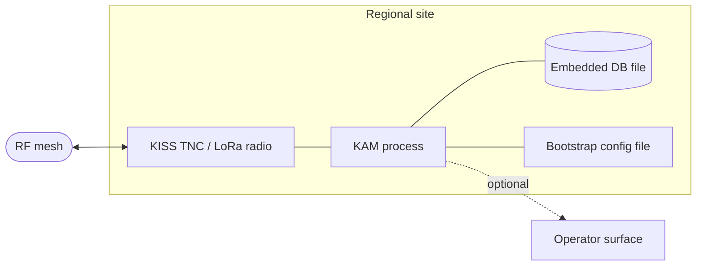

| Concern | Approach |
|---|---|
| Deployment | Single self-contained binary/process; no external service required at runtime. |
| Configuration | Human-editable bootstrap file plus command-line overrides (config path, store path, transport port). |
| Observability | Structured logs; in-memory queue/drop/flush counters; planned operator surface. |
| Failure containment | One in-flight hardware request; non-blocking ingestion; bounded queues with counted drops. |
| Recovery | Write-ahead logging + relaxed sync survives power loss; ordered shutdown flushes pending batches. |

---

## 11. Roadmap & open scope

The scope is not final. These are directions the architecture is **shaped to
allow**, not commitments:

1. **Operator metrics API / dashboard** — export queue metrics and traffic
   rollups; aggregator taps the consumer stream plus queue counters.
2. **Room administration and history surfaces** — the room server is
   implemented, and the monitor API already serves read-only history: channel
   message history and room summaries, clients and retained posts. Management
   endpoints (remove clients, edit roles, moderate posts), a status reply and
   live tails for operators are not.
3. **New payload-type parsers** — one module per type. The router is a pure
   dispatcher; emergency/weather payloads plug in without touching it.
4. **Originating broadcasts** — emergency/weather/ops via the outbound sender,
   with a policy + throttle layer (who may originate, which channels, repeat
   rules, flood limits).
5. **Non-USB transports** — TCP KISS / Bluetooth behind the transport
   interface, with no upper-layer changes.
6. **Storage splitting** — separate storage files per record type if write
   contention becomes the bottleneck.
7. **Retention / compaction** — a retention policy over adverts and group
   texts for long-running regional nodes.
8. **Multi-radio / multi-channel ingestion** — one process, several transport
   cores. The lifecycle currently owns one; the design does not forbid more.

---

## 12. Glossary

| Term | Meaning |
|---|---|
| **Advert** | MeshCore node announcement broadcast; carries identity, type, location; signature-verified. |
| **Group text** | Channel-scoped encrypted message; decrypted via a channel secret. |
| **RxMeta** | Radio-quality metadata (SNR/RSSI) delivered in a separate frame after a group text. |
| **Route type** | Flood / direct / transport classification of a frame. |
| **Hop path** | Sequence of hop hashes a frame traversed; yields hop count. |
| **KISS** | Simple framing protocol between host and TNC. |
| **TNC** | Terminal node controller; the radio/modem hardware. |
| **Room server** | MeshCore bulletin-board node; direct traffic, cyclic post queue, active push sync. |
| **Consumer tap** | Subscription stream of decoded group texts offered to non-persistence consumers. |
| **Dedup FIFO** | Fixed-size recent-hash set used to suppress duplicate frames. |
