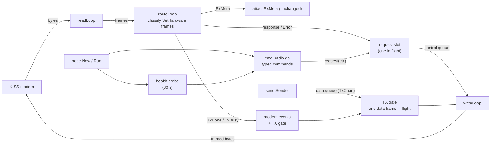
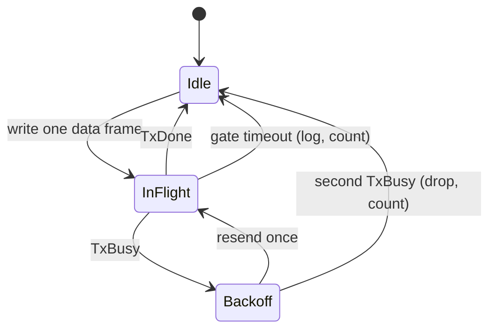

# Feature: KISS Modem Command Layer

**Status:** Implemented in code; real-radio smoke testing and Phase 0 measurements remain pending.
**Scope:** Cover the MeshCore KISS modem's command surface (standard KISS parameters, `SetHardware` sub-commands and unsolicited events) through the existing reader, router and writer, and put the typed command API in [cmd_radio.go](../internal/kiss/cmd_radio.go).
**Reference firmware:** MeshCore `main`, files read 2026-10-10. `examples/kiss_modem` last changed in `3b69e78` (committed 2026-07-18); `docs/kiss_modem_protocol.md` last changed in `448d1b2` (2026-09-18).

## 1. Summary

KAM talks to the modem through [kiss_reader.go](../internal/kiss/kiss_reader.go), [kiss_router.go](../internal/kiss/kiss_router.go) and [kiss_writer.go](../internal/kiss/kiss_writer.go). The typed command client covers the Tier 1 modem surface: 5 standard KISS parameters, radio configuration, TX power, signal reporting, diagnostics and unsolicited events. Crypto/identity commands and `Reboot` remain deferred (§2).

Implementation status: the request slot and Ping barrier, typed errors, prioritized control queue, command validation, startup probe, TX gate, modem events/counters, link fail-stop and reset probe are implemented. Hardware capture, timing measurements and the optional hardware smoke test have not been run in this environment.

Baseline findings addressed by this implementation:

1. **`SetRadio` success proves little.** The modem validates only the payload length. Board callbacks discard the radio driver's error codes, so an unsupported frequency or bandwidth still answers `OK` (§4.4 G1).
2. **`GetRadio` and `GetTxPower` return a host-supplied cache, not RF state.** The cache is zero until the host sets it. KAM's "set then read back" check confirms an echo; it does not confirm the radio accepted the values (G2). Hardware-backed reads exist only in `GetCurrentRssi`, `GetNoiseFloor`, `IsChannelBusy` and `GetStats`.
3. **Errors could not reach a caller.** The old response registry keyed one waiter by one response code, `Set` waited only for `OK`, and `Error` (`0xF1`) was dropped. A failing command surfaced as a timeout with no reason.
4. **Data frames could be lost silently.** The modem holds one pending transmission. A second data frame was rejected with `Error/TxBusy`, and the original KAM writer neither paced writes nor handled `TxDone` (`0xF8`).
5. **`OK` is ambiguous.** `SetRadio`, `SetTxPower` and `Reboot` all answer `0xF0`, and the modem has no request IDs. A late `OK` after a timeout would be taken for the next command's reply.
6. **Serial loss and modem resets were silent.** `readLoop` returned on any serial error and nothing noticed. A modem reset clears the cache, RxMeta and KISS parameters without any announcement.

The implementation: the Manager and router own request tracking (one in-flight slot, typed errors, a `Ping` barrier after a timeout), the writer paces data frames on `TxDone`, the typed command API validates requests, startup runs the defined probe sequence, and a low-rate probe detects resets and hangs.

## 2. Goals and non-goals

**Goals**

- GL-1. Every Tier 1 command (§7, D1) is available as a typed, validated Go method in `cmd_radio.go` and `cmd_diagnostics.go`; callers never build or parse raw frames.
- GL-2. A modem `Error` reaches the waiting caller as a typed error with its code, immediately rather than as a timeout.
- GL-3. A late or stale response is never attributed to a later request.
- GL-4. `TxDone` and `TxBusy` are observable events, and no data frame is rejected because KAM wrote it too early.
- GL-5. Radio settings are validated before they are sent, and startup reports what the modem actually answered.
- GL-6. A dead link or a reset modem is detected instead of leaving KAM silently deaf or misconfigured.

**Non-goals for the first release**

- Modem-held crypto and identity (`GetIdentity`, `GetRandom`, `SignData`, `VerifySignature`, `EncryptData`, `DecryptData`, `KeyExchange`, `Hash`). FeatureRoomServer D1 chose a KAM-held identity and KAM already has the AES/HMAC primitives.
- `Reboot`. The modem drops the connection and the Manager has no reconnect.
- Any HTTP surface for diagnostics (D8) and any Starlark host function. Scripts stay isolated from hardware ([FeatureStarlark.md](FeatureStarlark.md)).
- A CayenneLPP decoder; `GetSensors` returns raw bytes.
- Priority scheduling, airtime budgets and per-producer fairness. Those belong to the room-server TX scheduler (FeatureRoomServer RS-TX-1..3), which sits on top of the pacing added here and is implemented as `kiss.TxScheduler`.
- Hot-reloading radio settings. They stay startup-only, as in [APP_STRUCTURE.md](APP_STRUCTURE.md).

## 3. Sources and method

Primary sources were read from the MeshCore repository. DeepWiki's "KISS Modem" page (indexed at commit `d929643`, 2026-08-16) was read as a **secondary** source and is not normative. Where a doc and the firmware disagree, the firmware source is authoritative and the difference is listed in §9.

| Key | File | Used for |
|---|---|---|
| `KISS` | `docs/kiss_modem_protocol.md` | Frame format, command and response tables, data formats |
| `KM.h` | `examples/kiss_modem/KissModem.h` | Constants, defaults, error codes, callbacks |
| `KM.cpp` | `examples/kiss_modem/KissModem.cpp` | Per-command behaviour, TX state machine, output queue |
| `KM-main` | `examples/kiss_modem/main.cpp` | Board callbacks, receive loop, noise-floor and AGC cadence |
| `RLW` | `src/helpers/radiolib/RadioLibWrappers.cpp`, `CustomSX1262Wrapper.h` | What the callbacks do with driver errors, noise-floor behaviour |
| `CLI` | `docs/cli_commands.md` | Documented radio parameter ranges (`tempradio`, `set tx`) |
| `PKT-DOC` | `docs/packet_format.md` | Frame size limits |
| `RL` | RadioLib `SX1262.cpp` (master) | Chip-level frequency and power ranges |

Permalinks for `KM.*` and `KM-main`: `https://github.com/meshcore-dev/MeshCore/blob/3b69e7873bd76b52c3d3469d7496ff64a9048db5/examples/kiss_modem/<file>`. `KISS`: `.../blob/448d1b2239859ced5e44047bdc89717122ac626e/docs/kiss_modem_protocol.md`. `RLW`, `CLI`, `PKT-DOC` and `RL` were read from `main`/`master` unpinned.

## 4. Protocol reference

All multi-byte values are little-endian. Serial is 115200 baud, 8N1, no flow control `[KISS]`.

### 4.1 Framing

Standard KISS framing: `FEND(C0) | type | data (escaped) | FEND`, with `FESC(DB)` + `TFEND(DC)` / `TFESC(DD)` escapes. The type byte is `port<<4 | command`; only port 0 is used and frames with another port are ignored. The maximum unescaped frame is 512 bytes `[KISS, KM.h]`. [Frame](../internal/kiss/kiss_writer.go) and `readLoop` already implement the escaping.

A signed byte can equal `0xC0`: an RxMeta RSSI of -64 dBm is `0xC0`, so it travels as `DB DC`. Golden tests should include it (§11).

### 4.2 Standard KISS commands (host to modem)

None has a reply. The modem ignores a frame whose data is shorter than one byte `[KM.cpp]`.

| Type | Name | Data | Default | Notes |
|---|---|---|---|---|
| `0x00` | Data | raw packet, 1-255 B | - | One pending at a time (G5) |
| `0x01` | TXDELAY | 1 B, 10 ms units | 50 (500 ms) | Wait after the channel clears, before keying up |
| `0x02` | Persistence | 1 B, 0-255 | 63 | CSMA; transmit when `random(0-255) <= P` |
| `0x03` | SlotTime | 1 B, 10 ms units | 10 (100 ms) | Wait before the next CSMA attempt |
| `0x04` | TXtail | 1 B, 10 ms units | 0 | Stored but not referenced by the TX state machine (G9) |
| `0x05` | FullDuplex | 1 B | 0 | Non-zero bypasses CSMA; transmit after TXDELAY |
| `0xFF` | Return | - | - | Ignored |

Modem to host: type `0x00` carries a received packet (raw, no metadata).

### 4.3 `SetHardware` (`0x06`) sub-commands

Frame: `FEND | 0x06 | sub-command | data | FEND`. A response is `0x06 | (sub|0x80) | data`; generic replies use `0xF0` and above. Tier is defined in D1.

| Sub | Request | Request data | Response | Error codes | Tier |
|---|---|---|---|---|---|
| `0x01` | GetIdentity | - | `0x81` pubkey(32) | - | Deferred |
| `0x02` | GetRandom | len(1), 1-64 | `0x82` bytes | InvalidLength, InvalidParam | Deferred |
| `0x03` | VerifySignature | pubkey(32), sig(64), data | `0x83` 0/1 | InvalidLength | Deferred |
| `0x04` | SignData | data | `0x84` sig(64) | InvalidLength | Deferred |
| `0x05` | EncryptData | key(32), plaintext | `0x85` MAC(2), ciphertext | InvalidLength, EncryptFailed | Deferred |
| `0x06` | DecryptData | key(32), MAC(2), ciphertext | `0x86` plaintext | InvalidLength, MacFailed | Deferred |
| `0x07` | KeyExchange | remote pubkey(32) | `0x87` secret(32) | InvalidLength | Deferred |
| `0x08` | Hash | data | `0x88` SHA-256(32) | InvalidLength | Deferred |
| `0x09` | SetRadio | freq(4) Hz, bw(4) Hz, sf(1), cr(1) | `0xF0` OK | InvalidLength, NoCallback | 1 (exists) |
| `0x0A` | SetTxPower | dBm(1) | `0xF0` OK | InvalidLength, NoCallback | 1 |
| `0x0B` | GetRadio | - | `0x8B` freq, bw, sf, cr | - | 1 (exists) |
| `0x0C` | GetTxPower | - | `0x8C` dBm(1) | - | 1 |
| `0x0D` | GetCurrentRssi | - | `0x8D` int8 dBm | NoCallback | 1 |
| `0x0E` | IsChannelBusy | - | `0x8E` 0 clear / 1 busy | - | 1 |
| `0x0F` | GetAirtime | packet length(1) | `0x8F` ms(4) | InvalidLength | 1 |
| `0x10` | GetNoiseFloor | - | `0x90` int16 dBm | - | 1 |
| `0x11` | GetVersion | - | `0x91` version(1), reserved(1) | - | 1 |
| `0x12` | GetStats | - | `0x92` rx(4), tx(4), errors(4) | NoCallback | 1 |
| `0x13` | GetBattery | - | `0x93` millivolts(2) | - | 1 |
| `0x14` | GetMCUTemp | - | `0x94` int16 tenths of °C | NoCallback | 1 |
| `0x15` | GetSensors | permissions(1): `1` base, `2` location, `4` environment | `0x95` CayenneLPP (may be empty) | InvalidLength | 1 (raw) |
| `0x16` | GetDeviceName | - | `0x96` UTF-8, no terminator | - | 1 |
| `0x17` | Ping | - | `0x97` | - | 1 |
| `0x18` | Reboot | - | `0xF0` OK, then the link drops | - | Deferred |
| `0x19` | SetSignalReport | enable(1) | `0x9A` status(1) | InvalidLength | 1 |
| `0x1A` | GetSignalReport | - | `0x9A` status(1) | - | 1 |

An unknown sub-command answers `Error/UnknownCmd`. That is how a newer KAM discovers an older firmware; the single firmware version value (`KISS_FIRMWARE_VERSION 1`) cannot be used for feature detection `[KM.h]`.

### 4.4 Events and errors

| Frame | Meaning |
|---|---|
| `0x06 0xF8 result` | **TxDone.** `1` success, `0` failure. Sent once per data frame the modem accepted; retained until it can be queued, never dropped `[KISS]`. |
| `0x06 0xF9 snr rssi` | **RxMeta.** SNR as int8 x4 (0.25 dB), RSSI as int8 dBm. Follows each data frame. On by default; omitted if the data frame cannot be queued. |
| `0x06 0xF1 code` | **Error.** Codes: `01` InvalidLength, `02` InvalidParam, `03` NoCallback, `04` MacFailed, `05` UnknownCmd, `06` EncryptFailed, `07` TxBusy. |

Behaviour that the protocol document does not state, taken from the firmware source:

| # | Behaviour | Consequence for KAM |
|---|---|---|
| G1 | `SetRadio` and `SetTxPower` answer `OK` after the length check and a non-nil callback. The board callbacks (`setParams`, `setTxPower`) ignore RadioLib return codes `[KM-main, RLW]`. | `OK` means "received", not "applied". Validate in KAM (§6.2). |
| G2 | `GetRadio` and `GetTxPower` return `_config`, which starts zeroed and is only written by `SetRadio`/`SetTxPower` `[KM.cpp]`. | Zeros after boot or reset until set. A read-back is an echo. A zero `GetRadio` reveals a reset (D7). |
| G3 | `Error/TxBusy` is also queued when the host-output queue is full and a frame was dropped (`_tx_busy_error_pending`) `[KM.cpp]`. | TxBusy can mean "your response or event was dropped", not only "TX busy". |
| G4 | `OK` is shared by `SetRadio`, `SetTxPower` and `Reboot`. `SetSignalReport` replies with the `GetSignalReport` code `0x9A`, not `0x99`. | Matching a reply needs the exact expected code; `OK` needs the barrier (D3). |
| G5 | A data frame of length 0 or over 255 is discarded with no `Error` and no `TxDone`. A second data frame while one is pending gets `Error/TxBusy`. | Validate length before writing; otherwise the pacing gate would wait for a `TxDone` that never comes. |
| G6 | `GetSensors` with no sensors answers an empty `0x95`, not an error. `GetMCUTemp` answers `NoCallback` when the board has no reading. | Empty and `NoCallback` map to "unsupported". |
| G7 | RxMeta is enabled at boot; a reset restores that default. | Setting it explicitly at startup is cheap insurance. |
| G8 | While the radio transmits, or while host output is backed up, the main loop skips receiving `[KM-main]`. | Keep reading promptly; slow consumption loses inbound packets. |
| G9 | `TXtail` is stored (`_txtail`) but the TX state machine does not read it in the code reviewed. | Offer the method; do not expose a config key until Phase 0 confirms an effect. |
| G10 | The driver zeroes its noise floor after `begin` and after every AGC reset (every 30 s when idle) `[RLW, KM-main]`. | `GetNoiseFloor` = 0 means "not calibrated yet", not 0 dBm. |

### 4.5 Radio parameter limits

| Field | Wire | MeshCore documented range `[CLI, KISS]` | KAM validation |
|---|---|---|---|
| Frequency | uint32 Hz | 300-2500 MHz | 300 000 000-2 500 000 000 |
| Bandwidth | uint32 Hz | 7.8-500 kHz | 7 800-500 000 |
| Spreading factor | uint8 | 5-12 | 5-12 |
| Coding rate | uint8 | 5-8 | 5-8 |
| TX power | uint8 dBm | 1-22 | 1-22 |

The existing comment on `RadioConfig.SpreadingFactor` says 7-12, which is narrower than the protocol. The SX1262 driver itself accepts only 150-960 MHz and -9 to 22 dBm `[RL]`, and may reject other values per chip; KAM cannot tell which chip is attached, so chip-specific limits are not checked and the RSSI probe is the backstop (D5).

### 4.6 Example frames

Unframed (`FEND` omitted); the sub-command byte follows `06`.

| Exchange | Bytes |
|---|---|
| Ping | `06 17` -> `06 97` |
| GetRadio | `06 0B` -> `06 8B 50 51 D5 33 24 F4 00 00 07 05` |
| SetRadio 869.618 MHz, 62.5 kHz, SF7, CR5 | `06 09 50 51 D5 33 24 F4 00 00 07 05` -> `06 F0` |
| SetTxPower 17 dBm | `06 0A 11` -> `06 F0` |
| TXDELAY 500 ms | `01 32` (no reply) |
| TxDone, success | `06 F8 01` |
| TxBusy | `06 F1 07` |
| RxMeta SNR +7.25 dB, RSSI -64 dBm | `06 F9 1D C0` (on the wire `06 F9 1D DB DC`) |

## 5. Gap analysis and design

### 5.1 Implemented state

| Area | Implemented behavior |
|---|---|---|
| Protocol | Constants are centralized in `protocol.go`; codecs validate response lengths and have golden-frame tests. |
| Request tracking | One context-aware Manager slot serializes requests; timeouts trigger a Ping barrier; the registry and hardware mutex are removed. |
| Errors | `Error` is delivered as `*ModemError` with `errors.Is` sentinels; unmatched responses are counted and dropped. |
| Control send | Control frames use a prioritized queue and complete after the writer reports the serial write. |
| Router | Routes RxMeta, TxDone, TxBusy, faults, Pong barriers and expected replies without blocking on event subscribers. |
| Writer | Sends one data frame at a time, validates 1-255 byte payloads, retries once after TxBusy and releases on TxDone or gate timeout. |
| Commands | Typed Tier 1 methods cover radio/power/signal, standard KISS parameters and diagnostics. |
| Startup | `node.New` probes the modem, applies settings, compares the modem echo and records RSSI, noise-floor and airtime readings. |
| Config | Optional `tx_power_dbm` and `csma` values are range-checked both when YAML is loaded and before programmatic commands are sent. |
| Link health | Serial read/write failures and three consecutive probe timeouts close `Manager.Done`; `Node.Run` returns an error. A 30-second probe reapplies settings after a reset. |

### 5.2 Implemented shape



**Request slot (D2, D3).** `Manager` holds one pending request: the set of response codes it accepts plus `0xF1`, and a buffered result channel. Acquisition is ctx-aware and replaces `LockDevice`. A command is: acquire the slot, run the barrier if the link is marked unsynced, register, write to the control queue, wait for the result or `ctx.Done()`. On timeout the slot clears and the link is marked unsynced; the next request first sends `Ping` and discards every frame until `Pong`.

**Router classification** of a `0x06` frame, in order:

| Sub-command | Condition | Action |
|---|---|---|
| `0xF9` RxMeta | always | `attachRxMeta` (existing) |
| `0xF8` TxDone | always | publish `TxDone{OK}`; release the TX gate |
| `0x97` Pong | barrier active | end the barrier; drop the frame |
| any | barrier active | drop (stale) |
| `0xF1` Error | request pending | deliver `*ModemError{Code}` to the request |
| `0xF1` Error | no request pending | publish `TxBusy` (or `ModemError` for other codes); gate applies its retry rule |
| expected response | request pending | deliver payload |
| anything else | - | debug log, counter, drop (late or unsolicited) |

Unmatched frames never block the router, and result channels are buffered so delivery cannot stall it.

**Control and data queues.** Control frames (requests, standard KISS parameters, barrier pings) use a dedicated queue the writer always drains first. `TxChan()` stays the data queue used by [send.Sender](../internal/kiss/send/sender.go), so a gated data frame cannot block a command.

**TX gate (D4).**



Gate timeout: `txdelay + 10 x slot_time + 3 x airtime(255)`, with `airtime(255)` read through `GetAirtime` after `SetRadio`. When airtime is unavailable, the gate uses a conservative 1000 ms fallback. The actual timeout still needs hardware measurement. TxBusy is ambiguous (G3), so the writer waits for `TxDone` if one arrives; otherwise it backs off 500 ms, then resends once. A duplicate over the air is dropped by receivers that dedupe on the payload hash ([FeatureRoomServer.md §5.1](FeatureRoomServer.md)); a lost frame is not recoverable.

**Typed commands** live on `RadioClient` in `cmd_radio.go` and `cmd_diagnostics.go`. `GetRadio`/`SetRadio` are the canonical methods; `Get`/`Set` and `ApplyRadioConfig` remain compatibility wrappers. `node.New` uses the full startup routine (§6.3). The sibling files share unexported Manager state within the package.

```go
type ModemError struct{ Code byte }
type ModemEvent interface{ modemEvent() } // TxDone, TxBusy, ModemFault, TxAbandoned
func (m *Manager) SubscribeModemEvents(h ModemEventHandler) (cancel func())
func (m *Manager) Done() <-chan struct{}
func (m *Manager) Counters() ModemCounters

func (c *RadioClient) Ping(ctx context.Context) error
func (c *RadioClient) SetRadio(ctx context.Context, cfg RadioConfig) error
func (c *RadioClient) GetRadio(ctx context.Context) (RadioConfig, error) // cached host-set values (G2)
func (c *RadioClient) SetTxPower(ctx context.Context, dBm uint8) error
func (c *RadioClient) GetTxPower(ctx context.Context) (uint8, error) // cached host-set value
func (c *RadioClient) SetSignalReport(ctx context.Context, on bool) (bool, error)
func (c *RadioClient) GetSignalReport(ctx context.Context) (bool, error)
func (c *RadioClient) SetCSMA(ctx context.Context, cfg CSMAConfig) error // KISS parameter writes, then Ping
func (c *RadioClient) AirtimeMillis(ctx context.Context, length uint8) (uint32, error)
func (c *RadioClient) NoiseFloor(ctx context.Context) (dBm int16, calibrated bool, err error)
func (c *RadioClient) GetCurrentRSSI(ctx context.Context) (int8, error)
func (c *RadioClient) IsChannelBusy(ctx context.Context) (bool, error)
func (c *RadioClient) GetVersion(ctx context.Context) (FirmwareVersion, error)
func (c *RadioClient) GetStats(ctx context.Context) (ModemStats, error)
func (c *RadioClient) BatteryMillivolts(ctx context.Context) (uint16, error)
func (c *RadioClient) MCUTempTenthsCelsius(ctx context.Context) (int16, error)
func (c *RadioClient) Sensors(ctx context.Context, permissions uint8) ([]byte, error)
func (c *RadioClient) DeviceName(ctx context.Context) (string, error)
```

## 6. Requirements

**Priority:** MUST = needed for correctness or safety. SHOULD = clear robustness gain; deviation needs a reason. MAY = optional.

### 6.1 Protocol and request tracking

| ID | Requirement | Pri | Basis |
|---|---|---|---|
| KM-PROTO-1 | One file holds the protocol constants (standard commands, `SetHardware` sub-commands, response codes, error codes, event codes), named after §4. It replaces the `SUB_*` constants in `kiss_manager.go`. | MUST | 4.2-4.4 |
| KM-PROTO-2 | Codecs are pure encode/decode functions with golden-frame tests built from §4.6. Responses shorter than the documented layout return `ErrMalformedResponse` and never panic. | MUST | `KISS` |
| KM-PROTO-3 | Outgoing standard KISS type bytes use port 0. | MUST | 4.1 |
| KM-REQ-1 | The Manager owns one in-flight request slot. Acquisition is ctx-aware. `LockDevice`/`UnlockDevice` and `ResponseRegistry` are removed. | MUST | D2 |
| KM-REQ-2 | A matching response completes the request. `Error` (`0xF1`) while a request is pending completes it with `*ModemError`; sentinel errors support `errors.Is`. | MUST | §1 finding 3, D2 |
| KM-REQ-3 | Requests are written to a control queue with a ctx-aware send. The writer drains it before the data queue. | MUST | 5.2 |
| KM-REQ-4 | Frames that match nothing are logged at debug level, counted and dropped. The router never blocks on delivery. | MUST | 5.2 |
| KM-REQ-5 | After a request timeout or cancellation the link is marked unsynced. The next request sends `Ping` and discards frames until `Pong`; if `Pong` does not arrive within the caller's ctx, the request fails with `ErrModemUnresponsive`. | MUST | D3, G4 |
| KM-REQ-6 | Typed commands apply a 1 s timeout when the caller's ctx has no deadline. | SHOULD | |
| KM-REQ-7 | Commands without a reply (standard KISS parameters) complete when written. `SetCSMA` ends with a `Ping` round trip, which proves the modem parsed the earlier frames. | MUST | 4.2 |

### 6.2 Typed commands and validation

| ID | Requirement | Pri | Basis |
|---|---|---|---|
| KM-CMD-1 | Every Tier 1 command in §4.3 and the five standard parameters in §4.2 is a method on `RadioClient`. | MUST | D1 |
| KM-CMD-2 | `RadioConfig`, TX power and `CSMAConfig` validate against §4.5 and §6.4 before any frame is sent. Programmatic callers get the same errors as config load. | MUST | D6 |
| KM-CMD-3 | `NoCallback` and `UnknownCmd` map to `ErrUnsupported` so optional commands degrade instead of failing startup. | MUST | G6, 4.3 |
| KM-CMD-4 | Doc comments on `GetRadio` and `GetTxPower` state that they return the host-set cache. `GetRadio` naming or docs never claim hardware verification. | MUST | G2 |
| KM-CMD-5 | `NoiseFloor` reports whether the value is calibrated (non-zero). | SHOULD | G10 |
| KM-CMD-6 | `GetSensors` returns raw CayenneLPP bytes; an empty payload is a valid "no sensors" result. | MUST | G6 |
| KM-CMD-7 | `GetCurrentRssi` and `NoiseFloor` are the hardware-backed readings used by the startup probe. | SHOULD | G1, G2 |

### 6.3 Startup

| ID | Requirement | Pri | Basis |
|---|---|---|---|
| KM-START-1 | `node.New` replaces `ApplyRadioConfig` with the sequence below, one request at a time. | MUST | D5 |
| KM-START-2 | Required steps (1, 3, 7) abort `New` with a wrapped error. Optional steps log a warning and continue, including `ErrUnsupported` from older firmware. | MUST | D5 |
| KM-START-3 | A summary log line reports device name, firmware version, the radio values the modem echoed, and the RSSI/noise-floor probe. | SHOULD | D5 |
| KM-START-4 | The overall startup budget is 10 s; each request keeps its own 1 s timeout. | SHOULD | |

| Step | Command | Condition | Failure |
|---|---|---|---|
| 1 | `Ping` | always | fatal: "no KISS modem on `<port>`" |
| 2 | `GetVersion`, `GetDeviceName` | always | warn |
| 3 | `SetRadio` | always | fatal |
| 4 | `SetTxPower` | `tx_power_dbm` set | warn |
| 5 | `SetSignalReport(true)` | always | warn; the router already falls back after the RxMeta timeout |
| 6 | `SetCSMA` (ends with a `Ping` round trip) | `csma` block set | warn |
| 7 | `GetRadio`, compare with step 3 | always | fatal on mismatch (echo check) |
| 8 | `GetCurrentRssi`, `NoiseFloor`, `AirtimeMillis(255)` | always | log; the airtime feeds the TX gate |

### 6.4 Configuration

| ID | Requirement | Pri | Basis |
|---|---|---|---|
| KM-CFG-1 | New optional keys under `radio:` in `kam.yml`; unset keys leave the modem and board defaults untouched. | MUST | D6 |
| KM-CFG-2 | Validation runs at config load ([models.go](../internal/models/models.go)) and in the client. A bad value fails load with the key name. | MUST | D6 |
| KM-CFG-3 | `full_duplex: true` bypasses CSMA on a half-duplex LoRa radio; log a warning at startup. `tx_power_dbm` is limited to 22; the operator remains responsible for local regulations `[CLI]`. | SHOULD | D6 |

```yaml
radio:
  # existing: port, baud, frequency_hz, bandwidth_hz, spreading_factor, coding_rate
  tx_power_dbm: 17        # 1-22
  csma:
    txdelay_ms: 500       # multiples of 10, 0-2550
    persistence: 63       # 0-255
    slot_time_ms: 100     # multiples of 10, 0-2550
    full_duplex: false
```

`tx_tail_ms` is not a config key (G9); `SetTxTail` exists on the client only. FeatureRoomServer RS-CFG-1 lists `txdelay` among room-level keys; it moves here because it is a radio setting.

When a `csma` block is present, omitted numeric fields default to the modem defaults (500 ms TXDELAY, persistence 63, 100 ms slot time). Explicit zero values remain valid. With no `csma` block, KAM sends no KISS parameter frames.

### 6.5 Events and data-frame pacing

| ID | Requirement | Pri | Basis |
|---|---|---|---|
| KM-EVT-1 | The router publishes `TxDone{OK}`, `TxBusy` and `ModemFault{Code}` through `SubscribeModemEvents`. Handlers must not block, as for `SubscribeGroupText`. The writer also publishes `TxAbandoned` when it drops a data frame after a second `TxBusy` or a gate timeout, so a consumer waiting for the modem to become free (the room-server `TxScheduler`) does not stall. | MUST | D4 |
| KM-TX-1 | The writer sends at most one `CMD_DATA` frame at a time and releases the next on `TxDone`, on the retry outcome, or on gate timeout. | MUST | D4 |
| KM-TX-2 | Gate timeout is `txdelay + 10 x slot_time + 3 x airtime(255)`. On timeout the gate releases, logs and counts. | MUST | 5.2 |
| KM-TX-3 | On `TxBusy` for the in-flight frame: wait for a `TxDone` if one arrives, else back off 500 ms and resend once; a second `TxBusy` drops the frame and counts it. | SHOULD | G3 |
| KM-TX-4 | A data payload outside 1-255 bytes is rejected by the writer with a log entry, before it is written. | MUST | G5 |
| KM-TX-5 | `TxChan()` and `send.Sender` keep their current signatures; producers stay non-blocking. | MUST | D4 |
| KM-TX-6 | Counters: `tx_done_ok`, `tx_done_failed`, `tx_busy`, `tx_busy_retry`, `tx_gate_timeout`, `tx_rejected_length`, `rx_unmatched_frames`. | SHOULD | |

### 6.6 Link health

| ID | Requirement | Pri | Basis |
|---|---|---|---|
| KM-LINK-1 | `Manager.Done()` closes when `readLoop` exits on a serial error other than a requested stop. `Node.Run` returns an error so a supervisor can restart KAM. | MUST | D7 |
| KM-LINK-2 | A probe every 30 s sends `Ping` then `GetRadio`. An all-zero or different `GetRadio` means the modem reset: re-run startup steps 3-7 and log a warning. | SHOULD | D7, G2 |
| KM-LINK-3 | Three consecutive probe timeouts trip the same fail-stop as KM-LINK-1. | SHOULD | D7 |
| KM-LINK-4 | The probe is an ordinary request through the slot; it never interleaves with another command. | MUST | D2 |

### 6.7 Safety

| ID | Requirement | Pri | Basis |
|---|---|---|---|
| KM-SAFE-1 | No Starlark host function, and no automation-reachable API, exposes `RadioClient`. | MUST | [FeatureStarlark.md](FeatureStarlark.md) |

## 7. Decisions

Recorded 2026-10-10. D2 and D8 differ from the recommendation; their consequences are in 7.1. D6 carries one refinement.

| ID | Decision | Options | Recommendation | Outcome |
|---|---|---|---|---|
| D1 | **Command scope** | Tier 1 now with crypto and `Reboot` deferred; all 26 typed; radio, power and events only | Tier 1 now. No consumer for modem crypto exists after FeatureRoomServer D1. | **Tier 1 now.** Tier 1 = radio, TX power, signal report, standard KISS parameters, diagnostics, events. |
| D2 | **Request tracking** | One `exchange()` helper over the registry; per-method logic; Manager/router-owned tracking | Helper over the registry | **Manager/router-owned tracking** (differs). |
| D3 | **Stale responses** | `Ping` barrier; quiesce window; accept the risk | `Ping` barrier | **`Ping` barrier after a timeout.** |
| D4 | **`TxDone`/`TxBusy`** | Events plus writer-level gating; events only; blocking `Transmit` API | Events plus writer-level gating | **Events plus writer-level gating.** |
| D5 | **Startup sequence** | Full sequence with three fatal steps; keep `SetRadio` + `GetRadio`; every step fatal | Full sequence | **Full sequence** (§6.3). |
| D6 | **Config and validation** | `tx_power_dbm` + `csma` block; `tx_power_dbm` only; none | Both, validated | **Both, validated** (§4.5, §6.4). Refinement: `tx_tail_ms` omitted from YAML (G9). |
| D7 | **Link loss and resets** | Fail-stop plus probe; fail-stop only; out of scope | Fail-stop plus probe | **Fail-stop plus 30 s probe.** `Reboot` stays deferred. |
| D8 | **Operator exposure** | Read-only `GET /radio/status`; none yet; read and write endpoints | Read-only endpoint | **No HTTP surface yet** (differs). |

D2 and D4 are candidates for ADRs.

### 7.1 Consequences of the decisions that differ from the recommendation

**D2, Manager/router-owned tracking**

- `registry.go`, `ResponseRegistry`, `hwTxMutex` and `LockDevice`/`UnlockDevice` are removed. They have no tests and no callers outside `cmd_radio.go`, the Manager and the router, so the blast radius is small.
- The router becomes a classifier with state (pending request, barrier flag). Its table in §5.2 is the contract and is unit-tested frame by frame.
- Error routing improves: `Error` while a request is pending belongs to it; otherwise it is a TX event. A TxBusy for a data frame that arrives while a request is pending is still ambiguous (R2).
- `TestInit` and the `Test*Chan` seams gain a control queue; existing router tests keep working through `TestRxChan`.

**D8, no HTTP surface**

- Commands whose only v1 consumers are tests and the startup summary (`GetStats`, `GetBattery`, `GetMCUTemp`, `GetSensors`, `IsChannelBusy`) are thin wrappers. They stay in Tier 1 per D1, ship in the last code phase, and can be cut without affecting anything else.
- `GetAirtime`, `GetCurrentRssi`, `GetNoiseFloor`, `Ping`, `GetVersion`, `GetDeviceName` and `GetRadio` all have consumers (startup, gate, probe).
- A later `GET /radio/status` on the Local Management API needs a shared mux so it does not depend on the automation runtime; that refactor is not part of this feature.

## 8. Risks and open questions

| ID | Risk or question | Mitigation |
|---|---|---|
| R1 | The router is on the hot path for every frame; a classification bug could drop RxMeta or group texts. | Existing router tests stay green; add one test per table row in §5.2; the data-frame branch is unchanged. |
| R2 | TxBusy attribution (G3): a TxBusy during a pending request, or a data TxBusy caused by an earlier TX that KAM does not know about. | Phase 0 trace to see which cases occur; gate retry rule tolerates a duplicate; counters expose it. |
| R3 | Default TXDELAY is 500 ms, tuned for analog radios; it adds latency to every transmission (FeatureRoomServer R2). | Measure in Phase 0; make it configurable (done in D6) but do not change the default silently. |
| R4 | Gate timeout is derived from the firmware's own `1.5 x airtime` factors; the real `TxDone` latency is unmeasured. | Phase 0 measurement; the formula is a constant in one place. |
| R5 | Re-applying radio settings during the probe while a transmission is in flight could disturb that transmission. | Re-apply only after a confirmed reset (zero cache), which means nothing is in flight; otherwise skip. |
| R6 | Older firmware lacks some sub-commands. | `UnknownCmd` maps to `ErrUnsupported`; only Ping and SetRadio are fatal; Phase 0 checks one older build if available. |
| R7 | The chip is unknown, so chip-specific limits are unchecked and a rejected radio setting still echoes back. | RSSI/noise-floor probe at startup; warn when `GetCurrentRssi` is 0 or the noise floor stays uncalibrated; document. |
| R8 | `readLoop` pushes to `rxChan` (capacity 10) with a blocking send; a slow router backs up the modem, which then skips receiving (G8). | The router does no blocking work for modem frames; keep that invariant (KM-REQ-4). |
| R9 | `full_duplex: true` is harmful on a half-duplex radio. | Warning at startup (KM-CFG-3). |
| R10 | `TXtail` may be dead in firmware (G9). | Confirm in Phase 0 by changing it and timing a transmission. |

## 9. Corrections to existing notes

| Where | Statement | Current source says |
|---|---|---|
| `ApplyRadioConfig` doc, `Node.RadioConfig` doc, [SYSTEM_DESIGN.md §4.4](SYSTEM_DESIGN.md) | The radio configuration is "read back from the hardware" and "verified". | `GetRadio` returns the cache of what the host last sent (G2). It is an echo check. |
| `RadioConfig.SpreadingFactor` comment in `kiss_manager.go` | "7 to 12". | The protocol allows 5-12 `[KISS, CLI]`. |
| [SYSTEM_DESIGN.md §3.1](SYSTEM_DESIGN.md) | Because one goroutine holds the lock, "the next response frame is unambiguously theirs". | Not after a timeout (G4), and `Error` was never routed. D2 and D3 address both. |
| [SYSTEM_DESIGN.md §3.2](SYSTEM_DESIGN.md) | The registry routes to "the single registered waiter channel". | Replaced by the request slot (D2). Update the section when implemented. |
| [FeatureRoomServer.md §7](FeatureRoomServer.md) "TX path" | `TxDone` and `TxBusy` are not handled. | Still true today; this feature supplies the events and the pacing, and RS-TX-1 builds its scheduler on them. |
| DeepWiki "KISS Modem" | Encryption is "AES-128-CBC with HMAC-SHA256". | `KISS` says AES-128 block encryption with zero padding, no IV; FeatureRoomServer §5.2 records ECB from `Utils.cpp`. Not re-verified here because crypto is deferred. |
| DeepWiki "KISS Modem" | RxMeta is sent "when enabled via `HW_CMD_SET_SIGNAL_REPORT`". | Enabled by default at boot (G7). |
| `KISS` (protocol doc) | `Sensors` response is a CayenneLPP payload. | Empty when no sensors report (G6). Also undocumented: G1, G2, G5, G9, G10. |

These are listed for correction; this document does not edit them.

## 10. Delivery plan

No time estimates. Each phase ends with an observable exit criterion.

| Phase | Content | Exit criterion |
|---|---|---|
| **0. Hardware spikes** | Capture every Tier 1 exchange from a real board. Confirm G2 (zero cache after boot), G9 (TXtail), G10 (noise-floor zero window). Observe TxBusy and `TxDone` latency with and without a pending request. Measure TXDELAY effect. Try one older firmware. | **Pending hardware verification.** |
| **1. Request tracking** | Protocol constants, Manager request slot/control queue, router classification, typed errors, Ping barrier; remove `registry.go`. | **Implemented and unit-tested.** |
| **2. Commands, config, startup** | Typed Tier 1 methods, validation, optional YAML keys and startup sequence. | **Implemented and package-tested.** |
| **3. Events and pacing** | Event subscriptions, airtime, TX gate, retry, length checks and counters. | **Implemented and unit-tested.** |
| **4. Diagnostics** | RSSI, noise floor, channel busy, stats, battery, temperature, sensors, version and device name. | **Implemented; hardware response captures pending.** |
| **5. Link health** | `Manager.Done`, fail-stop in `Node.Run`, 30-second probe, reset detection and re-apply. | **Implemented; unplug/reset hardware smoke test pending.** |

## 11. Verification

- **Unit:** SetRadio and escaped RxMeta golden frames; malformed-response checks; radio/CSMA validation tables; request error and Ping-barrier tests; TxDone/TxBusy routing; writer serialization, retry and length tests; link fail-stop; `ModemError` sentinels.
- **Fake modem (integration, in process):** a test double driven through `TestRxChan` and the control/data queue seams that mimics the firmware: echo cache starting at zero, `OK` for any well-formed `SetRadio`, `Error` for short payloads and unknown sub-commands, `NoCallback` where the firmware gives it, TxBusy on a second data frame, `TxDone` after a delay, a dropped response followed by a queued TxBusy, and a late `OK` after a timeout to prove the barrier.
- **Hardware smoke test:** skipped unless `KAM_TEST_PORT` is set; runs the §6.3 sequence and a `TxDone` round trip with a short frame, and logs measured latencies for R3 and R4. Not run during this implementation pass; no radio port was provided.
