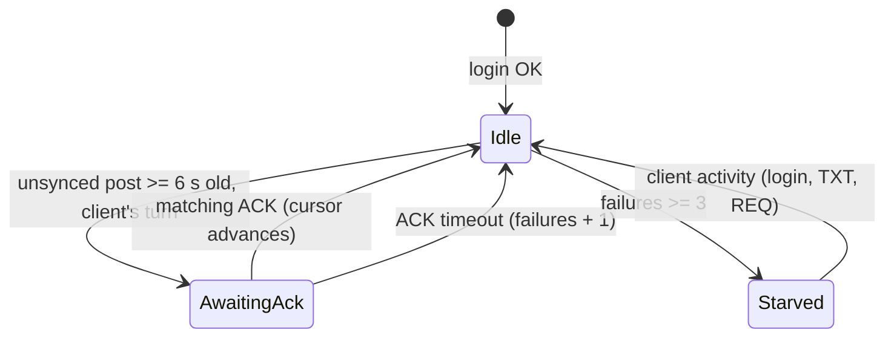
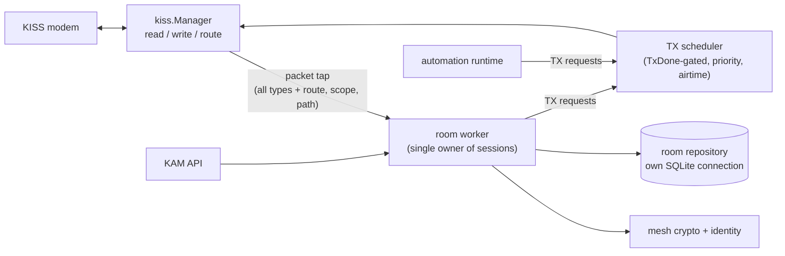

# Feature: MeshCore Room Server

**Status:** Plan phases 1-3 are implemented (2026-10-10): packet tap, transmit scheduler, identity and crypto, signed adverts, login and roles, durable posts, push sync, keep-alive, and session persistence. Open: Phase 4 items marked in §6.14 and §11. The Phase 0 captures from a real room server are not possible at the moment (2026-10-18); interoperability is validated instead by subscribing to KAM while it runs, with the hosted rooms advertised at start-up (RS-ADV-6). Decisions D11-D17 were recorded during implementation.
**Scope:** What KAM must do to appear and behave as a MeshCore **room server** (advert type `ROOM`) to unmodified MeshCore clients, plus the KAM-specific requirements (durability, safety, operations) that the reference firmware does not provide.
**Reference firmware:** MeshCore `main` at commit `a366955` (2026-09-30), `FIRMWARE_VERSION` `v1.17.1` in `MyMesh.h`.

[SYSTEM_DESIGN.md §10](SYSTEM_DESIGN.md) narrates the login/post/push flow and §3.7 and §4.5 describe how KAM implements it. This document does not repeat the narrative. It records the facts the requirements depend on, the corrections to earlier notes (§10), the requirements with their implementation status (§6.14), and the deviations found while building (§6.15).

## 1. Summary

KAM before this work decoded adverts and group texts. A room server is a different protocol surface: clients address the node by public key, authenticate with a login, post with ECDH-encrypted direct messages, and the server pushes stored posts back one at a time, gated on per-post ACKs. None of that traffic reached KAM's pipeline.

Findings that shape the plan:

1. **No single spec exists.** Wire formats are in `payloads.md` / `packet_format.md`; the server state machine exists only in the reference firmware source (`examples/simple_room_server`). The requirements below are derived from both, and the source wins where they differ.
2. **The room logic is the smaller part of the work.** The larger gaps are plumbing: a general packet tap that keeps route type, transport codes and path; a TX path gated on the modem's `TxDone`; a correct dedup window; commit-before-ACK persistence; and an identity with Ed25519 signing and X25519 ECDH (§7).
3. **KAM can beat the reference on durability** (posts survive restart, more than 32 posts, sessions survive restart) **but not on protocol limits**: post text is capped at 150 bytes, one push per client is in flight at a time, and each push costs about 0.5 s of airtime at KAM's current radio settings (§9).
4. **Four decisions are hard to reverse** and need sign-off before build: identity custody, post retention/backlog policy, role semantics, and region scoping (§8).
5. **Several statements in existing notes and in DeepWiki do not match the current source** (§10).

## 2. Terminology

| Term | Meaning here |
|---|---|
| **Room server** | A MeshCore node whose advert type is `ROOM` (3). A bulletin board: clients log in, post, and receive pushed posts. |
| **Room** | The post history of one room server. One identity = one room. |
| **Channel / group text** | Shared-key broadcast chat. Not a room. KAM already handles it. |
| **Client** | A MeshCore node (companion app/radio) that has logged in. |
| **Post** | A text stored by the room, with author pubkey and a server-assigned timestamp. |
| **Push** | The server sending a stored post to one client as a signed-plain `TXT_MSG`, then waiting for the client's ACK. |
| **Sync cursor** (`sync_since`) | Per-client timestamp; posts newer than it are still owed to the client. |
| **Out path** | The stored direct route from server to a client. Unknown means flood. |
| **Scope / region** | A transport-code namespace on flood packets (`ROUTE_TYPE_TRANSPORT_FLOOD`). |
| **Role** | `GUEST` 0, `READ_ONLY` 1, `READ_WRITE` 2, `ADMIN` 3 (low 2 bits of permissions). |

This document uses "room" only in the MeshCore sense above. Mirroring channels into a room is out of scope (§3). (An earlier draft design doc's "aggregate and serve group-text rooms" wording caused this clarification; that doc has been removed.)

## 3. Goals and non-goals

**Goals**

- G1. A stock MeshCore client can discover or import the room, log in, post, receive pushes, and reconnect and catch up.
- G2. Acknowledged posts survive restarts and power loss.
- G3. Room traffic cannot starve existing KAM functions (ingest, automation) or exceed the airtime budget.
- G4. An operator can administer the room without an over-the-air CLI.

**Non-goals for the first release**

- Repeating or forwarding packets (KAM is not a relay hop; the reference room server also defaults to `disable_fwd = 1`).
- Over-the-air admin CLI, sensor telemetry, OTA firmware, region management over the air.
- Bridging channels and rooms.
- The future authenticated Remote API.

## 4. Sources and method

Primary sources are the MeshCore repository files below, read at the pinned commit. DeepWiki's "Room Server" page was read as a **secondary** source and is not normative. Where a doc and the firmware source disagree, the source is treated as authoritative and the disagreement is listed in §10.

| Key | File | Used for |
|---|---|---|
| `PAY` | `docs/payloads.md` | Payload layouts, advert flags, room login, text types |
| `PKT-DOC` | `docs/packet_format.md` | Header, route types, path encoding, size limits |
| `CLI` | `docs/cli_commands.md` | Passwords, ACL, advert limits, region and duty-cycle semantics |
| `KISS` | `docs/kiss_modem_protocol.md` | Modem framing, TX rules, SetHardware sub-commands |
| `COMP` | `docs/companion_protocol.md` | Client-visible message formats |
| `RS.cpp` / `RS.h` | `examples/simple_room_server/MyMesh.cpp` / `.h` | Server state machine, constants |
| `ACL` | `src/helpers/ClientACL.h` / `.cpp` | Roles, client table, persistence rules |
| `MESH` | `src/Mesh.cpp` | Receive rules, datagram/path/ACK construction |
| `UTIL` | `src/Utils.cpp` | Cipher, MAC, ACK hash |
| `ID` / `KX` | `src/Identity.cpp`, `lib/ed25519/key_exchange.c` | Identity rules, ECDH, test keypair |
| `PKT` | `src/Packet.cpp` | Packet hash, path validation |
| `BCM` | `src/helpers/BaseChatMesh.cpp` | What clients do with login, pushes, ACKs, adverts |
| `ADV` / `TXT` | `src/helpers/AdvertDataHelpers.h`, `TxtDataHelpers.{h,cpp}` | Type constants, string copy semantics |
| `TKS` / `POL` | `src/helpers/TransportKeyStore.*`, `RoutingPolicy.h` | Transport code math, reply scope rule |
| `RGN` | `src/helpers/RegionMap.cpp` | Region key derivation (name with `#`), region matching, `$` private regions |
| `CORE` | `src/MeshCore.h` | Size constants, `getCurrentTimeUnique` |

Permalinks use `https://github.com/meshcore-dev/MeshCore/blob/a366955cb2f67b8e6842d4f00d2b6a554dddd88a/<path>`.

## 5. Reference behaviour

Only facts that the requirements rely on are listed.

### 5.1 Addressing and envelope

- Node hash is the first byte of the public key `[PAY]`. Identity generation rejects keys whose first byte is `0x00` or `0xFF` `[ID]`.
- Peer datagrams (`REQ`, `RESPONSE`, `TXT_MSG`, `PATH`): `dest_hash(1) | src_hash(1) | MAC(2) | ciphertext` `[PAY]`.
- `ANON_REQ`: `dest_hash(1) | sender_pubkey(32) | MAC(2) | ciphertext` `[PAY]`.
- `ACK`: 4-byte checksum. `MULTIPART`: first byte is `remaining<<4 | inner_type`; an inner ACK carries 4 more bytes `[PAY, MESH]`.
- 1-byte hashes collide. The receiver matches `dest_hash` to its own first key byte, then tries **every** known client with matching `src_hash` until a MAC verifies `[MESH]`.
- Frame: `header | [transport_codes(4)] | path_len | path(≤64) | payload(≤184)`; KISS data frames are ≤255 bytes `[PKT-DOC, KISS, CORE]`. `path_len` bits 0-5 are hop count, bits 6-7 are hash size minus 1; code `0b11` is invalid `[PKT-DOC, PKT]`.
- Duplicate key is `SHA-256(payload_type | payload)` truncated to 8 bytes; the path is excluded `[PKT, CORE]`.
- A **direct** packet with a non-empty remaining path belongs to a forwarder, not to the final destination. The only exception is an ACK, which is processed early `[MESH]`. Flood packets are always processed.

### 5.2 Cryptography

- Identity: Ed25519. Public key 32 B, private key 64 B, seed 32 B `[CORE]`. The first 32 bytes of the private key are the ECDH scalar `[KX]`.
- Shared secret: clamp the first 32 bytes of the private key (`e[0]&=248; e[31]&=63; e[31]|=64`), convert the peer's Edwards `y` to Montgomery `u = (1+y)/(1-y)`, run the X25519 ladder, output 32 B `[KX]`.
- Envelope: AES-128-ECB with key `secret[0:16]`, zero-padded to 16 B blocks; MAC is `HMAC-SHA-256(key = all 32 secret bytes, data = ciphertext)[0:2]`; wire form `MAC | ciphertext` `[UTIL]`. KAM's [group_text.go](../internal/kiss/parsers/group_text.go) already implements the same primitives for channel secrets.
- ACK hash: `SHA-256(plaintext_prefix | pubkey)[0:4]` `[UTIL, RS.cpp, BCM]`.
- Advert signature: Ed25519 over `pubkey | timestamp(4) | appdata` `[MESH]`.
- `Identity.cpp` embeds a known-good client keypair and a symmetric ECDH check, usable as a test vector `[ID]`.

### 5.3 Advert

- Payload `pubkey(32) | ts(4 LE) | sig(64) | appdata`; appdata `flags | [lat int32 | lon int32] | [feat1(2)] | [feat2(2)] | name`. Flags: low nibble `3` = room; `0x10` location; `0x80` name `[PAY, ADV]`.
- `MAX_ADVERT_DATA_SIZE` is 32; names fit 31 B, or 23 B with location `[CORE, CLI]`.
- Clients ignore an advert whose timestamp is not newer than the last one stored for that contact `[BCM]`. Whether a client auto-adds a room depends on its own policy and hop limit; manual import of a shared advert is the fallback `[BCM]`.
- Reference cadence for a room server: zero-hop every `advert_interval x 2` min (constructor default 1), flood every `flood_advert_interval` h (constructor default 47; `CLI` lists 12 for repeaters, range 3-168) `[RS.cpp, CLI]`. Repeaters cap flood adverts at 8 hops by default `[CLI, POL]`.

### 5.4 Login (`ANON_REQ`)

Plaintext: `timestamp(4) | sync_since(4) | password` (NUL-terminated; the reference client truncates passwords to 15 bytes) `[PAY, BCM]`.

| Condition | Outcome `[RS.cpp]` |
|---|---|
| Blank password and sender already in the client table | Accepted without re-checking; no state reset |
| Password equals admin password | `ADMIN` |
| Password equals guest password | `READ_WRITE` |
| Otherwise, `allow_read_only` on | `GUEST` |
| Otherwise | **No response** (client times out) |
| New login with `timestamp <= last_timestamp` | Dropped as replay |

On success the server stores `sync_since`, clears `pending_ack` and `push_failures`, stores the shared secret, delays the next push by 2000 ms, and clears the out path if the request arrived by flood.

Response plaintext (13 B): `server_ts(4) | 0x00 (LOGIN_OK) | 0x00 (legacy keep-alive) | (admin ? 1 : permissions==0 ? 2 : 0) | permissions | random(4) | firmware_level=1`. If the request was flood, it is wrapped in a `PATH` return (path as received, extra type `RESPONSE`); otherwise it is a `RESPONSE` datagram sent direct (known out path) or flood `[RS.cpp, MESH]`.

### 5.5 Roles and client table

- Roles `GUEST 0`, `READ_ONLY 1`, `READ_WRITE 2`, `ADMIN 3`; `setperm <pubkey> <0-3>` `[ACL, CLI]`.
- `MAX_CLIENTS` is 20. When full, the least recently active **non-admin** is evicted `[ACL]`.
- Only admins are persisted (`saveFilter`), written 5 s after change; shared secrets are recomputed on load. Guests and read-write clients live in RAM only `[RS.cpp, ACL]`.
- A client that is not in the table cannot be decrypted and gets no reply to anything but a login `[MESH]`.
- Posting check is `(permissions & ROLE_MASK) == GUEST` only, so **`READ_ONLY` (1) can post** in the reference code `[RS.cpp]`.

### 5.6 Posting (client to server)

- `TXT_MSG`, plaintext `timestamp(4) | (txt_type<<2 | attempt)(1) | text`; `len > 5`. Handled types: `PLAIN` (post) and `CLI_DATA` (admin command, no ACK either way). A `GUEST` post gets no ACK `[PAY, RS.cpp]`.
- Replay: `timestamp < last_timestamp` is dropped; equal means retry (ACK again, do not add again) `[RS.cpp]`.
- Stored: author pubkey, `post_timestamp = getCurrentTimeUnique()` (strictly increasing: `if t <= last then ++last`), text copied with `StrHelper::strncpy(dest, src, MAX_POST_TEXT_LEN)`. That helper copies at most `buf_sz-1` bytes, so **at most 150 bytes** are kept although the constant is 151 `[RS.cpp, RS.h, CORE, TXT]`.
- ACK: `SHA-256(plaintext[0 : 5+strlen(text)] | client_pubkey)[0:4]`, sent after 200 ms; direct if an out path is known, else a plain flood ACK `[RS.cpp, BCM]`.
- Cyclic queue of 32 posts, **RAM only**; lost on reboot `[RS.h, RS.cpp]`.

### 5.7 Push sync (server to client)

- Round-robin over clients; a client is eligible when `pending_ack == 0`, `last_activity != 0`, `push_failures < 3`. After a push the next pass is 1200 ms away; otherwise 150 ms `[RS.cpp]`.
- Candidate post: `post_timestamp > sync_since`, `author != client`, `now >= post_timestamp + 6 s`; scanned oldest first `[RS.cpp]`.
- Push plaintext: `post_ts(4) | (TXT_TYPE_SIGNED_PLAIN<<2 | random 2 bits) | author_pubkey[0:4] | text`. Fits one packet: 160 B plaintext, 164 B payload `[RS.cpp, TXT]`.
- Expected ACK: `SHA-256(push_plaintext | client_pubkey)[0:4]`. A client computes it from its own pubkey `[BCM]`.
- Route: direct via out path (ACK wait `4000 + 2000 x (hops+1)` ms), else scoped flood (12000 ms) `[RS.cpp]`.
- ACK accepted from an `ACK` packet, a `MULTIPART` ACK, or the `extra` of a `PATH` `[MESH, RS.cpp]`. On match: clear pending, clear failures, `sync_since = pushed post timestamp`.
- The reference does **not** reset the out path after 3 failures (DeepWiki says it does; the current `loop()` does not) `[RS.cpp]`.
- Any authenticated `TXT_MSG`/`REQ` from the client resets `push_failures` `[RS.cpp]`.

### 5.8 Paths

- A client that receives a flooded server packet sends a **reciprocal `PATH`** (direct) carrying the route it saw; the server stores it as the out path and also processes an ACK in `extra` `[MESH, BCM, RS.cpp]`.
- `PATH` plaintext: `path_len(1) | path | extra_type(1, low nibble) | extra`; with no extra it is `0xFF | random(4)` `[MESH]`.
- The server never sends a reciprocal path back (`return false`) `[RS.cpp]`.
- `createPathReturn` fails if `path bytes + extra_len + 5 > 166` `[MESH]`.

### 5.9 Keep-alive and requests

- `REQ`: `timestamp(4) | type(1) | data`. Types: `0x01` status, `0x02` keep-alive, `0x03` telemetry, `0x05` access list (admin) `[PAY, RS.cpp]`.
- Keep-alive is honoured on **direct** routes only. It refreshes activity, may force `sync_since` (optional 4 B, ignored if 0), clears `pending_ack`, and replies with an ACK `SHA-256(first 9 bytes | pubkey)[0:4]` plus one trailing byte: the unsynced-post count. It replies only when an out path is known `[RS.cpp]`.
- Status reply: `reflected_ts(4)` followed by the `ServerStats` struct memcpy'd from firmware (battery, TX queue, noise floor, RSSI, packet counters, airtime, uptime, flood/direct counts, errors, SNR x4, dup counts, `n_posted`, `n_post_push`). The layout is defined only by the C struct; no spec doc covers it `[RS.cpp, PAY]`.
- `REQ` replay rule: `timestamp < last_timestamp` is dropped, the same boundary as `TXT_MSG`; an equal timestamp is processed again rather than treated as a retry `[RS.cpp]`.

### 5.10 Routing scope

- Scoped flood is `ROUTE_TYPE_TRANSPORT_FLOOD` (0) with `transport_codes[0]` set and `[1] = 0`. Code is `HMAC-SHA-256(key = region_key(16), data = payload_type | payload)[0:2]` read as a little-endian `uint16` (the firmware writes the native `uint16`; every supported MCU is little endian: inferred), with `0x0000 -> 0x0001` and `0xFFFF -> 0xFFFE`. The key of a public region is the first 16 bytes of `SHA-256("#" + name)`: a name that already starts with `#` is hashed as is and one without gets the `#` prepended; matching by name ignores a single leading `#` `[TKS, RGN, PKT-DOC]`. Names starting with `$` are private regions with stored keys, which KAM does not support `[RGN]`. Packets are serialised as `header | codes[0] LE | codes[1] LE | path_len | path | payload` `[PKT]`.
- Reply scope rule `[POL, RS.cpp]`: request scope resolved -> reuse it; request was an unscoped flood -> unscoped; else default scope if configured; else unscoped. Repeaters can drop unscoped floods at hop 0 (`flood.max.unscoped = 0`), so an unscoped reply may never travel `[RS.cpp, CLI]`.
- Own flood sends use `path_hash_mode + 1` as hash size; replies mirror the request's hash size. Firmware 1.13 and older drops multi-byte path hashes `[RS.cpp, CLI]`.

### 5.11 Constants

| Constant | Value | Source |
|---|---|---|
| `MAX_UNSYNCED_POSTS` | 32 | `RS.h` |
| `MAX_POST_TEXT_LEN` (effective stored text) | 151 (150 B) | `RS.h`, `TXT` |
| `MAX_CLIENTS` | 20 | `ACL` |
| `PUSH_NOTIFY_DELAY_MILLIS` / `SYNC_PUSH_INTERVAL` | 2000 / 1200 ms | `RS.cpp` |
| `POST_SYNC_DELAY_SECS` | 6 | `RS.cpp` |
| `PUSH_ACK_TIMEOUT_FLOOD` | 12000 ms | `RS.cpp` |
| `PUSH_TIMEOUT_BASE` / `FACTOR` | 4000 / 2000 ms | `RS.cpp` |
| `SERVER_RESPONSE_DELAY` / `TXT_ACK_DELAY` | 300 / 200 ms | `RS.h` |
| `MAX_PACKET_PAYLOAD` / `MAX_PATH_SIZE` / `MAX_TRANS_UNIT` | 184 / 64 / 255 | `CORE` |
| Password length used by clients | 15 B | `BCM` |

## 6. Requirements

**Priority:** MUST = needed for client interoperability or safety. SHOULD = clear robustness or operability gain; deviation needs a reason. MAY = optional. Source keys refer to §4/§5.

### 6.1 Identity and advertising

| ID | Requirement | Pri | Basis |
|---|---|---|---|
| RS-ID-1 | Generate a persistent Ed25519 identity per room on first enable. Store each generated private key in its own file next to the database, created with mode `0600`. Reject a generated key whose public key starts with `0x00` or `0xFF`. | MUST | `ID`, RS-CFG-2 |
| RS-ID-2 | ECDH must be byte-compatible with `ed25519_key_exchange`, proven by vectors including the `Identity.cpp` test keypair. | MUST | `KX`, `ID` |
| RS-ID-3 | Show the public key to the operator; never log the private key. | MUST | |
| RS-ID-4 | Provide identity backup/export. Importing a MeshCore 64-byte private key is optional. | SHOULD / MAY | D1 |
| RS-ADV-1 | Emit signed `ROOM` adverts (type nibble `3`, name flag `0x80`, plus location flag `0x10` when a location is set). Validate name length at config load (31 B, 23 B with location). | MUST | 5.3 |
| RS-ADV-2 | Advert timestamps strictly increase within a run. Across restarts they rely on the host clock (D9). | MUST | 5.3 `BCM` |
| RS-ADV-3 | Zero-hop and flood advert intervals are configurable and counted in the airtime budget. Defaults are set in Phase 0. | MUST | 5.3 |
| RS-ADV-4 | Advert on name/location change and on demand. Expose the current signed advert (hex) for manual contact import. | SHOULD | 5.3 |
| RS-ADV-5 | Flood adverts use the configured hash size and default scope. | MUST | 5.10 |
| RS-ADV-6 | At start-up, advert every hosted room so a client can discover it and subscribe while KAM is running: one flood advert per room (a zero-hop advert when the flood interval is off), staggered across rooms. Setting both advert intervals to 0 opts a room out of advertising. | MUST | 5.3, D14 |

### 6.2 Receive pipeline

| ID | Requirement | Pri | Basis |
|---|---|---|---|
| RS-RX-1 | Route `REQ`, `TXT_MSG`, `ACK`, `ANON_REQ`, `PATH`, `MULTIPART` through a general packet tap that carries route type, transport codes, `path_len`/hash size, path bytes, payload and RxMeta. Advert and group-text handling is unchanged. | MUST | 5.1 |
| RS-RX-2 | Process peer payloads only when `dest_hash` equals our first key byte and the "for us" rule holds (direct with remaining path is ignored, except ACK). | MUST | 5.1 |
| RS-RX-3 | Dedup on `(payload_type, payload)` over a time-bounded window sized for retry timescales. Retries with different attempt/random bytes must pass. | MUST | 5.1 |
| RS-RX-4 | On `src_hash` collision, try every candidate. `ANON_REQ` derives its secret from the supplied pubkey. | MUST | 5.1 |
| RS-RX-5 | Short, malformed or undecryptable packets are dropped silently with bounded work and without panics (fuzz-tested). | MUST | |
| RS-RX-6 | Never forward or retransmit any received packet. | MUST | 3 |
| RS-RX-7 | Process an ACK on a direct route with remaining path as an early ACK. | SHOULD | 5.1 |

### 6.3 Authentication and sessions

| ID | Requirement | Pri | Basis |
|---|---|---|---|
| RS-AUTH-1 | Decrypt and parse login; apply the decision table in 5.4. A failed login produces no response. | MUST | 5.4 |
| RS-AUTH-2 | Refuse to enable the room when the admin password is empty or the reference default `password`. A blank guest password is accepted only with an explicit `open_room: true`. | MUST | `CLI`, D10 |
| RS-AUTH-3 | Compare passwords in constant time. Validate configured passwords at 15 bytes or less (clients truncate at 15). | MUST | `BCM` |
| RS-AUTH-4 | Per-client replay protection on the client's clock: login drops `<= last`; `TXT_MSG` and `REQ` drop `< last`; equal on `TXT_MSG` is a retry. | MUST | 5.4-5.6 |
| RS-AUTH-5 | Login response uses the 13-byte layout in 5.4 with a 300 ms response delay, wrapped in a `PATH` return when the request was flood. | MUST | 5.4 |
| RS-AUTH-6 | A successful password login sets the cursor to the request value, clears pending ACK and failures, and clears the out path when the request was flood. A blank-password resume by a known client changes none of that state. | MUST | 5.4 |
| RS-AUTH-7 | Bounded client table (default 20, configurable) with least-recently-active eviction of non-admins. | MUST | 5.5 |
| RS-AUTH-8 | Rate-limit login attempts per source key and globally. Bound the shared-secret cache. Log failures with a short key prefix only. | SHOULD | 9 R10 |
| RS-AUTH-9 | Persist sessions (pubkey, role, cursor, out path, last client timestamp) so a restart does not force re-login. Secrets are recomputed, not stored. | SHOULD | D4 |
| RS-AUTH-10 | Role changes made through the API take effect immediately and persist. | MUST | |

### 6.4 Posts

| ID | Requirement | Pri | Basis |
|---|---|---|---|
| RS-POST-1 | Accept `TXT_MSG` with `txt_type` `PLAIN` from roles allowed to post (D3). Store author pubkey, server timestamp, and text up to the first NUL, truncated to 150 bytes at a UTF-8 boundary. | MUST | 5.6 |
| RS-POST-2 | Post timestamps are strictly increasing, unique `uint32` seconds within a run (bump by 1 when the clock repeats). Across restarts they rely on the host clock (D9). | MUST | 5.6 |
| RS-POST-3 | ACK is the first 4 bytes of `SHA-256` over the plaintext prefix (5 + length of the text as received) followed by the client pubkey, sent only **after** the post is durably committed. A retry with an equal client timestamp is re-ACKed and not re-added. No ACK for roles that cannot post. | MUST | 5.6 |
| RS-POST-4 | ACK route: direct when an out path is known, else a plain flood ACK with the scope rule; 200 ms delay. | MUST | 5.6, 5.10 |
| RS-POST-5 | A client never receives its own posts. | MUST | 5.7 |
| RS-POST-6 | Post storage is transactional and ordered. It must not use the drop-on-full batch queues used for adverts and group texts. | MUST | 7 |
| RS-POST-7 | Retention is configurable by count and age, with the default of at least the newest 32 posts. | SHOULD | D2 |
| RS-POST-8 | System posts authored by the room identity (API now, Starlark later) share the same limits. | MAY | 5.6 |
| RS-POST-9 | `TXT_TYPE_SIGNED_PLAIN` from clients and unknown text types are ignored and logged. `CLI_DATA` from non-admins gets no reply and no ACK. | MUST | 5.6 |

### 6.5 Push sync

| ID | Requirement | Pri | Basis |
|---|---|---|---|
| RS-PUSH-1 | Push posts newer than the client's cursor, oldest first, excluding the client's own, and only once they are at least 6 s old. | MUST | 5.7 |
| RS-PUSH-2 | At most one unacknowledged push per client; clients are served round-robin; cadence is no faster than the reference (1200 ms after a push, 150 ms idle scan). | MUST | 5.7 |
| RS-PUSH-3 | Push uses the layout in 5.7 with random attempt bits per retry so packet hash and ACK differ. Expected ACK is recorded before sending. | MUST | 5.7 |
| RS-PUSH-4 | Accept ACKs from `ACK`, `MULTIPART` ACK, and `PATH` extra; match against every client's pending ACK; on match advance the cursor to the pushed post and clear failures. | MUST | 5.7, 5.8 |
| RS-PUSH-5 | ACK timeout is 12 s for flood and `4 s + 2 s x (hops+1)` for direct; each timeout increments failures; at 3 failures stop pushing until the client shows authenticated activity. | MUST | 5.7 |
| RS-PUSH-6 | After 3 failures also drop the out path so the next exchange rediscovers it. This is a deliberate improvement over the reference. | SHOULD | 5.7, 10 |
| RS-PUSH-7 | Backlog window: a new or returning client receives at most the newest N posts (default 32), regardless of how old its cursor is. | SHOULD | D2, 9 R3 |
| RS-PUSH-8 | Login `sync_since` and keep-alive `forceSince > 0` override the stored cursor. | MUST | 5.4, 5.9 |
| RS-PUSH-9 | The push engine runs on an injectable clock so it is deterministic under test. | SHOULD | 12 |

### 6.6 Paths and replies

| ID | Requirement | Pri | Basis |
|---|---|---|---|
| RS-PATH-1 | Handle `PATH`: decrypt, validate encoded `path_len` (hash size 4 or more than 64 path bytes is invalid), store the out path, process an ACK in `extra`. Never send a reciprocal path. | MUST | 5.8 |
| RS-PATH-2 | Replies to flood-received `REQ` and login are `PATH` returns carrying the path as received, with `extra_type` `RESPONSE`; drop when the combined size exceeds 166 B. | MUST | 5.8 |
| RS-PATH-3 | Replies mirror the request's path hash size. | MUST | 5.10 |
| RS-PATH-4 | Store the out path in its encoded `path_len` form so any hash size round-trips. | SHOULD | 5.1 |

### 6.7 Requests and keep-alive

| ID | Requirement | Pri | Basis |
|---|---|---|---|
| RS-REQ-1 | Keep-alive on direct routes: refresh activity, apply `forceSince`, clear pending ACK, reply with ACK plus unsynced-count byte, only when an out path is known. | MUST | 5.9 |
| RS-REQ-2 | Status request returns a `ServerStats`-compatible reply. Layout is validated against a capture from a real room server before release. | SHOULD | 5.9, 9 R6 |
| RS-REQ-3 | Telemetry (base values only for `GUEST`) and access-list (admin only). Unknown request types get no reply. | MAY | 5.9 |
| RS-REQ-4 | Over-the-air CLI subset (`ver`, `clock`, `advert`, `room.post`, `setperm`). | MAY | D5 |

### 6.8 Transmission

| ID | Requirement | Pri | Basis |
|---|---|---|---|
| RS-TX-1 | One TX scheduler owns the radio data path for all producers (group-text sender, automation, room). It sends one data frame at a time, waits for `TxDone` (`0xF8`) with a timeout, and retries on `Error/TxBusy` (`0xF1`, `0x07`) with backoff. | MUST | `KISS` |
| RS-TX-2 | Priorities: direct ACK and replies, then flood replies and `PATH`, then pushes, then adverts. Support per-packet delay (200/300 ms rules) and cancellation of obsolete pushes. | MUST | `MESH`, 5.11 |
| RS-TX-3 | Configurable duty-cycle cap with accounting (estimate from the LoRa formula or `GetAirtime` `0x0F`). Over budget, defer pushes and adverts first; never silently drop ACKs or login replies. | MUST | `KISS`, `CLI` |
| RS-TX-4 | Validate frame bounds before send: payload at most 184 B, path at most 64 B, frame at most 255 B. | MUST | 5.1 |
| RS-TX-5 | Set the modem `TXDELAY` at startup to a configured value (KISS default is 500 ms) and record the effect on client timeouts. | SHOULD | 9 R2 |
| RS-TX-6 | Build packets with transport codes and any path hash size. | MUST | 5.10 |
| RS-TX-7 | The outbound queue is bounded with counters; room traffic and automation replies cannot starve each other. | SHOULD | 3 |

### 6.9 Scoping

| ID | Requirement | Pri | Basis |
|---|---|---|---|
| RS-SCOPE-1 | Configure a default scope region and a list of known regions. Derive keys and transport codes as in 5.10. | MUST | `TKS` |
| RS-SCOPE-2 | Resolve a request's scope by matching `transport_codes[0]` against configured regions; choose the reply scope with the rule in 5.10. | MUST | `POL` |
| RS-SCOPE-3 | With no region configured, send unscoped floods and warn at startup that scoped meshes may not carry them. | SHOULD | 5.10 |

### 6.10 Persistence

| ID | Requirement | Pri | Basis |
|---|---|---|---|
| RS-DB-1 | A room repository on its own SQLite connection (same pattern as `AutomationRepository`) with versioned migrations for rooms, posts and clients, all keyed by room id. | MUST | [automation.go](../internal/db/automation.go) |
| RS-DB-2 | A post is committed (WAL) before its ACK is sent. Restart must not lose an acknowledged post. | MUST | 6.4 |
| RS-DB-3 | Retention pruning is a background job with size and age metrics. | SHOULD | D2 |

### 6.11 Configuration

| ID | Requirement | Pri | Basis |
|---|---|---|---|
| RS-CFG-1 | A `rooms:` list in `kam.yml`. Per room: enabled, name, location, advert intervals, passwords, `allow_read_only`, `open_room`, `max_clients`, history limits. Shared: `default_scope`, `regions`, `path_hash_size`, `duty_cycle_percent`, `txdelay`. An invalid room stays disabled; other rooms and ingestion keep running. | MUST | [models.go](../internal/models/models.go) |
| RS-CFG-2 | Hand-written secrets (passwords) are plain text in `kam.yml`, like explicit channel keys (D11). The generated identity key is not: it has its own file (RS-ID-1), because storing it in `kam.yml` would mean KAM rewrites the hand-edited file and drops its comments. KAM does not police the file mode. | MUST | [models.go](../internal/models/models.go) |
| RS-CFG-3 | `path_hash_size` defaults to 1 for compatibility with firmware 1.13 and older. | MUST | `CLI` |

### 6.12 Operations

| ID | Requirement | Pri | Basis |
|---|---|---|---|
| RS-OPS-1 | Counters: logins ok/failed/rate-limited, posts accepted/rejected, pushes sent/acked/timed-out, active clients, per-client backlog, TX queue depth and defers, airtime used, dedup drops. | MUST | |
| RS-OPS-2 | KAM API endpoints (loopback, same posture as automation): list clients, set role or remove, list/create/delete posts, force advert, show pubkey and advert, show stats. | SHOULD | G4 |
| RS-OPS-3 | Ordered shutdown: stop intake, stop the room worker (flush commits), stop TX, then the manager. | MUST | [SYSTEM_DESIGN.md §6](SYSTEM_DESIGN.md) |
| RS-OPS-4 | A room failure never stops radio ingestion. | MUST | |
| RS-OPS-5 | Log a warning when the host time at startup is earlier than the newest stored post or advert timestamp. Do not refuse to run (D9). | MAY | 9 R7 |

### 6.13 Multiple rooms (D7)

| ID | Requirement | Pri | Basis |
|---|---|---|---|
| RS-MULTI-1 | Each room has its own identity, client table, post store, cursors, passwords and advert. All state is keyed by room id. | MUST | D7 |
| RS-MULTI-2 | The receive path tries every room whose first key byte matches `dest_hash`; the first MAC that verifies wins. `ANON_REQ` is tried against each matching room. | MUST | 5.1 |
| RS-MULTI-3 | Reject and regenerate a new identity whose first key byte equals another room's. | SHOULD | 5.1 |
| RS-MULTI-4 | All rooms share one TX scheduler and one airtime budget. Pushes are scheduled fairly across rooms; adverts are staggered. | MUST | RS-TX-1, RS-TX-3 |
| RS-MULTI-5 | The number of rooms is bounded by configuration. The limit is fixed in Phase 0 after airtime measurement. | MUST | 9 R3 |

### 6.14 Implementation status

Status as of 2026-10-10. **Done** means implemented and covered by tests (see §12). The airtime-dependent numbers (the room limit, duty-cycle defaults) rest on the estimate in R3 and still need hardware confirmation.

| Group | Status | Notes |
|---|---|---|
| RS-ID-1, RS-ID-2, RS-ID-3 | Done | One hex seed per room in `<database directory>/rooms/<id>.key` (mode `0600` in a `0700` directory, written atomically; a corrupt file is refused, never replaced). Hash `0x00`/`0xFF` and another room's hash are regenerated. X25519 uses `math/big` and `crypto/ecdh` (no new dependency) and is checked against the MeshCore test key pair from `Identity.cpp`. Public keys are logged and printed by `kam room show`; the private seed is never logged (tested). |
| RS-ID-4 | Partly | Backup is copying the key file. Importing a 64-byte MeshCore private key (MAY) is not implemented. |
| RS-ADV-1, RS-ADV-2, RS-ADV-3, RS-ADV-5 | Done | Signed `ROOM` adverts, strictly increasing timestamps within a run, configurable intervals counted by the scheduler, hash size and default scope applied. Name length is validated at load. |
| RS-ADV-4 | Partly | `kam room show` (signed advert hex and `meshcore://contact/add` URI). On-demand adverts and adverts after a name change need an HTTP endpoint or a restart. Start-up adverts are RS-ADV-6. |
| RS-ADV-6 | Done | One flood advert per room at start-up, staggered 2 s, replacing its own stale queued advert (D14). Pinned as its own MUST on 2026-10-18 because subscribing to KAM while it runs is the interoperability validation now that the Phase 0 room-server captures are not possible. |
| RS-RX-1 .. RS-RX-7 | Done | Packet tap (`Manager.SubscribePackets`), the "for us" rule with the early-ACK exception, a 2-minute / 512-entry dedup over type and payload, `src_hash` collisions, malformed input dropped without panic (tests feed truncated, bit-flipped and random packets; there is no Go fuzz target yet), no forwarding code. |
| RS-AUTH-1 .. RS-AUTH-7 | Done | Decision table, silence on failure, constant-time compare (SHA-256 of both sides), 15-byte limit, per-client replay rules, 13-byte response with 300 ms delay and PATH wrapping, bounded client table with least-recently-active eviction. |
| RS-AUTH-8 | Done | Per source key 0.5 attempts/s (burst 5), overall 10/s (burst 20), 256 tracked keys, key prefix only in logs. Shared secrets live in the bounded client table rather than a separate cache. |
| RS-AUTH-9 | Done | Role, cursor, route and replay timestamp are stored; secrets are recomputed. See §6.15 for how restored clients behave. |
| RS-AUTH-10 | Deferred | Needs the management API; roles change only by password login. |
| RS-POST-1 .. RS-POST-7, RS-POST-9 | Done | 150 bytes cut at a UTF-8 boundary, ACK over the text as received and only after commit, role gate (D3), retention by count and age. |
| RS-POST-8 | Deferred | System posts (API/Starlark). |
| RS-PUSH-1 .. RS-PUSH-9 | Done | One push in flight per client, round robin at the reference cadence, 12 s / `4 s + 2 s x (hops+1)` timeouts, three failures stop pushing until the client is active, the route is dropped after three failures, backlog window from the in-memory cache of the newest `backlog_posts`, injected clock. |
| RS-PATH-1 .. RS-PATH-4 | Done | PATH validation and storage in encoded form, PATH returns for flood requests, replies mirror the request's hash size. |
| RS-REQ-1 | Done | Keep-alive on direct routes. |
| RS-REQ-2, RS-REQ-3 | Deferred | Status, telemetry and access-list requests get no reply and are counted. |
| RS-REQ-4 | Not planned | D5. |
| RS-TX-1, RS-TX-2, RS-TX-4, RS-TX-6, RS-TX-7 | Done | `kiss.TxScheduler`: one frame at a time, `TxDone` gate with a `TxAbandoned` event when the writer gives up, four priority classes, per-packet delay, cancellation by tag, packets validated with `mesh.Parse`, bounded queue (128) with eviction of deferrable packets and counters. `send.Sender` goes through the scheduler unchanged. |
| RS-TX-3 | Partly | Sliding one-hour airtime budget from the LoRa formula (D15). `GetAirtime`-based accounting is deferred. |
| RS-TX-5 | Done earlier | `radio.csma.txdelay_ms` ([FeatureKissModem.md](FeatureKissModem.md)). |
| RS-SCOPE-1 .. RS-SCOPE-3 | Done | `mesh.default_scope` and `mesh.regions`; R5 resolved (§5.10); a startup warning when no default scope is set. |
| RS-DB-1, RS-DB-2 | Done | `RoomRepository` on its own connection with `synchronous=FULL`, versioned migrations (`room_schema_version`), post and client timestamp in one transaction. |
| RS-DB-3 | Partly | Pruning every 10 minutes with a log line; no metrics export. |
| RS-CFG-1, RS-CFG-3 | Done | `rooms:` and `mesh:` blocks; an invalid room stays disabled (`KamConfig.ResolveRooms`). `txdelay` stays under `radio.csma` ([FeatureKissModem.md](FeatureKissModem.md)). |
| RS-CFG-2 | Done | Passwords are plain text in `kam.yml`, like channel keys (D11). The generated identity key is its own file. |
| RS-OPS-1 | Partly | Counters in `room.Stats` and `TxScheduler.Stats`; room statistics are logged at shutdown; no export. |
| RS-OPS-2 | Deferred | D17. |
| RS-OPS-3, RS-OPS-4, RS-OPS-5 | Done | Intake, then automation, rooms, scheduler, manager; a room that cannot start never stops ingestion; a start-up warning when the host clock is earlier than the newest stored post. |
| RS-MULTI-1 .. RS-MULTI-5 | Done | Up to 4 rooms (D13). Regeneration avoids hash collisions at creation; keys that already collide are used and logged, and the first MAC that verifies wins. |

### 6.15 Deviations and additions found while building

1. **Blank-password resume marks the client active.** The reference leaves `last_activity` alone, which for a session restored after a restart would mean no pushes until the client sends something else. A blank-password login by a known client now sets activity only; cursor, pending ACK, failures and route are untouched (RS-AUTH-6).
2. **Restored sessions are not pushed to until heard from.** After a restart `last_activity` is zero, as for the reference's persisted admins, so a client that left does not trigger airtime until it logs in, posts or sends a keep-alive.
3. **Empty post text is acknowledged but not stored.** The reference would store and push an empty post.
4. **Timestamp collisions after a clock step.** A post whose server timestamp is already stored in the room (D9: the clock stepped back across a restart) takes the next free timestamp, up to three attempts, instead of failing.
5. **A push still queued at its ACK timeout is not a failure.** If the scheduler still holds the packet (for example deferred by the duty-cycle cap), it is withdrawn and the client is not blamed.
6. **ACK and cursor ordering.** `last_timestamp` of the author moves only after the post is committed, in the same transaction, so a failed write leaves the retry to be processed as new.
7. **Router changes.** The router uses `mesh.Parse`, so a reserved path hash size, a path over 64 bytes, a missing payload or a payload over 184 bytes is dropped (previously an empty payload reached the advert parser). Deduplication is now time-bounded and includes the payload type (previously a FIFO of 10 over the payload only), and room packets KAM transmits are marked seen so a repeater's echo is ignored (group texts are not marked, so their echoes are processed as before). `EncryptThenMAC` and `macThenDecrypt` in `parsers` delegate to `mesh`.
8. **Group-text sends now go through the scheduler.** They queue as `TxPriorityGroupText`, are validated with `mesh.Parse`, and count towards the airtime ledger but are never deferred.
9. **`kam room show`** creates a missing identity key, as node start does.

## 7. Gap analysis against current KAM

The table records the state **before** implementation. Every row is closed by plan phases 1-3 except the automation event (RS-POST-8, deferred); §6.14 has the details.

| Area | Today | Needed |
|---|---|---|
| Router | [kiss_router.go](../internal/kiss/kiss_router.go) dispatches only `ADVERT` and `GRP_TXT`; other types log "unhandled". | RS-RX-1 |
| Packet metadata | Route type and transport codes are sliced off and discarded; only hop count and hop hashes survive. | RS-RX-1, RS-SCOPE-2 |
| "For us" rule | Every packet is treated alike; a direct packet with a remaining path would be processed as if final. | RS-RX-2 |
| Dedup | `isDuplicate` hashes the app payload only (no payload type) and keeps a FIFO of 10 with no time bound. | RS-RX-3 |
| TX path | `txChan` has capacity 10; `writeLoop` writes immediately; `TxDone` and `TxBusy` are not handled (the registry has no waiter for them). `Sender` builds only flood `GRP_TXT` with no path, transport codes, priority, delay or airtime accounting. | RS-TX-1..7 |
| Hardware commands | [cmd_radio.go](../internal/kiss/cmd_radio.go) implements only get/set radio. No identity, sign, key exchange, `TXDELAY`, airtime or stats. | D1, RS-TX-3/5 |
| Crypto | AES-ECB + HMAC exist for channel secrets in `parsers`; no Ed25519 signing key, no X25519 ECDH, no Edwards-to-Montgomery conversion. | RS-ID-2; likely a new dependency (e.g. `filippo.io/edwards25519`), to confirm in the spike |
| Persistence | `kiss.Persistence` covers adverts and group texts only; its queues drop on overflow by design. No room tables. | RS-POST-6, RS-DB-1/2 |
| Config | No identity or room settings. | RS-CFG-1/2 |
| Time | `Builder` uses `time.Now`; there is no strictly increasing unique timestamp source. | RS-POST-2, RS-ADV-2 |
| Automation | Only a `group_text` event; no room event or host function. | RS-POST-8 (later) |

**Implemented shape** (follows the automation runtime's bounded-queue + single-owner worker pattern):

New code lives in `internal/mesh` (packet framing, envelope, identity, adverts, region codes; the AES/HMAC primitives moved out of `parsers`, which now delegates), the `TxScheduler`, airtime estimate and dedup cache in `internal/kiss`, `internal/room` (service, push engine, adverts, identity files, login limiter), and `internal/db/rooms.go`. `internal/node` wires it and owns shutdown order. Room settings are in `internal/models/rooms.go`.

## 8. Decisions

Recorded 2026-10-10. D7 and D9 differ from the recommendation; their consequences are in 8.1. D11-D17 were decided during implementation (2026-10-10); D11 follows the project's pragmatic stance (README Philosophy) and its consequences are in 8.2.

| ID | Decision | Options | Recommendation | Outcome |
|---|---|---|---|---|
| D1 | **Identity custody** (hard to reverse: the public key is the room's address) | (A) KAM-held software identity. (B) Modem's own identity via `GetIdentity`/`SignData`/`KeyExchange`. | **A.** The modem protocol has no set-identity command and generates a key on first boot, so replacing or erasing the modem would silently change the room's address. Modem `EncryptData`/`DecryptData` take a caller-supplied key, so offloading them (as [SYSTEM_DESIGN.md §10.10](SYSTEM_DESIGN.md) suggests) gains nothing; only B's key exchange and signing need the modem. Keep an identity interface so B stays possible. | **A.** |
| D2 | **Post retention and backlog** | Mirror the 32-post RAM queue, or durable store with a backlog window | Durable store; keep all posts within configured count/age; each login receives at most the newest N (default 32). | **Accepted.** |
| D3 | **Role semantics** | Mirror the reference (`READ_ONLY` can post) or enforce intent | Enforce intent: only `READ_WRITE` and `ADMIN` post. Document the deviation. | **Accepted.** |
| D4 | **Session persistence** | RAM only (reference) or persist | Persist role, cursor, out path and last client timestamp; recompute secrets. | **Accepted.** |
| D5 | **Over-the-air CLI** | None, subset, full | None in v1; administer through the KAM API. | **Accepted.** |
| D6 | **Region scoping** | Default scope plus known regions, or unscoped only | Support both; require the operator to choose, and warn when unscoped. Confirm key-name format first (R5). | **Accepted.** Phase 0 confirms the key format. |
| D7 | **Rooms per instance** | One, or N identities on one radio | One in v1. Key all state by identity so N later is additive. | **Decided: multiple rooms in v1** (recommendation was one). |
| D8 | **Channel bridging** | In scope or later | Later. | **Accepted.** |
| D9 | **Clock source in an outage** (no NTP, possibly no RTC) | Trust host clock, or guard with high-water marks | Guard with high-water marks; document the operator requirement. | **Decided: trust the host clock only** (recommendation was a guard). |
| D10 | **Open rooms** | Allow blank guest password silently, or require explicit opt-in | Require `open_room: true`. A blank guest password already means anyone logs in as read-write under the reference `strcmp` rule (inferred from `RS.cpp`; the CLI doc lists the default as blank). | **Accepted.** |
| D11 | **Where passwords live** (RS-CFG-2) | (A) environment variables, (B) a `0600` secrets file, (C) plain text in `kam.yml` | A: keeps secrets out of a file that `SaveKamConfig` rewrites at `0644`. | **C, plain text in `kam.yml`.** Consistent with the README Philosophy (enthusiast project, pragmatism over hardening) and with explicit channel `key_hex`, which is already plain text there. `SaveKamConfig` is unchanged (8.2). |
| D12 | **Identity storage** (refines D1, RS-ID-1) | Key file per room; inside SQLite; environment variable | Key file per room, mode `0600`. | **Key file per room** at `<database directory>/rooms/<id>.key`. The seed is generated, not hand-written, and KAM rewrites `kam.yml` (dropping comments), so it stays out of the yml. |
| D13 | **Room limit** (RS-MULTI-5) | 2, 4 or 8 rooms | 4, a constant that can be raised after airtime measurement. | **4.** |
| D14 | **Advert defaults** (RS-ADV-3) | Reference defaults; conservative (10 min / 12 h); minimal | Reference defaults. | **Zero-hop every 2 minutes, flood every 47 hours, plus one flood advert at start-up.** |
| D15 | **Duty-cycle cap in this round** (RS-TX-3) | Basic cap in the scheduler; or document the gap | Basic cap. | **Basic cap:** sliding one-hour estimate, default 10%, defers pushes and adverts only. |
| D16 | **Retention defaults** (RS-POST-7) | 1000 posts / 30 days; 200 / 7 days; unlimited | 1000 / 30. | **1000 posts / 30 days**; 0 means unlimited. |
| D17 | **Operator access in this round** (RS-ID-3, RS-ADV-4, RS-OPS-2) | Log + CLI; log only; CLI + loopback API | Log + CLI. | **Start-up log and `kam room show`**; HTTP endpoints wait for Phase 4. |

D1, D2, D3, D6, D7, D9 and D11 are candidates for ADRs.

### 8.1 Consequences of the decisions that differ from the recommendation

**D7, multiple rooms in v1**

- Config becomes a `rooms:` list (RS-CFG-1). Each room is a separate identity with its own client table, post store and push engine; the radio, TX scheduler, airtime budget, scope settings and KAM API are shared (RS-MULTI-1..5).
- Receive and dispatch must try every room that matches `dest_hash`. 1-byte hash collisions between a KAM's own rooms are avoidable at identity generation (RS-MULTI-3).
- Airtime scales with the room count: adverts, pushes and catch-up all draw from one budget, so the room limit is a Phase 0 output, not a free parameter.
- The KAM API endpoints in RS-OPS-2 take a room id.
- Open question: the maximum number of rooms to support.

**D9, trust the host clock only**

- The persisted high-water marks and the refuse-to-run guard are dropped. Timestamps are still strictly increasing and unique within a run (RS-POST-2, RS-ADV-2).
- Failure mode, accepted: if the clock steps backwards across a restart, clients ignore adverts that are not newer than the last one they stored, and clients never receive new posts whose timestamp is not above their stored cursor. Neither failure is visible on the KAM side.
- Mitigation is operational: provide an RTC or NTP source and say so in the operator docs. RS-OPS-5 keeps only a startup warning.

### 8.2 Consequences of D11 (plain-text passwords)

- Anyone who can read `kam.yml` can log in to a room, as they can already read explicit channel keys. KAM does not check or change the file mode.
- Kept anyway, because they are cheap: passwords are never logged and config problems never quote them (both tested); `kam room show` never prints them; a blank or default (`password`) admin password disables the room; passwords are limited to 15 bytes; logins are rate limited and compared in constant time.
- Do not commit a real configuration (the sample `kam.yml` in the repository has only a commented example).
- Moving passwords out later is additive (for example `admin_password_env`) and does not touch the room logic.

## 9. Risks and open technical questions

| ID | Risk or question | Mitigation |
|---|---|---|
| R1 | Ed25519-to-X25519 interop mistakes break every login. | Vector tests from `Identity.cpp`; test against a real client early (Phase 0). |
| R2 | KISS `TXDELAY` defaults to 500 ms, and the modem accepts one pending TX. Added latency may exceed client ACK timeouts, which firmware derives from estimated airtime (inferred from `BCM` `calc*TimeoutMillisFor` usage). | Measure on hardware; set `TXDELAY` explicitly; keep the 200/300 ms reply delays. |
| R3 | Airtime. A 166-byte packet at `kam.yml`'s SF7 / BW 62.5 kHz / CR 4/5 is about 0.53 s (LoRa airtime formula, 8-symbol preamble, explicit header, CRC; estimate). A full 32-post catch-up is about 17 s per client; 20 clients is about 5.7 min of TX, about an hour under a 10% cap. | RS-TX-3, RS-PUSH-7; confirm with `GetAirtime`. |
| R4 | 1-byte hash collisions; up to `MAX_CLIENTS` MAC attempts per packet. | RS-RX-4; cheap at this size. |
| R5 | Region key derivation: the exact byte string hashed (with or without `#`) is not shown in the files read. | **Resolved 2026-10-10** from `RegionMap.cpp` and `TransportKeyStore.cpp`: SHA-256 of `#` + name, first 16 bytes (§5.10). |
| R6 | `ServerStats` is a raw C struct; natural-alignment offsets are an inference. | Capture a real status reply and pin the layout with a golden test. |
| R7 | A Pi without RTC or NTP can have a wrong clock; clients use timestamps for replay checks and cursor logic. Accepted under D9; the failure is silent. | Operator docs; RS-OPS-5 warning; RS-POST-2 and RS-ADV-2 within a run. |
| R8 | One half-duplex radio is shared with automation replies and group-text sends. | RS-TX-1/7. |
| R9 | The KAM API is unauthenticated (loopback only) and would control roles and posts. | Keep the loopback and `Host` checks; no role changes from unauthenticated non-loopback paths; note for the Remote API design. |
| R10 | Login flooding costs an ECDH per attempt; the reference has no rate limit. | RS-AUTH-8. |
| R11 | Client variance across companion apps and firmware levels (multi-byte path hashes from 1.14, `FIRMWARE_VER_LEVEL` 1). | Test at least two client implementations (§12). |
| R12 | Reference quirks (`READ_ONLY` posting, 150-byte cap, no out-path reset, no inactive-client eviction, replay state in RAM). | D3, RS-PUSH-6, RS-AUTH-9; list deviations in operator docs. |
| R13 | Anyone who can read `kam.yml` can log in as admin (D11), as they can already read explicit channel keys. | Accepted, in line with the README Philosophy. Validation and rate limiting stay; moving passwords out later is additive (8.2). |
| R14 | The scheduler assumes the modem reports `TxDone`, and its airtime estimate uses an 8-symbol preamble that may undercount. Both are untested on hardware. | Fallback timer and the writer's `TxAbandoned` event; measure with `GetAirtime` and a real client in Phase 0/4. |

## 10. Corrections to existing notes

| Where | Statement | Current source says |
|---|---|---|
| [SYSTEM_DESIGN.md §10.1](SYSTEM_DESIGN.md), DeepWiki | `MAX_POST_TEXT_LEN` 151 characters | 151 is the buffer constant; `StrHelper::strncpy` keeps at most 150 bytes. |
| §10.6, DeepWiki | After 3 failures `out_path` is reset to unknown | Not in the current `loop()`. Only a flood login clears it. |
| §10.2 | Read-only role cannot post | Only role `GUEST` (0) is blocked; `READ_ONLY` (1) posts. |
| §10.10 item 2 | Offload crypto to the modem | Modem encrypt/decrypt take a caller-supplied key; KAM already has the primitives. Only identity-bound operations need the modem (D1). |
| §10.3 step 4 | ACL is lazily written | Only admin entries are persisted. |
| §10.4 | `REQ` replay rule is "stricter" than `TXT_MSG` | Same boundary (`<` dropped); `REQ` simply has no retry case. |
| §10 intro | Forwarding by room servers | Reference room server defaults to `disable_fwd = 1`. |
| §5.10 of the first draft of this document | Region key is `SHA-256(region name)` | `SHA-256("#" + name)`; a name without `#` gets one prepended (R5). |
| §10.1 | Constants list | Omits `MAX_CLIENTS` (20) and the LRU eviction rule. |

SYSTEM_DESIGN.md §10 was updated with these corrections on 2026-10-10 (the earlier draft DESIGN.md parallel architecture doc has been removed; its unique content lives in SYSTEM_DESIGN.md). Where the old text is quoted above it is listed for the record only.

## 11. Delivery plan

No time estimates. Each phase ends with an observable exit criterion.

| Phase | Content | Exit criterion |
|---|---|---|
| **0. Spikes and decisions** | Fix the room limit (RS-MULTI-5). Prove ECDH and signing against test vectors. Capture a real room server's login, push and status traffic. Measure `TXDELAY` and airtime. Confirm region key format (R5). | Vectors pass; captures stored as golden files; decisions recorded. |
| **1. Foundations** | Packet tap with route/scope/path; dedup fix; TX scheduler with `TxDone`; mesh crypto/identity package; config and secrets handling; room-keyed state; signed `ROOM` advert per room. | A stock client discovers or imports the room contact. Existing group-text and automation behaviour unchanged. |
| **2. Login and sessions** | `ANON_REQ` to `RESPONSE`/`PATH` return; client table and roles; replay rules; path learning; rate limit. | A client logs in as admin, read-write and guest, and sees a correct role. |
| **3. Posts and push** | Post store, ACK-after-commit, push engine, ACK handling, keep-alive, backlog window, session persistence. | Two clients exchange posts through KAM; an offline client catches up; restart loses nothing acknowledged. |
| **4. Operations** | Status reply, counters, airtime cap, retention, KAM API endpoints, startup validation, operator docs. | Soak test within the duty-cycle cap; clean shutdown with pending pushes. |
| **5. Optional** | Starlark room event and `room_post` host function, channel bridge, CLI subset (multi-room moved into v1 by D7). | Per item. |

**Status 2026-10-18.**

- Phase 0: paused (2026-10-18) — the captures from a real room server are not possible at the moment: the login/push/status capture (golden files and the `ServerStats` layout, R6) needs a second device running MeshCore room-server firmware. Interoperability is validated instead by the operator subscribing to KAM while it runs, against the §12 scenarios, with the hosted rooms advertised at start-up (RS-ADV-6). The modem-side measurements ran 2026-10-18 ([FeatureKissModem.md](FeatureKissModem.md) §11): TXDELAY adds 0.3-0.6 s per transmission at the 500 ms default, and the modem's `airtime(255)` reading of 848 ms scales to roughly 0.55 s for a 166-byte post, consistent with the R3 estimate; the duty-cycle ledger still needs confirmation against real catch-up traffic.
- Phases 1-3: done (§6.14).
- Phase 4: the duty-cycle cap, retention pruning, counters and start-up validation are done; the status reply, counter export, and KAM API endpoints are open; operator documentation is in the README and the manual.
- Phase 5: open.

## 12. Verification

- **Unit:** crypto vectors; packet builders and parsers with golden frames; login decision table; replay rules; push state machine on an injected clock; scope code math; UTF-8-safe truncation.
- **Integration (in process):** a fake client that implements the client side of login, post, ACK, `PATH` and keep-alive, driven through the existing `Manager.TestRxChan` / `TestTxChan` seams.
- **Interop (hardware):** MeshCore companion app plus the `meshcore_py` library (scriptable) against KAM on a real modem. Scenarios: discover/import; login each role; wrong password gets silence; post and receive on a second client; ACK loss and retry; flood-then-direct path switch; reconnect with `sync_since`; keep-alive; 20 clients; scoped and unscoped meshes.
- **Fault:** power cycle during a push; duplicate floods; host clock jump backwards; backlog storm at the duty-cycle cap; malformed-packet fuzzing of every new parser.

**Implemented (2026-10-10).** `gofmt`, `go vet` and `go test -race ./...` pass.

- `internal/mesh`: golden frames, round trips and rejection cases for packets; envelope round trip, tamper and independent-MAC checks; the Edwards-to-Montgomery conversion against `crypto/ecdh` public keys and the MeshCore `Identity.cpp` test key pair (the same symmetric exchange `validatePrivateKey` performs); key file creation, permissions and refusal of corrupt files; advert layout and signatures; region keys and codes; PATH returns.
- `internal/kiss`: router tap delivery (route, scope, path preserved), malformed and duplicate handling, dedup window and bound, `MarkSeen`, scheduler priority, delay, cancellation, duty-cycle deferral, bounded queue, missing `TxDone`, modem events, legacy channel, `TxAbandoned`, airtime against the Semtech calculator.
- `internal/models`: defaults, explicit zeros, every validation rule, `ResolveRooms` (an invalid room or mesh block disables only what it must), save round trip, and a channel upsert that keeps room settings.
- `internal/db`: migrations alongside the legacy schema, `synchronous=FULL`, ordering, isolation by room, durability across reopen, timestamp uniqueness, transactional client update, pruning, concurrent writers next to the persistence connection.
- `internal/room` (about 93% of statements, race detector on): an in-process fake client built from the same `mesh` primitives drives login in every role, flood and direct replies and scope rules, replay and blank resume, rate limiting, eviction, hash collisions, the "for us" rule, posting (commit before ACK, retries, failed writes, text limits, role gate), push sync (delay, order, one in flight, timeouts, route drop, withdrawal, ACK via PATH extra and MULTIPART), backlog window, keep-alive, PATH handling, restart recovery, retention, adverts, multiple rooms, identities, and the worker lifecycle.
- `internal/node`: a login frame through the real router, tap, room service and scheduler to the reply frame the modem would receive, with a duplicate frame ignored; room start-up failure leaves the database usable.
- `main`: `kam room show` output, key creation, and error cases.

Not covered by automated tests: a real radio or MeshCore client — validated by the operator subscribing to KAM while it runs (§11) — and a Go fuzz target.

## 13. Open items outside this document

- Whether KAM should also act as a **client** of other room servers (for example to fetch their status for the operator metrics surface in [SYSTEM_DESIGN.md §8](SYSTEM_DESIGN.md)). It reuses the same crypto and envelope but is a separate feature.
- `docs/qr_codes.md` was read: a contact is shared as `meshcore://contact/add?name=...&public_key=<64 hex>&type=3` (`kam room show` prints it). `docs/number_allocations.md` was not read; check it if registered data types matter.
- Deferred from this round: status/telemetry/access-list replies, the KAM API endpoints for rooms, system posts, the over-the-air CLI, `GetAirtime` accounting, and a Go fuzz target for the parsers.
