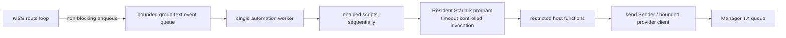

# Feature: Starlark Automations

**Status:** v1 implemented (storage, runtime, Local Management API, ECHO as an example script, tests, operator docs); the only open item is the post-v1 weather capability
**Scope:** Store operator-managed Starlark scripts in SQLite, manage them through an on-device Local Management API, and replace the native ECHO service with a Starlark script.

**API naming:** This plan uses **Local Management API** for the API available only on the KAM device. The later authenticated interface is called the **Remote API**. “Open API” can imply an unauthenticated/public API, while “OpenAPI” commonly refers to the API-description standard.

## Summary

KAM will support a small number of operator-managed Starlark scripts that react to decoded group-text events. Scripts are persisted in SQLite, compiled and validated into memory at load, and run outside the KISS route loop by a bounded automation worker. Each script record has a configurable timeout, defaulting to 500 ms. A script that exceeds its timeout is frozen and remains inactive until an operator explicitly recovers it. A script that fails compilation or validation is marked broken and is not run.

The first trigger is `group_text`. The first outbound capability is `reply(channel, text)`. The ECHO mention responder is an example Starlark script ([examples/echo.star](examples/echo.star)) that replaced the former native service. Weather lookups are a follow-on host capability, not arbitrary HTTP from Starlark.

YAML remains the source for node, radio, and channel configuration. SQLite becomes the source of truth for automation script definitions and their enabled state. Advert and group-text records remain in SQLite as they are today.

### Implemented Behavior

- Node startup creates the automation schema using a separate SQLite connection. If this setup fails, automation stays disabled while core radio ingestion continues.
- ECHO is an ordinary script. The native `internal/echo` service, `models.EchoConfig`, and the `legacy_echo_v1` migration were removed; databases that already ran the migration keep their `builtin.echo` row, and a leftover `echo:` block in `kam.yml` is ignored.
- A single worker processes a bounded 128-event queue in order. Enabled scripts run sequentially in stable script-ID order. Queue saturation is non-blocking and logged; shutdown cancels the active invocation and drops queued events with a log entry.
- Each invocation initializes fresh Starlark globals from its resident compiled program. Message dictionaries and path lists are frozen copies. The `reply` capability uses the existing sender and a best-effort 500 ms send timeout.
- The script routes listen on the unified local REST API (`monitor.listen`, default `127.0.0.1:8766`) without authentication ([FeatureUnifiedApi.md](FeatureUnifiedApi.md) merged them with the monitoring listener, retiring port 8765). The routes are `GET /scripts`, `GET /scripts/{id}`, `POST /scripts`, `POST /scripts/validate`, `PUT /scripts/{id}`, `POST /scripts/{id}/enable`, `POST /scripts/{id}/disable`, `POST /scripts/{id}/recover`, and `DELETE /scripts/{id}?revision=N`. Create/update/action requests carry an `expected_revision`; create uses zero. Create/update payloads wrap the script record in a `script` object. A missing `timeout_ms` defaults to 500, and unknown JSON fields are rejected. `enable` and `disable` change only the desired state: a `FROZEN` or `BROKEN` script stays inactive until `recover` (which recompiles the stored source and may set `timeout_ms`) or a source update. Name collisions and stale revisions return 409; unknown IDs return 404.
- Because the API has no authentication, it only serves loopback `Host` headers (DNS-rebinding guard) and requires `Content-Type: application/json` on `POST`/`PUT`, which browsers cannot send cross-site without a preflight that the API never answers.
- A timeout freezes the script in memory immediately; if persisting `FROZEN` fails the error is logged and the script stays frozen until restart.
- Host functions are registered in one table (`hostFunctions` in `internal/automation/runtime.go`); compilation only accepts those names as predeclared, and each call receives the invocation context so it shares the script deadline. Adding a capability such as weather means adding an entry there.
- Status changes (`BROKEN`, `FROZEN`) and API mutations (save, enable/disable, delete) are logged to the console, together with queue drops and script errors.

## Current State

- ECHO is the example script `docs/examples/echo.star`; `internal/node` wires only the Starlark runtime.
- `internal/kiss.Manager.SubscribeGroupText` is the consumer integration point. Its handler is called inline from dispatch and must enqueue quickly without blocking the route loop.
- `internal/kiss/send.Sender` enqueues outbound group-text frames on the manager TX queue.
- `internal/db.Persistence` owns the SQLite handle and the advert/group-text schemas. `internal/db.AutomationRepository` owns the automation schema on its own single connection.
- `kam.yml` has no ECHO settings; an old `echo:` block is ignored.

## Goals

- Store source, identity, enabled state, and revision of each automation in SQLite.
- Provide an on-device Local Management API to list, create, validate, enable, update, disable, recover, and delete scripts.
- Apply valid script changes without restarting the node.
- Keep script execution and host capabilities isolated from packet routing and direct hardware access.
- Preserve event order for each script and bound memory, execution time, and outbound effects.
- Replace the native ECHO behavior with a script that keeps its reply format and mention semantics.

## Non-Goals for the First Release

- General-purpose Go plugins or arbitrary Go evaluation.
- Arbitrary outbound HTTP, filesystem access, process execution, dynamic package loading, or goroutine creation from scripts.
- Persistent per-script mutable globals or a general key/value store.
- Multiple event types beyond group text.
- Parallel execution of a single script.
- Weather-provider integration in the first release; it is explicitly post-v1.
- Per-user script ownership, multi-tenant permissions, or ownership transfer. The initial deployment has a small operator population; the Local Management API has a single system-administrator model.
- The future Remote API. It is a separate project and must define authentication and authorization before exposure beyond the local device.
- Automatically hot-reloading radio, database path, node identity, or channel configuration through the automation API.

## Proposed Runtime Contract

### Script shape

Each script exports one entry point:

```python
def on_group_text(message):
    pass
```

A script is compiled and checked for this callable before it can be enabled. Scripts execute with a fresh Starlark thread per invocation; persistent state must not be hidden in module globals. Events are processed sequentially in the first release, so event ordering is deterministic and scripts need no internal locking.

Illustrative post-v1 weather script (not part of the first release; the host functions shown here are proposed, not implemented):

```python
def on_group_text(message):
    if message["channel"] != "#kam-test":
        return
    if "@kam_weather" not in message["body"]:
        return

    coords = gps_coordinates(message["body"])
    if coords == None:
        reply(message["channel"], "Include latitude and longitude.")
        return

    forecast = weather_forecast(coords["latitude"], coords["longitude"])
    if forecast == None:
        reply(message["channel"], "Forecast unavailable right now.")
        return

    reply(message["channel"], "Forecast: %s" % forecast["summary"])
```

### Event data

The initial event is a read-only Starlark struct or dictionary with stable, documented fields:

| Field | Type | Meaning |
|---|---|---|
| `channel` | string | Normalized channel name, such as `#public`. |
| `sender` | string | Parsed sender name. |
| `body` | string | Message body after sender-prefix parsing. |
| `timestamp_unix` | integer | Message timestamp in Unix seconds. |
| `hop_count` | integer | Number of relays from the received path. |
| `hop_stations` | list of strings | Hex-encoded path hashes. |
| `has_rx_meta` | bool | Whether modem RxMeta was received. |
| `snr_quarter_db` | integer | Signed SNR value in quarter-dB units; meaningful only when `has_rx_meta`. |
| `rssi_dbm` | integer | Signed RSSI in dBm; meaningful only when `has_rx_meta`. |
| `time_drift_seconds` | integer | Parsed message time drift, used by the example ECHO reply. |

The exposed values must be copied/immutable from the script's perspective. Do not expose Go pointers or mutable parser objects.

### Host capabilities

Host functions are explicit capabilities, not implicit language features:

- `reply(channel, text)`: enqueue a send through `send.Sender`. It must not write to the serial port directly; the existing packet builder enforces the radio frame format.
- `gps_coordinates(text)`: post-v1 helper to parse supported coordinate forms and validate latitude/longitude ranges. It performs no I/O.
- `weather_forecast(latitude, longitude)`: post-v1 capability. KAM selects a configured provider, enforces a strict request timeout and rate limit, validates coordinates, and returns a small normalized result. Scripts cannot choose arbitrary URLs or headers.

Host functions that perform I/O receive the invocation context and enforce their own deadlines. Starlark execution-step limits do not bound time spent inside Go host functions.

## SQLite Storage Design

Add an idempotently created `automation_scripts` table. Exact SQL can follow existing SQLite conventions; the proposed logical schema is:

```sql
CREATE TABLE IF NOT EXISTS automation_scripts (
  script_id TEXT PRIMARY KEY,
  name TEXT NOT NULL UNIQUE,
  source TEXT NOT NULL,
    enabled INTEGER NOT NULL DEFAULT 0 CHECK (enabled IN (0, 1)),
    timeout_ms INTEGER NOT NULL DEFAULT 500 CHECK (timeout_ms > 0),
    runtime_status TEXT NOT NULL DEFAULT 'READY'
        CHECK (runtime_status IN ('READY', 'BROKEN', 'FROZEN')),
    last_error TEXT,
  revision INTEGER NOT NULL DEFAULT 1,
  created_at INTEGER NOT NULL DEFAULT (unixepoch()),
  updated_at INTEGER NOT NULL DEFAULT (unixepoch())
);
```

Design notes:

- Use stable IDs (for example `builtin.echo`) so API renames do not change identity.
- `name` is a human-facing unique identifier; reject empty names and reserved IDs/names as appropriate.
- `source` stores UTF-8 Starlark source, not compiled bytecode. Compile on startup and on update; bytecode compatibility is not a persistence concern.
- `timeout_ms` is the per-script execution budget in milliseconds. It defaults to 500 and can be tuned by the system administrator through the Local Management API. The implementation may use interpreter instruction accounting internally to enforce this wall-clock timeout, but that is not a separate script setting.
- `runtime_status` is persisted as `READY`, `BROKEN`, or `FROZEN`, defaulting to `READY`. `enabled` is the operator's desired state; a script is runnable only when enabled and `runtime_status = 'READY'`.
- `last_error` stores the latest error detail associated with `BROKEN` or `FROZEN`. It is not an error history. Whenever a status transition sets `runtime_status = 'READY'`, clear `last_error` to `NULL` in the same SQLite transaction.
- `revision` increments on every source or enabled-state change and supports optimistic concurrency in the API.
- Do not persist run queues, compiled programs, mutable globals, or per-invocation logs in this table. Persist the latest `last_error` with `BROKEN`/`FROZEN`; also log failures to the console.
- Script reads and writes use a dedicated repository interface. Do not add script methods to `kiss.Persistence`; the router should not know about script storage.
- Use transactions for script update + revision increment. Require a positive timeout; 500 ms is the default and administrators may choose a different value without an application-imposed maximum.
- There are no product-level v1 caps on script count, source length, or per-script reply rate. Administrators accept responsibility for the timeout they configure. The event queue remains bounded as an internal safeguard for packet routing, not as a per-script policy limit.

There is no data-migration registry. The `app_migrations` table that once recorded `legacy_echo_v1` was removed with that migration; add one again when a future data migration needs a durable marker.

## Script Lifecycle and Execution

### Startup

1. Open SQLite and ensure the automation schema exists.
2. Load all script rows and their timeout/status into memory.
3. Compile and validate each script, including the required entry point and allowed host names. Compilation occurs on every process load; compiled programs are process-local and are not stored in SQLite.
4. Mark compile/validation failures `BROKEN`, persist the diagnostic in `last_error`, log it to the console, and leave the script inactive. A broken script must not prevent radio/node startup.
5. Preserve `BROKEN` and `FROZEN` across restart; a successful compile alone must not silently re-enable a failed script. Only enabled `READY` scripts are dispatched.
6. Start the automation worker and subscribe its non-blocking event-enqueue handler to `SubscribeGroupText`.

The API and database are the only writers of script definitions. The existing YAML file watcher remains responsible for channel configuration and must not overwrite automation rows.

### In-memory and storage behavior

- Load each script record from SQLite once during automation startup, then keep its compiled Starlark `Program`, timeout, and status in the in-memory runtime registry for the lifetime of the process (or until that script is updated, disabled, deleted, frozen, or marked broken).
- For each message, invoke the resident compiled program with fresh per-invocation Starlark execution state. Do not reload or recompile the source from SQLite for each event, and do not retain mutable Starlark globals between events.
- Normal event processing performs no reads or writes to the `automation_scripts` table. SQLite access occurs at startup, Local Management API mutations, and meaningful status transitions such as marking a script `BROKEN` or `FROZEN`; successful invocations do not write script state. Only the latest `BROKEN`/`FROZEN` error is persisted in `last_error`, not a history.
- An API mutation persists and compiles a candidate once, then replaces the in-memory program only after the DB transaction succeeds. A restart reloads and recompiles scripts from SQLite.

### Event path



- Use one bounded queue and one worker initially; events and scripts execute sequentially. This matches the expected low, infrequent trigger volume and preserves ordering.
- The route-loop callback must use a non-blocking enqueue. On saturation, drop the automation event and log to the console. Never block packet routing.
- The worker takes a stable snapshot of enabled `READY` programs for each event. A script update compiles first, then atomically replaces that script's active program.
- Apply the script's `timeout_ms` to every invocation. The default is 500 ms; the system administrator may tune it and accepts responsibility for long values. If execution exceeds its timeout, mark that script `FROZEN`, persist the status and error detail in `last_error`, log the error to the console, and do not dispatch future events to it until explicit operator recovery. Interpreter interruption/instruction accounting may be used internally to enforce this timeout, but there is no separate user-configurable execution-step limit.
- Ensure all host capabilities share the invocation deadline. A Go host function that ignores cancellation could defeat the timeout and stall the single worker; host functions must therefore be context-aware and tested for prompt cancellation.
- Log non-timeout runtime errors to the console and continue processing later scripts. Such an error does not change the script status or write to SQLite; only load-time compile/validation failures mark `BROKEN`, and timeout overruns mark `FROZEN`.
- Shutdown stops event intake, then drains or explicitly drops the bounded queue according to a documented shutdown policy, then joins the worker before stopping the manager. Do not let scripts enqueue after the KISS write loop exits.

### API update semantics

For create/update/enable/recover:

1. Accept the request only through the on-device Local Management API. This initial API uses a single system-administrator model; it has no per-user script ownership or multi-tenant ACLs. Bind it to loopback HTTP only.
2. Validate ID/name uniqueness, positive timeout, and expected revision.
3. Compile candidate source in memory and verify its required entry point and allowed built-ins.
4. Persist source, enabled state, timeout, status, last_error, and revision in a SQLite transaction.
5. After commit, atomically publish the compiled program. If commit fails, keep the current active program unchanged.
6. Return revision and validation/activation status.

For disable/delete, update persistent state first, then atomically remove the program from the active snapshot. `builtin.echo` is not protected: the system administrator may edit or delete it like any other script. Nothing recreates a deleted ECHO script on later startups. `recover` clears `FROZEN` or `BROKEN` only after the source compiles and validates; it may also update the timeout. A successful recovery or source update sets status to `READY` and clears `last_error` in the same transaction; a newly detected compile/validation failure sets `BROKEN` and records its error. Use optimistic concurrency (for example `If-Match` revision) to prevent lost updates.

## Security and Execution Policy

- Choose the Go Starlark implementation (`go.starlark.net/starlark`) and pin a reviewed module version.
- Scripts receive only predeclared functions and immutable message values. Do not expose `os`, filesystem, sockets, arbitrary URL fetch, shell, Go reflection, database handles, or KISS manager internals.
- Expose script management through loopback HTTP only; do not bind it to LAN interfaces. The first release has one system-administrator trust model, not per-user identities, ownership, or ACLs.
- Do not add product-level caps on script count, source length, reply rate, or administrator-configured timeout in v1. The configured per-script timeout is the execution budget. The bounded event queue is retained only to keep packet routing non-blocking.
- Log compile failures, runtime errors, timeouts, and queue drops to the console. Persist the latest `last_error` with `BROKEN`/`FROZEN`, clear it on `READY`, and do not add an error-history table or per-invocation database writes.
- Weather/provider security controls (TLS, provider allowlisting, response-size limits, caching, and request rate limits) are post-v1 and belong to the provider adapter, not the first-release script runtime.
- Store provider credentials outside script source, preferably environment/secret configuration; never return them to scripts or API reads.
- Treat incoming message text and parsed coordinates as untrusted. Validate coordinate ranges and escape/limit generated replies.

## ECHO as a Script

The former native ECHO service is gone. Its behavior lives in the example script [examples/echo.star](examples/echo.star); an operator edits its three settings (`CHANNELS`, `MENTION`, `NODE_NAME`) and installs it through the Local Management API (see the README).

### Behavior

- Match only the configured channels.
- Ignore messages sent by the local node.
- Match the mention only when the next character is not a word character (`[A-Za-z0-9_]`), judged at the first occurrence of the mention in the body.
- Reply with the sender (or `someone`), hop count, SNR/RSSI when RxMeta is present, and time drift, through `reply` with its 500 ms best-effort send budget.

`TestEchoExampleScript` pins these replies, including the cases carried over from the native service's tests.

### Retirement of the native implementation

- Removed: `internal/echo`, `models.EchoConfig` and the `echo:` section of `kam.yml`, and the one-time `legacy_echo_v1` migration with its `app_migrations` table. The migration window was closed explicitly, so nothing reads legacy `echo:` YAML any more: a leftover block is ignored, and a fresh install has no ECHO until the example is installed.
- Databases that already ran the migration keep their `builtin.echo` row. It is an ordinary script: editable, deletable, and never recreated.
- Downgrade: an older binary still reads YAML `echo.enabled`. Restore the `echo:` block only if you intend to run that native service, and disable `builtin.echo` first to avoid duplicate replies.

## Implementation Plan

### Phase 0: Interface and compatibility decisions

- [x] Implement the Local Management API over loopback HTTP only; do not listen on LAN interfaces.
- [x] Confirm stable script ID/name rules, the explicit recover operation, and the downgrade policy. `builtin.echo` is editable and deletable.
- [x] Choose the Starlark module version and verify interpreter interruption, thread/cancellation semantics, and license.
- [x] Fix and document the first-release message fields, handler signature, host built-ins, queue/drop/shutdown policy, and persisted status transitions.
- [x] Require a positive per-script timeout, default it to 500 ms, and allow the system administrator to tune it without an application-imposed maximum. Verify the runtime can enforce the configured timeout.
- [x] Keep weather-provider integration out of the first release; implement the generic restricted host-capability interface so weather can be added later.

### Phase 1: SQLite repository and migration

- [x] Add `EnsureAutomationScriptsSchema` in `internal/db` (the migration-marker table was added for the ECHO conversion and removed with it).
- [x] Implement an automation repository with list/get/insert/update/disable/delete operations and revision checks.
- [x] Make script writes transactional and validate enabled state, uniqueness, positive timeout, and revision behavior.
- [x] Implement `legacy_echo_v1` conversion as a one-transaction, idempotent data migration (since removed; see Phase 4).
- [x] Test fresh and legacy-shaped databases, status and `last_error` persistence, revision and uniqueness rules, and concurrent writers (`internal/db/automation_test.go`). The migration-specific cases (retry, preservation, repeated runs) were retired with the migration.

### Phase 2: Starlark runtime and capability host

- [x] Add and pin `go.starlark.net`; implement a private automation package with small interfaces for repository and sender.
- [x] Implement source compilation on load and update, required handler validation, predeclared capability registration, timeout enforcement, and typed message conversion.
- [x] Implement the bounded queue and single sequential worker; ensure handler enqueue is non-blocking and metrics/drop behavior is testable.
- [x] Add packet-format validation through the existing sender, context-aware send, per-script error isolation, console error logging, and the READY/BROKEN/FROZEN transitions.
- [x] On timeout, stop future dispatch to the script, persist `FROZEN`, and expose a local-admin recovery action; ensure persistence failures are observable.
- [x] Test valid/invalid code, missing handler, BROKEN with last_error on load, forbidden globals, timeout interruption/freezing with last_error, recovery to READY clearing last_error, host errors/timeouts, ordering, queue saturation, update activation, and shutdown.

### Phase 3: API and live script management

- [x] Add Local Management API endpoints for list/get/create/validate/update/enable/disable/recover/delete.
- [x] Keep the API local-only by default and use the single system-administrator model; do not add per-user ownership or ACL columns.
- [x] Require revisions for updates and return compile diagnostics without activating invalid source.
- [x] Persist source, timeout, status, last_error, and revision first, then atomically update the active runtime snapshot.
- [x] Expose enabled/revision/timeout/status and latest error detail for BROKEN/FROZEN scripts; ensure entering READY clears last_error and no error history is stored.
- [x] Test local transport binding, optimistic concurrency conflicts, transaction errors, status transitions, and live updates while events are arriving.

### Phase 4: ECHO parity and cutover

- [x] Port mention matching, self-message filtering, channel selection, reply format, and timeout semantics to the built-in Starlark ECHO script/host.
- [x] Run parity cases against the existing `internal/echo` implementation, including mention suffix boundaries, missing sender, RxMeta absent/present, and queue full. The cases now live in `TestEchoExampleScript`; queue-full behavior is covered by `TestHandleNeverBlocksWhenQueueIsFull`.
- [x] Add migration integration tests proving legacy ECHO becomes exactly one active DB script and is not overwritten on later starts (retired with the migration).
- [x] Switch node wiring to the automation runtime; ensure native ECHO is never active alongside a script ECHO.
- [x] Remove `EchoConfig` only after the compatibility/migration window is explicitly closed; update `kam.yml` examples and docs. The window was closed explicitly; `kam.yml`, the README, and the design docs no longer mention ECHO settings.
- [x] Remove `internal/echo` after the new runtime passes full and race tests.

### Phase 5: Weather capability (post-v1, explicitly out of first release)

- [ ] Select a weather provider, licensing/attribution requirements, credential source, and supported forecast fields.
- [ ] Implement a Go provider adapter with coordinate validation, TLS, strict deadlines, response-size limits, caching, and provider-level rate limits.
- [ ] Expose only normalized forecast fields to Starlark; never expose arbitrary URLs or raw credentials.
- [ ] Add tests with a fake provider for successful forecast, provider timeout/error, malformed response, caching, and rate limiting.
- [ ] Add an example `@kam_weather` Starlark script and document its expected coordinate syntax and response size.

### Phase 6: Operational hardening and documentation

- [x] Log queue drops, script runtime errors, timeouts, and status changes to the console; defer metrics and persistent error history.
- [x] Verify shutdown behavior under a full queue and a script blocked in a bounded host call.
- [x] Run `go test ./...`, `go test -race ./...`, `go vet ./...`, and migration tests against copies of real legacy databases (`TestMigrateRealKamDbOnce` skips when no `kam.db` is at the repo root; legacy-shaped databases are covered by `internal/db/automation_test.go`).
- [x] Update `README.md`, `docs/APP_STRUCTURE.md`, and `docs/SYSTEM_DESIGN.md` to distinguish implemented behavior from planned automation/API behavior.
- [x] Document backup/restore expectations: SQLite backups now contain user script source and must be included in operational backups.

## Acceptance Criteria

- A script can be created, validated, enabled, updated, disabled, recovered, and deleted through the on-device Local Management API without restarting KAM.
- Script definitions survive process restart and SQLite backup/restore.
- Every script is loaded into memory and compiled/validated on startup. Invalid scripts are marked `BROKEN`, remain inactive, and do not prevent radio ingestion.
- Each script stores a timeout defaulting to 500 ms. Exceeding it marks the script `FROZEN` and persists `last_error`; later invocations stop until operator recovery. Switching status to `READY` clears `last_error` in the same transaction.
- Invalid source never replaces the last known-good active program; successful explicit recovery is required after BROKEN or FROZEN.
- Inbound route processing is never blocked by script execution, host operations, or outbound sends.
- The configured per-script timeout is enforced and causes `FROZEN`; the internal bounded event queue prevents route-loop blocking and queue drops are logged.
- No product-level v1 caps are imposed on script count, source length, reply rate, or administrator-configured timeout.
- ECHO runs only as a script (`docs/examples/echo.star`); no native ECHO implementation exists, and restarts never overwrite script edits made through the API.
- The example ECHO script's replies are pinned by tests.
- Scripts cannot access arbitrary filesystem, network, process, database, or radio operations.

## Settled v1 Decisions

- Local Management API uses loopback HTTP only.
- The per-script timeout is the only operator-configurable execution limit. It defaults to 500 ms, must be positive, and has no application-imposed maximum; the system administrator accepts responsibility for tuning it.
- There are no product-level v1 caps on script count, source length, or reply rate. The event queue remains internally bounded to protect packet routing.
- Default `runtime_status` to `READY`. Persist current status and `last_error` for `BROKEN`/`FROZEN`; clear `last_error` when status changes to `READY`. Also log errors to the console; do not persist error history.
- If automation schema setup fails, continue core radio ingestion/persistence with automation disabled.
- Weather is post-v1. The Remote API and its authentication/authorization model must be designed separately before remote exposure.
