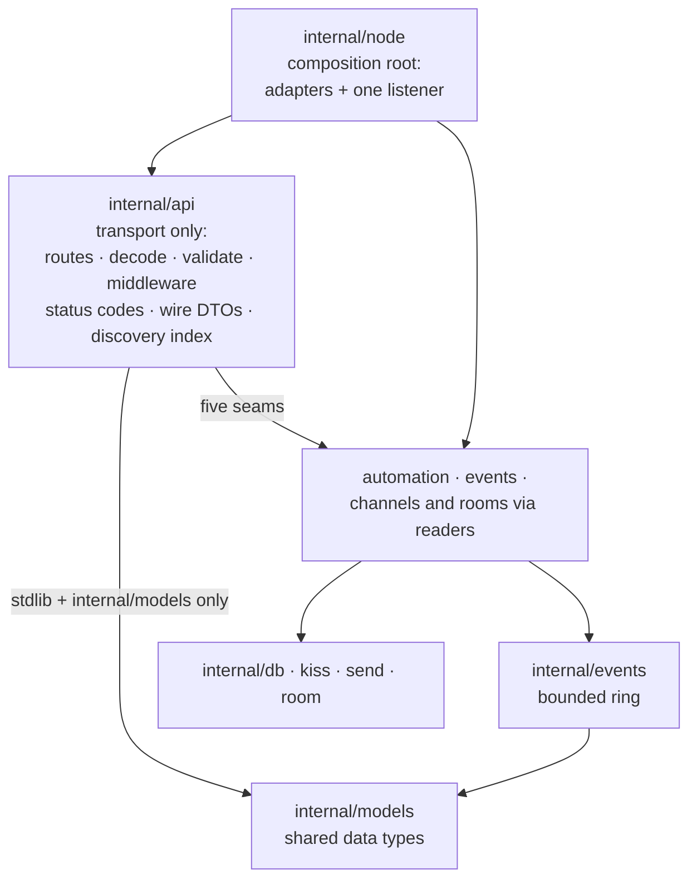

# Feature: Unified local REST API

**Status:** Implemented (phases 1-3: the ring extraction, the transport-only `internal/api`, and the one-listener cutover with scripts); this change also aligns the operator docs (UA-D-*). The two-listener behaviour this plan was written against is gone; the live service is described in [APIdetails.md](APIdetails.md). The §11 verification drills remain to be run.
**Scope:** KAM's REST surface on the local device: one loopback listener that serves script management *and* the monitoring resources (status, events, channels, rooms), built as a transport-only API package that hands every operation to the capability that already owns the data. Includes the documentation alignment that must ship in the same change.
**Written from:** Reading the KAM code and docs on 2026-10-23. No MeshCore sources are involved; every claim below is about KAM's own code and is tied to a named file or test.

## 1. Summary

*(Historical section, describes the pre-cutover state.)* KAM served two REST APIs when this plan was written:

| API | Code | Address | What it serves |
|---|---|---|---|
| Local Management (script) API | `internal/automation/api.go` (pre-cutover path; dissolved, see §4.4) | `127.0.0.1:8765` (fixed constant) | `/scripts` CRUD, `validate`, `enable`/`disable`/`recover` |
| Monitor API | `internal/monitor/api.go` (pre-cutover path; the package was dissolved, see §4.4) | `127.0.0.1:8766` (`monitor.listen`) | `/v1/status`, `/v1/events`, `/v1/channels*`, `/v1/rooms*` |

They are two `http.Server`s with two goroutine rows in [SYSTEM_DESIGN.md §2](SYSTEM_DESIGN.md) (7a and 7d), two shutdown paths in [Node.Run](../internal/node/node.go), two `GET /` indexes, two loopback guards with different `403` texts, and two `writeJSON` helpers. The split was decided in [FeatureKamApi.md](FeatureKamApi.md) D4; the cost of keeping it is now visible in that code.

**Governing rule of this feature** (from the design discussion of 2026-10-23): the API handler handles requests and hands the processing to internal capabilities. The handler has a very strict responsibility and implements no KAM capability itself. It decides nothing about KAM's behaviour; it parses, validates shape, applies transport policy, and translates between HTTP and capability calls.

Concretely, the feature:

1. Merges both surfaces onto **one listener** (the monitor's, default `127.0.0.1:8766`; port 8765 stops listening).
2. Creates one **transport-only package** `internal/api` that owns routes, middleware, wire shapes, error-to-status translation and the single discovery index.
3. Extracts the **event ring** into `internal/events`, because the handler must not own KAM state (`§4.4`).
4. Defines **capability seams** (interfaces or plain funcs, defined by the API package, implemented by adapters in [internal/node](../internal/node/node.go)), so the handler depends on nothing concrete.
5. Updates **every piece of documentation that describes the API surface** in the same change (`§6`, UA-D-*).

Plain words for terms used below:

- **Capability** — the part of KAM that owns something real: the script runtime, SQLite persistence, the event ring, the room worker, the radio.
- **Transport** — the HTTP layer: routing, decoding, status codes, JSON. It owns the shape of responses, not the meaning.
- **Seam** — the narrow interface (or function) through which the handler calls a capability. Defined next to the handler; implemented by the composition root.
- **Composition root** — `internal/node`. It builds the capabilities, writes the adapters that satisfy the seams, and hands the finished handler to one listener.
- **Guard test** — a plain Go test that fails the build when a package violates its dependency rule.

## 2. Goals and non-goals

**Goals**

- GL-1. One loopback listener serves the whole REST surface; one port, one config block, one shutdown path, one goroutine row.
- GL-2. `internal/api` implements no KAM capability and imports nothing KAM-specific except `internal/models` (shared data types). The rule is checkable by a guard test (§4.1, UA-T-2).
- GL-3. Every operation the handler performs goes through a seam; every write reaches the part of KAM that already owns that data, carrying [FeatureKamApi.md GL-3](FeatureKamApi.md) forward unchanged.
- GL-4. A capability that is off shows the same pattern everywhere: script routes answer `503 {"error":"automation is disabled"}` exactly as room routes answer `503 {"error":"rooms are disabled"}` today.
- GL-5. The event ring keeps its short-lock copying and no-HTTP-under-the-lock guarantee; the radio and room paths keep recording through `models.MonitorSink` unchanged.
- GL-6. No response ever contains a channel key or room password (both APIs' existing rule, kept).
- GL-7. After the last phase, no document in the repo still describes a two-listener API; the reference documentation matches the running code.
- GL-8. Handler tests need no SQLite, no Starlark and no serial port.

**Non-goals**

- New endpoints. Room-client removal and script dry runs/run info remain planned ([FeatureKamApi.md §7 and §10](FeatureKamApi.md)); the modem snapshot/apply routes that §7 lists landed directly on this unified listener when their phase shipped. This feature moved wiring, not features.
- Authentication, TLS, CORS, WebSockets, or any change to the loopback-only posture (FeatureKamApi D12, kept).
- A new configuration schema. `monitor.enabled`, `monitor.listen` and `monitor.event_ring` keep working exactly as today (§4.5, D2).
- Any change to existing response shapes. Script JSON and monitor JSON stay byte-identical apart from the unifications §4.5 states once (rows 5, 6 and 8); no resource gains or loses a field.
- Changes to automation behaviour itself: compilation, revisions, FROZEN/BROKEN handling, timeouts and Starlark scoping stay as implemented ([FeatureStarlark.md](FeatureStarlark.md)).
- Anything reachable from Starlark scripts.
- KAMmon-side changes. KAMmon is a separate project; the `script_api` index field it may read is handled in §9 R2.

## 3. Sources and method

Sources are KAM's own code and docs; this feature has no external protocol surface. Method: every claim names the file it comes from, existing behaviour is tied to an existing test where one exists, and each phase below ends with `go test ./...` green. Where a doc and the code disagree, the code wins and the difference lands in §7.

| Key | File | Used for |
|---|---|---|
| `API-A` | `internal/automation/api.go` (pre-cutover path; its API files were deleted in the cutover) | Script routes, guards, listener, evidence of concrete coupling (`NewAPI(runtime *Runtime)`, `db` imports, client-side defaults) |
| `API-A-T` | [internal/automation/runtime_test.go](../internal/automation/runtime_test.go) | Current script-API test style: real runtime + real SQLite (`openTestRepository`) |
| `API-M` | `internal/monitor/api.go` (pre-cutover; dissolved into `internal/api`, see §4.4) | Monitor routes, ring, middlewares, index, `ChannelReader`/`RoomReader` seams |
| `API-M-T` | `internal/monitor/api_test.go` (pre-cutover; split into `internal/api` and `internal/events` tests) | Fake-reader test precedent (`testChannelReader`, `testRoomReader`); ring lock test (`TestSlowReaderDoesNotHoldRingLock`); concurrency limit test |
| `NODE` | [internal/node/node.go](../internal/node/node.go), [internal/node/monitor.go](../internal/node/monitor.go) | Composition root today: startup flags, shutdown order, `monitorChannels`/`monitorRooms` adapters, status closure |
| `MODELS` | [internal/models/monitor.go](../internal/models/monitor.go) | `MonitorConfig` (defaults, validation), `MonitorSink { Record(MonitorEvent) }`, `MonitorEvent` wire shape |
| `AGENTS` | [AGENTS.md](../AGENTS.md) | Philosophy, and the rule that API docs and the `endpoints` slices must change together |
| `APS` | [docs/APP_STRUCTURE.md](APP_STRUCTURE.md) | Package responsibilities, the `MonitorSink` separation sentence, the automation row that teaches the wrong home |
| `SD` | [docs/SYSTEM_DESIGN.md](SYSTEM_DESIGN.md) | Goroutine inventory rows 7a/7d (§2), shutdown ordering (§6) |
| `PAI` | [docs/APIdetails.md](APIdetails.md) | The API reference that becomes the single-API reference |
| `RDM` | [README.md](../README.md) | Operator-facing API sections with 8765/8766 examples |
| `FMA` | [docs/FeatureKamApi.md](FeatureKamApi.md) | D4 (two listeners), D12 (default on), D11/D13 (envelopes), planned endpoints |
| `FST` | [docs/FeatureStarlark.md](FeatureStarlark.md) | The script API's described address and rules |
| `FKM` | [docs/FeatureKissModem.md](FeatureKissModem.md) | §7.1 D8: the "shared mux" note this feature resolves |

## 4. Design

### 4.1 The governing rule, made observable

The rule "the handler has a very strict responsibility and implements no KAM capability" is only real if it is checkable. Three mechanisms make it so:

1. **A dependency rule written down:** `internal/api` may import the Go standard library and `internal/models` (shared data types) — nothing else from this repository. Capability packages (`kiss`, `room`, `automation`, `db`, `events`) never import `internal/api`. `AGENTS.md` and [APP_STRUCTURE.md](APP_STRUCTURE.md) state the rule (UA-D-3).
2. **A guard test:** [internal/api](../internal/api) carries a test that walks the package's `.go` files with `go/parser` and fails on any import under `kam.bytecoder.nl/internal/` that is not `models` (UA-V-1). Stdlib-only, no new dependency (`AGENTS` philosophy: no new dependency unless it clearly pays off).
3. **A review question recorded once:** does this line make a decision, or translate one? Decisions belong to capabilities; translation belongs to the handler. §5.3 lists what moved for this feature.

### 4.2 What stays in the handler, what a capability owns

| Handler (`internal/api`) keeps | Capability keeps |
|---|---|
| Route table and the single `GET /` discovery index | Starlark compilation, FROZEN/BROKEN state, recovery |
| Loopback Host guard, JSON Content-Type check for POST/PUT | Revision compare-and-set and name-uniqueness rules |
| Body decode with unknown-field rejection, paging limit clamps | `timeout_ms` defaulting (moved here from the handler; D7) |
| Transport policy: ≤ 8 concurrent requests, 5 s deadline, panic recovery | SQLite persistence and writer queues |
| Error → status-code translation (`404`/`409`/`422` from the seam's `ScriptError` classes, written by node's adapter from `automation.ErrScriptNotFound`, `ErrScriptConflict` (see D8)) | Domain error definitions (`ErrScriptNotFound`, `ErrScriptConflict`, …; D8) |
| Wire shapes (JSON structs and tags) for every response | What the resource *is*: scripts, channels, rooms, events, counters |
| The two endpoint contracts that are genuinely HTTP's: a `POST /scripts` create carries revision `0`, and `validate` changes nothing | Everything the response *means* |

The line, applied to today's code: the handler defaulting `timeout_ms` to 500 ([API-A] L69-71, L86-88) is capability policy and moves down; a create carrying `expected_revision: 0` is the endpoint's documented contract (`PAI`) and stays.

### 4.3 The five seams

| Seam | Shape | Implementation | Wired in |
|---|---|---|---|
| Scripts | `api.Scripts` interface: `List`, `Get`, `Save`, `Delete`, `SetEnabled`, `Recover`, `Validate` | Adapter in `internal/node` over `automation.Runtime` (maps `db.AutomationScript` ↔ `api.Script`; D6) | `node.startMonitor` |
| Status | `func() api.Status` (plain function, as today) | Existing status closure in `node.startMonitor` ([NODE]) | `node.startMonitor` |
| Events | `api.EventsSource`: `Page` returns the wire shape (`EventsResponse`), `Stats` the ring snapshot | The `internal/events` ring behind a small field-copy adapter in `internal/node` (D5) | `node.startMonitor` |
| Channels | `api.ChannelReader` (exists as `monitor.ChannelReader`, moved unchanged) | Existing `monitorChannels` adapter in [NODE] | `node.startMonitor` |
| Rooms | `api.RoomReader` (exists as `monitor.RoomReader`, moved unchanged) | Existing `monitorRooms` adapter in [NODE] | `node.startMonitor` |

The ring's seam exists for the dependency rule, not for polymorphism (D5): it has no alternative implementation worth one, the monitor tests exercise the real ring through the same adapter shape node uses, and [FeatureKamApi.md API-EV-10](FeatureKamApi.md) concerns its locking, not its interface. The plan first handed the concrete `*events.Ring` to the handler, but that parameter forces an `internal/events` import into `internal/api` — the guard test (UA-T-1/D10) failed on its first run and the seam won by the exact mechanism this feature built to enforce its own rule. The same logic settled how script errors cross the seam (D8's refinement): the handler can never apply `errors.Is` against `automation.ErrScriptNotFound` without importing `automation`, so the `Scripts` errors are classified at the seam — node's adapter wraps the capability's sentinels into `*api.ScriptError` (class + the capability's own message), and the handler maps class → status. `MonitorStats` stays on the runtime rather than the seam: the status snapshot is composition-root code, which may name the capability it composes.

Scripts were the original motivator for seams: the automation runtime is the first of several possible script engines, and its current concrete coupling is exactly the drift §5.2 describes.

Today's `API-M` reaches into ring internals (`len(ring.events)` for the capacity in `/v1/status`). After extraction that becomes `ring.Stats()` — same value, no cross-package field access.

### 4.4 Package moves

- `internal/monitor` **dissolves**. Routes, DTOs, middleware, error mapping and the index move to `internal/api`; its `api_test.go` split along the same seam; the ring moves to `internal/events` with its lock behaviour and tests untouched.
- `internal/events` (new, tiny) holds the bounded ring. It imports only `models`. `kiss.Manager` and `room.Service` keep recording `models.MonitorEvent` through the existing `models.MonitorSink` interface — the radio path gains no dependency on any HTTP package (GL-5).
- `internal/automation` keeps the runtime and loses HTTP: `NewAPI`, `ServeLocalAPI`, `ListenLocalAPI`, `listenLoopback`, `LocalAPIAddress` and `requireLocalJSON` leave the package; in their place come the domain sentinels and default application (D7, D8). The loopback/JSON guards move to `internal/api` as the single implementation (D11).
- `internal/node` stays the composition root: it keeps the channel/room adapters, gains the script adapter, and holds the one `http.Server`.
- `internal/models` does not change (D5 rationale: `MonitorEvent` with its JSON tags already lives there and is shared by the recording path).

Final shape:

### 4.5 The merged listener and its behaviour changes

One `http.Server` on `monitor.listen` (default `127.0.0.1:8766`), built where `monitor.Listen` is built today, with the same server timeouts. The behaviour changes below are stated once, here, and then in the docs (UA-D-*); they are not repeated as warnings elsewhere.

| # | Change | Reason (recorded in §8) |
|---|---|---|
| 1 | Port 8765 stops listening; scripts move to the monitor's address. Paths stay `/scripts`, `/scripts/{id}`, … — clients change the port only. | D1, D4 |
| 2 | `monitor.enabled: false` now disables script management too (today it stays up on 8765). | D3 |
| 3 | When automation failed to start, script routes answer `503 {"error":"automation is disabled"}` instead of the port being closed. | D9 (rooms' existing pattern) |
| 4 | The 8-slot limit, 5 s deadline and panic recovery now also apply to script endpoints. | D11 |
| 5 | The loopback guard, JSON Content-Type check and unknown-field rejection become rules of the whole listener; the `403`/`415` message texts unify on one wording each. | D11 |
| 6 | `GET /` returns one combined endpoint list; the `script_api` pointer field is dropped. | D12 |
| 7 | Shutdown ordering simplifies to one HTTP shutdown; [SYSTEM_DESIGN.md §6](SYSTEM_DESIGN.md) wording changes accordingly. | follows from D1 |
| 8 | One response writer for the whole listener: script endpoint bodies drop the trailing newline the old writer appended, gain `Cache-Control: no-store`, and are capped at 8 MB like every other response. | D11 (one middleware stack, one writer) |

## 5. Assessment: do the design principles promote this separation of concerns?

This section answers the question this plan was written against: are the separation rules maintained throughout, or only where convenient?

### 5.1 What already promotes the separation

- [APP_STRUCTURE.md](APP_STRUCTURE.md) states, for the monitor: "A small `models.MonitorSink` interface separates transport from HTTP handling" and "No monitor handler opens the modem or accesses worker-owned room maps directly" ([APS] Lifecycle and Data Ownership).
- [FeatureKamApi.md](FeatureKamApi.md) made the owner rules goals: GL-3 ("Every write goes through the part of KAM that already owns that data") and GL-7 ("The API describes KAM's own things … No field exists only to suit one client").
- The consumer-side interface pattern is proven in-repo: `ChannelReader`/`RoomReader` defined by the handler package, implemented by adapters in `node`, tested with fakes ([API-M-T]).
- [AGENTS.md](../AGENTS.md) forces documentation and code to move together; `models` exists precisely as the shared, dependency-free data-type layer.
- [FeatureKissModem.md §7.1 D8](FeatureKissModem.md) already knew what was missing and said so: "A later `GET /radio/status` on the Local Management API needs a shared mux so it does not depend on the automation runtime."

### 5.2 Where the principles failed to hold the line

Honest findings from reading the code, not opinions:

1. **The script API drifted, and nothing caught it.** `NewAPI(runtime *Runtime)` takes the concrete runtime, imports `db` for its sentinels and row type, and applies capability policy in the handler (timeout defaulting). No test, rule or review gate failed when this landed; the boundary was crossed by accretion.
2. **The documentation teaches the wrong home.** [APP_STRUCTURE.md](APP_STRUCTURE.md) still lists "serves the loopback Local Management API" as an `internal/automation` responsibility ([APS]). A rule that says "the handler is transport" cannot be promoted by the same docs that assign an API to a runtime package. Corrected in UA-D-3.
3. **Enforcement was goodwill.** The separation holds in `monitor` because it was designed with interfaces from day one, not because anything prevents the next handler from taking a concrete dependency. Absent a mechanism, the next feature drifts the same way automation did.
4. **Two-of-everything hid the cost.** Two indexes, two guards, two `writeJSON` helpers, two goroutine rows and two shutdown paths made the split feel cheap piecemeal; no single piece was broken enough to force convergence. The tax now visible: clients need two base URLs (recorded verbatim in FeatureKamApi's D4 note).
5. **One handler isn't even its package's only responsibility.** `internal/monitor` mixes transport with a stateful capability (the ring). The principle "the handler implements no capability" contradicts the package's actual content — which is why §4.4 extracts the ring rather than renaming the package.

**Verdict:** the principles promote the separation *where they are written and enforced* (`monitor`), and fail to promote it where they are neither (`automation`). Written intent alone does not survive accretion; checkability is the missing ingredient, not more philosophy.

### 5.3 What this feature adds so the separation is promoted throughout

1. The dependency rule becomes **explicit and finite** (§4.1): which imports the transport package may have, stated in `AGENTS.md` and `APP_STRUCTURE.md` — not inferred from where files happen to sit.
2. **The guard test** turns the rule into a failing build instead of a review note (UA-V-1). It is ~40 lines of stdlib `go/parser`; the philosophy test for adding it is that it clearly pays off: it is the only mechanism that would have caught finding 5.2.1.
3. **One index, one reference.** The `endpoints` slice rule in `AGENTS.md` currently names two files ([AGENTS]); after the merge it names one, which removes the possibility of the two lists disagreeing.
4. **Policy has an address.** Capability policy (defaults, CAS, sentinels) lives in the capability package; transport policy stays in `api` (§4.2). Future endpoints inherit this by construction: a new route is a seam plus a handler, never a new capability in the handler.
5. **Tests encode the boundary.** Handler tests with fakes (`§4.3` precedent) make "the handler needs no KAM" the cheapest way to write its tests, so convenience keeps pointing at the right layer.

### 5.4 Honest limits

The guard test checks imports, not semantics; a capability could still leak decision-making through a too-wide interface signature, and no automated check catches that. Reviews remain the backstop for that class; this plan records the limitation once, here, rather than pretending full enforcement. The ring's `EventsSource` seam (D5) is the inverse case: an interface with a single implementation, kept because the dependency rule requires it — not because polymorphism does.

## 6. Requirements

| ID | Requirement | Level |
|---|---|---|
| **Listener** | | |
| UA-L-1 | One loopback listener serves the script and monitoring surfaces; port 8765 no longer opens. | MUST |
| UA-L-2 | `monitor.enabled`, `monitor.listen`, `monitor.event_ring` keep their meaning and defaults; `enabled: false` removes the whole listener. | MUST |
| UA-L-3 | The listener binds loopback only and refuses a non-loopback bind (existing `listenLoopback` behaviour, moved). | MUST |
| UA-L-4 | One shutdown path; `Node.Run` stops the single server with the existing 5 s grace. | MUST |
| **Transport** | | |
| UA-T-1 | `internal/api` imports only the standard library and `internal/models`; no capability package imports `internal/api`. | MUST |
| UA-T-2 | The import rule is enforced by a guard test that runs in `go test ./...`. | MUST |
| UA-T-3 | Loopback Host guard, JSON Content-Type on POST/PUT, unknown-field rejection, 8-slot limit, 5 s deadline and panic recovery wrap the whole surface. | MUST |
| UA-T-4 | Error mapping consumes the seam's own error classes — for scripts, `ScriptError` classes written by node's adapter from capability sentinels; transport never names `db.*` or `automation.*` sentinels directly. | MUST |
| UA-T-5 | `GET /` serves the single combined index (`api`, `api_version`, `endpoints`, `docs`); no `script_api` field. Endpoints of a disabled capability stay listed and answer `503`. | MUST |
| UA-T-6 | No response contains a channel key or room password. | MUST |
| **Capabilities** | | |
| UA-C-1 | Scripts are served through the `api.Scripts` seam; the handler holds no `*automation.Runtime`, no `db` types. | MUST |
| UA-C-2 | `timeout_ms` defaulting (and equivalent `validate` defaulting) is applied by `automation`, not by the handler. | MUST |
| UA-C-3 | `automation` exports its domain sentinels (not-found, conflict, name-taken; every unclassified failure is invalid) and the handler maps the seam's `ScriptError` classes to `404`/`409`/`422`. | MUST |
| UA-C-4 | The ring lives in `internal/events`, imports only `models`, keeps the short-lock copy/page behaviour and its tests, and exposes `Page`/`Stats`; `kiss` and `room` record through `models.MonitorSink` unchanged. | MUST |
| UA-C-5 | The status seam stays a plain function; channel/room reader seams move unchanged. | MUST |
| **Behaviour** | | |
| UA-B-1 | Script JSON responses are byte-identical to today's (`PAI` script object) modulo the one-writer consequences of §4.5 row 8; monitor responses are byte-identical; index changes are limited to §4.5 row 6. | MUST |
| UA-B-2 | When automation is off, script routes answer `503 {"error":"automation is disabled"}`. | MUST |
| UA-B-3 | Empty lists are arrays, never `null`, on every route (FeatureKamApi D13). | MUST |
| **Documentation (ships in the same change, GL-7)** | | |
| UA-D-1 | [APIdetails.md](APIdetails.md) describes one listener: intro, quick-check curls, script and monitor sections merged under the new address, index example without `script_api`. | MUST |
| UA-D-2 | [README.md](../README.md) merges the "Backend Monitoring API" and "Local Management API" sections; every 8765 example updated. | MUST |
| UA-D-3 | [APP_STRUCTURE.md](APP_STRUCTURE.md): package graph and responsibility rows replaced (`internal/api` transport-only, `internal/events` ring, automation without HTTP); the `MonitorSink`/ownership sentences updated to name the unified listener. | MUST |
| UA-D-4 | [SYSTEM_DESIGN.md](SYSTEM_DESIGN.md): goroutine rows 7a and 7d become one row; shutdown ordering (§6) shows one HTTP shutdown; module map rows follow. | MUST |
| UA-D-5 | [AGENTS.md](../AGENTS.md): the endpoints-slices rule names the single `endpoints` slice in `internal/api`; the §4.1 dependency rule is added to the project docs. | MUST |
| UA-D-6 | Corrections recorded: [FeatureKamApi.md](FeatureKamApi.md) D4 superseded, [FeatureStarlark.md](FeatureStarlark.md) address updated, [FeatureKissModem.md](FeatureKissModem.md) D8 shared-mux note marked resolved (§7). | MUST |
| UA-D-7 | Docs match the live service: the index response, the reference doc and the README use the same route list. | SHOULD |

## 7. Corrections to existing text

All rows are updated in the same change as the code (UA-D-*); the table states what changes.

| Where | Statement today | What this feature changes |
|---|---|---|
| [APIdetails.md](APIdetails.md) intro | "KAM serves two small REST APIs" with an address table | One listener at `monitor.listen` (default 8766) serving both surfaces; quick-check curls use one address |
| [APIdetails.md](APIdetails.md) §Discovery | Index example carries `script_api: "http://127.0.0.1:8765/"` | Field removed; single combined endpoint list |
| [APIdetails.md](APIdetails.md) §Script API / §Monitor API | Two sections under two addresses | Both survive as sections of one listener; per-API specifics (415, unknown fields, revisions) stay in the script section, listener-wide rules (slots, deadline) fold into the shared-rules section |
| [README.md](../README.md) "Backend Monitoring API" | "a separate loopback API on 127.0.0.1:8766, independent of the script API on port 8765" | One loopback API; independence sentence removed |
| [README.md](../README.md) "Local Management API" + curl examples (incl. "ECHO as a script") | Port 8765 in every URL | Port 8766 in every URL; rules text unchanged |
| [APP_STRUCTURE.md](APP_STRUCTURE.md) `internal/automation` row | "…exposes `reply` through the shared sender, and serves the loopback Local Management API" | HTTP responsibility removed from the row; runtime-only description |
| [APP_STRUCTURE.md](APP_STRUCTURE.md) `internal/monitor` row and package graph | "read-only channel/room HTTP API on loopback port 8766 … owns a bounded metadata-only event ring" | Replaced by `internal/api` (transport-only; the import rule stated) and `internal/events` (ring) rows; graph edges drawn per §4.4 |
| [SYSTEM_DESIGN.md](SYSTEM_DESIGN.md) §2 goroutine inventory, rows 7a and 7d, and the ASCII startup flow line for `automation.ServeLocalAPI` | Two HTTP server rows/lines | One "local API server" row owned by `node`; automation has no server |
| [SYSTEM_DESIGN.md](SYSTEM_DESIGN.md) §6 shutdown ordering | Monitor HTTP shutdown before automation API shutdown | Single HTTP shutdown in the existing order |
| [AGENTS.md](../AGENTS.md) Project docs | "the `GET /` index lists (the `endpoints` slices in `internal/monitor/api.go` and `internal/automation/api.go`)" | "the `GET /` index (`endpoints` in `internal/api`)"; plus the §4.1 dependency rule in the philosophy/docs section |
| [FeatureKamApi.md](FeatureKamApi.md) D4 and its D4-vs-RS-OPS-2 note | "A separate monitoring listener … script routes stay on 8765"; "KAMmon therefore holds two base URLs" | Superseded by this feature's D1: one base URL; noted in the corrections of that document rather than rewritten |
| [FeatureKamApi.md](FeatureKamApi.md) §1 Phase 2 Delivery | "KAM has a Local Management API on `127.0.0.1:8765` … on port 8766" | Same supersession reference |
| [FeatureStarlark.md](FeatureStarlark.md) Summary, Implemented Behavior | "The Local Management API listens on `127.0.0.1:8765`" | New address; the described rules (loopback Host, JSON Content-Type, revisions, defaults) are unchanged in meaning |
| [FeatureKissModem.md](FeatureKissModem.md) §7.1 D8 | "A later `GET /radio/status` on the Local Management API needs a shared mux so it does not depend on the automation runtime; that refactor is not part of this feature" | The shared mux now exists by design; modem endpoints land directly on the unified listener when their phase ships |

## 8. Decisions

Recorded 2026-10-23.

| ID | Question | Options considered | Outcome |
|---|---|---|---|
| D1 | One listener where? | Monitor's `8766`; script's fixed `8765`; a new fixed port | **The monitor's listener (default `127.0.0.1:8766`).** It is the configurable one, it is default-on (FMA D12), and monitoring routes keep their address — the smallest possible change for the largest client (KAMmon) |
| D2 | Keep `monitor.*` config keys? | Keep; rename to `api.*` | **Keep.** Renaming buys a prettier key at the cost of every existing `kam.yml` and doc. Revisit only if a second listener ever appears |
| D3 | What does `monitor.enabled: false` mean after the merge? | Disables everything; always-on listener regardless | **Disables everything.** Today's split leaves a write-capable, unauthenticated script listener up even with monitoring "off" (FMA D12/R5 accepted that posture); one knob with one meaning is simpler, and the security posture is unchanged either way. Stated once in §4.5 row 2 |
| D4 | Script paths under `/v1`? | Keep `/scripts` shapes; fold into `/v1/scripts` | **Keep the shapes.** A client change is unavoidable (port); a path change adds nothing. The `/v1` prefix stays monitor-historical, documented once |
| D5 | Where does the ring live? | Stay in the merged package; `internal/events` with `models.MonitorEvent`; read-only interface in `api` | **`internal/events`; the handler sees `api.EventsSource`, node wraps the ring.** The original hand-off — concrete `*events.Ring` passed to `api` — failed this plan's own guard test on its first run: the parameter required an `internal/events` import into `internal/api` (UA-T-1). The seam won by the mechanism D10 built to enforce the rule; `events.Page` sheds its JSON tags because wire shapes live in `api` |
| D6 | How does the handler get scripts? | `api` imports `db` directly; consumer interface + node adapter; `automation` returns `api` own DTOs | **Consumer interface `api.Scripts` + adapter in `node`.** First two options violate UA-T-1 or invert ownership; the adapter cost (~30 lines, same pattern as channels/rooms) is the price of the boundary |
| D7 | Who applies `timeout_ms` defaults? | Handler (today); capability | **Capability.** It is resource policy, not HTTP shape; `db.DefaultAutomationTimeout` already names the value one level below the handler today |
| D8 | Which sentinels does the handler map? | `db.Err*` directly (today); automation-owned domain sentinels | **Automation owned, classified at the seam.** The handler should not know which storage engine backs a capability — and it cannot name `automation`'s sentinels either, because UA-T-1 forbids the import (the same guard-test logic that settled D5). So `automation` aliases its sentinels (`ErrScriptNotFound`, `ErrScriptConflict`, `ErrScriptNameTaken`), node's adapter wraps them into `*api.ScriptError` (class plus the capability's own message text, so the wire keeps today's bodies), and the handler maps class → status |
| D9 | Script routes when automation is off? | Omit routes; serve `503` | **Serve `503 {"error":"automation is disabled"}`.** Matches rooms' existing disabled pattern, keeps port discovery stable, and the index stays truthful |
| D10 (alias for UA-T-2) | Enforce the dependency rule how? | Convention only; guard test; external linter dependency | **Guard test.** Convention-only is what failed (§5.2.1); a linter dependency fails the philosophy bar for what a 40-line stdlib test does |
| D11 | One middleware stack or per-route? | Stack the monitors globally; keep per-API stacks | **Global.** Two middleware stacks were the mechanism of drift. Consequences stated once in §4.5 rows 4-5; script operations are SQLite-plus-compile, far inside the 5 s deadline |
| D12 | Index payload after the merge? | Combined list, drop `script_api`; keep both fields | **Combined, field dropped.** `script_api` is a pointer to a listener that will not exist; open question about KAMmon in §9 R2 |

## 9. Risks and open questions

| ID | Risk or question | Mitigation |
|---|---|---|
| R1 | Existing local automation (curl scripts, README/FeatureStarlark examples, any operator habit) targets 8765. | Port-only change, one release note, greps in §10; no path change (D4). The repo itself adds no runtime code that dials 8765 |
| R2 | **Resolved during the cutover:** KAMmon (separate project) does not read the index's `script_api` field; it carries its own `kam_scripts_url` config key, default `http://127.0.0.1:8765`. | KAMmon needs a one-line config change (`kam_scripts_url: http://127.0.0.1:8766`) or a consolidation to one URL in its own repo; recorded here because the repo cannot change that project. `script_api` is dropped from the index as planned (D12) |
| R3 | Ring extraction moves hot-path code (`ring.Record` is called per packet). | Pure move: the lock, the copying and both tests ([API-M-T] `TestSlowReaderDoesNotHoldRingLock`, the record benchmark) move unchanged; no behaviour edit in the same commit |
| R4 | Wire-shape regressions in the move. | Golden/body-comparison tests per UA-B-1; the existing monitor and script tests already assert exact bodies |
| R5 | Guard-test false positives (e.g. future generated files). | The guard reads `.go` files of its own package with `go/parser`; additions to it are reviewed like any code, and the allow-list is one line |
| R6 | A slow-disk script write meeting the global 5 s deadline returns `503` where it previously hung until completion. | Accepted per D11: ops are normally milliseconds; a deadline beats an indefinite hang; counters and logs will show it |

## 10. Delivery plan

Each phase ends with `go test ./...` green. Phases 1-2 are pure moves (no behaviour change); phase 3 is the only cutover.

| Phase | Content | Exit criterion |
|---|---|---|
| **1. Extract the ring** | `internal/events` gains `Ring` (+`Page`/`Stats`), imports `models` only; ring tests and benchmark move; `monitor` calls through | `go test ./...` green; `TestSlowReaderDoesNotHoldRingLock` passes from its new home; radio/room wiring untouched |
| **2. Create `internal/api`** | Move monitor routes, DTOs, middleware, error mapping and the index into `internal/api`; add the import guard test; `node` wires the new package; dissolve `internal/monitor` | `go test ./...` green; grep shows no `internal/monitor` references; guard test present and passing; merged listener serves the monitoring surface exactly as before (no wire changes) |
| **3. Scripts onto the unified listener** | `automation` gains domain sentinels + default application and loses its API files; `api` gains `Scripts` seam + script routes + script DTOs; node adapter; single listener cutover; `503`-when-disabled behaviour; index merged; `LocalAPIAddress`/`ServeLocalAPI` deleted | `go test ./...` green; port 8765 no longer bound at runtime; script endpoints answer on `monitor.listen`; automation-off drill shows `503`; all script behaviour tests pass against the new surface |
| **4. Documentation alignment** | Every UA-D row executed, corrections per §7 | `grep -rn "8765" --exclude-dir=.git .` returns only correction/historical mentions; APIdetails, README, APP_STRUCTURE, SYSTEM_DESIGN, AGENTS and the three feature docs match the running service |
| **5. Verification pass** | §11 executed end to end on the running node | All §11 items ticked; results recorded here — *executed 2026-10-23 without a serial modem; the hardware-bound live-curl drills remain (see §11)* |

## 11. Verification

### Results, 2026-10-23 (no serial modem attached; hardware-bound items marked)

- **Guard:** executed (`go test ./internal/api`); the allow-list is exactly `internal/models`. Exercised for real in phase 2, when the concrete-ring hand-off failed it (D5).
- **Unit (handler, fakes only):** scripts list/get/create/update/delete/validate/enable/disable/recover through the `Scripts` fake, with `404`/`409`/`422` mapping, the raw message preserved, `503` when automation is off, create forwarding revision `0`, recover forwarding `timeout_ms` unmolested (`internal/api/scripts_test.go`); channel and room reader tests unchanged from the monitor package; index lists all routes with script routes present even when automation is off and no `script_api` field; loopback Host guard with the unified `403` text; `415` for non-JSON `POST`/`PUT`; unknown-field `400`; delete revision and `expected_revision` validation; slot-limit `503`. Not unit-tested: the 5 s deadline body (a stubbed stdlib wrapper would take the full 5 s; the wrapper is stdlib `http.TimeoutHandler`).
- **Unit (capabilities, unchanged homes):** automation runtime tests pass with the new sentinels, `timeout_ms` defaulting (`Save`, `Validate`) and CAS (stale save conflicts, rejects bad source without persisting); ring tests in `internal/events`, including the slow-reader lock test from their new package.
- **Integration (real adapter, real runtime, real handler over HTTP):** `internal/node/scripts_test.go` — create applies the capability's `timeout_ms` default, duplicate name and stale revision are `409` with the capability's text, delete pins the revision, read-after-delete is `404`, validate `200`/`422`; the listener policy (loopback `403`, `415`, unknown-field `400`) covers the script routes through the merged middleware.
- **Behaviour drills:** `monitor.enabled: false` → covered by `TestMonitorDisabledOrBindFailureKeepsManagerAlive` (the node starts with no server, manager untouched); port 8765 cannot be bound because no code listens on it (grep clean). Needs a physical node: the automation-DB-unopenable drill observed through a live listener, and the scripted live curl wire-diff of every documented endpoint. Without hardware, wire identity rests on the struct-level assertions above (the monitoring handlers moved unchanged; script shapes are tested field by field).
- **Docs check:** executed in phase 4 — `grep -rn "8765"` returns only correction/historical mentions; the APIdetails reference and the merged index agree on the route list.
- **Suite:** `go test ./...` and `go vet ./...` clean; `gofmt -l` clean at every commit.